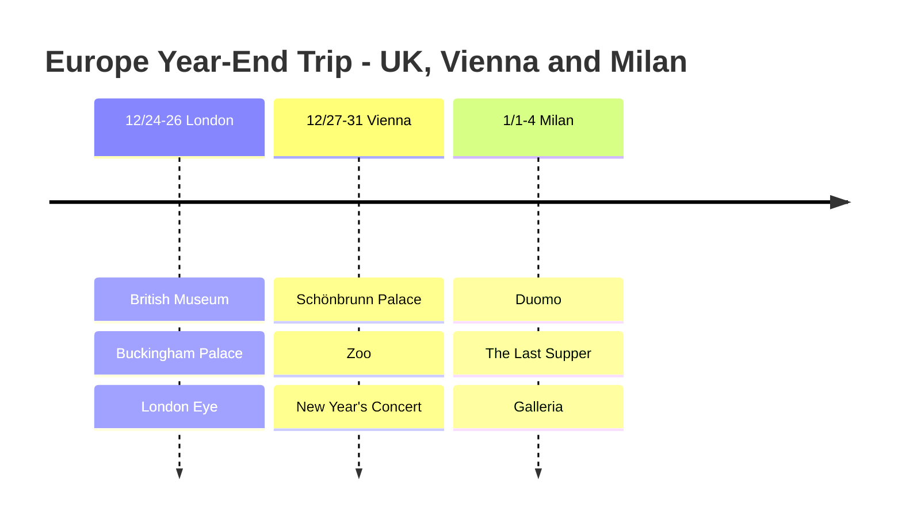

# Europe Year-End Trip: UK, Vienna and Milan

A trip across Europe from Christmas 2024 to January 4, 2025: starting in London, welcoming the new year in Vienna and finishing in Milan.

## 📍 Trip Overview

- **Dates**: December 24, 2024 - January 4, 2025 (12 days)
- **Countries**: United Kingdom 🇬🇧 → Austria 🇦🇹 → Italy 🇮🇹
- **Highlight**: Vienna New Year's Concert 🎻

## 🗓️ Itinerary Summary

| Date | City | Highlights |
|------|------|----------|
| 12/24-26 | London | British Museum, Buckingham Palace, London Eye |
| 12/27-31 | Vienna | Schönbrunn Palace, zoo, **New Year's Concert** |
| 1/1-4 | Milan | Duomo, The Last Supper, Galleria |

## Itinerary Timeline

## ✈️ Transportation

1. **Incheon → London**: Korean Air direct flight (12 hours)
2. **London → Vienna**: Ryanair (2 hours)
3. **Vienna → Milan**: ÖBB Nightjet overnight train (7 hours)
4. **Milan → Incheon**: Emirates (via Dubai)

## 💡 Travel Tips

1. Buying tickets individually can be cheaper than a **Eurail Pass**
2. Apply for the Vienna New Year's Concert through a **lottery a year ahead**
3. The Last Supper must be **reserved 2 months ahead**
4. The sun sets early in Europe in late December, so plan more museum and indoor activities

---

An unforgettable European year-end trip! 🎄🎆
