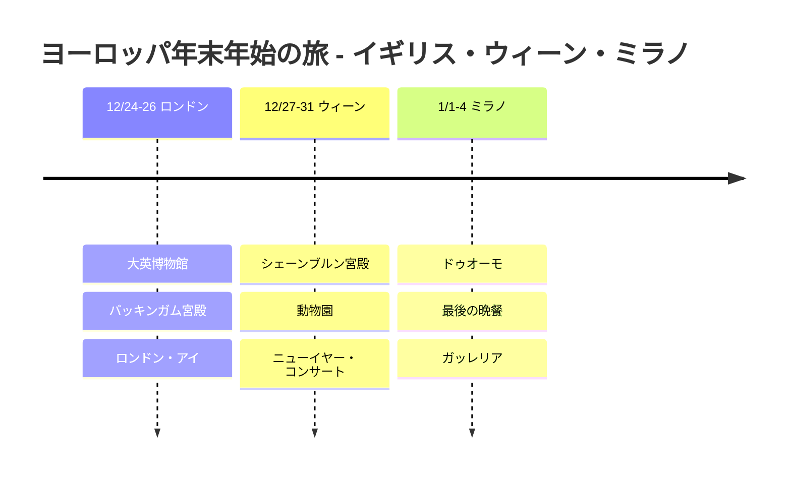

# ヨーロッパ年末年始の旅:イギリス・ウィーン・ミラノ

2024年のクリスマスから2025年1月4日まで、ロンドンから出発し、ウィーンで新年を迎え、ミラノで締めくくるヨーロッパ横断の旅行記。

## 📍 旅行概要

- **期間**: 2024年12月24日 ~ 2025年1月4日(12日間)
- **国**: イギリス 🇬🇧 → オーストリア 🇦🇹 → イタリア 🇮🇹
- **ハイライト**: ウィーンのニューイヤー・コンサート 🎻

## 🗓️ 旅程の概要

| 日付 | 都市 | 主な予定 |
|------|------|----------|
| 12/24-26 | ロンドン | 大英博物館、バッキンガム宮殿、ロンドン・アイ |
| 12/27-31 | ウィーン | シェーンブルン宮殿、動物園、**ニューイヤー・コンサート** |
| 1/1-4 | ミラノ | ドゥオーモ、最後の晩餐、ガッレリア |

## 旅程タイムライン

## ✈️ 移動手段

1. **仁川 → ロンドン**: 大韓航空の直行便(12時間)
2. **ロンドン → ウィーン**: ライアンエア(2時間)
3. **ウィーン → ミラノ**: ÖBB Nightjet の夜行列車(7時間)
4. **ミラノ → 仁川**: エミレーツ航空(ドバイ経由)

## 💡 旅のヒント

1. **ユーレイルパス**よりも個別に購入したほうが安い場合がある
2. ウィーンのニューイヤー・コンサートは**1年前の抽選**に申し込む
3. 最後の晩餐は**2か月前の予約**が必須
4. 12月末のヨーロッパは日が早く暮れるので、博物館や屋内の予定を多めにする

---

忘れられないヨーロッパの年末年始! 🎄🎆
