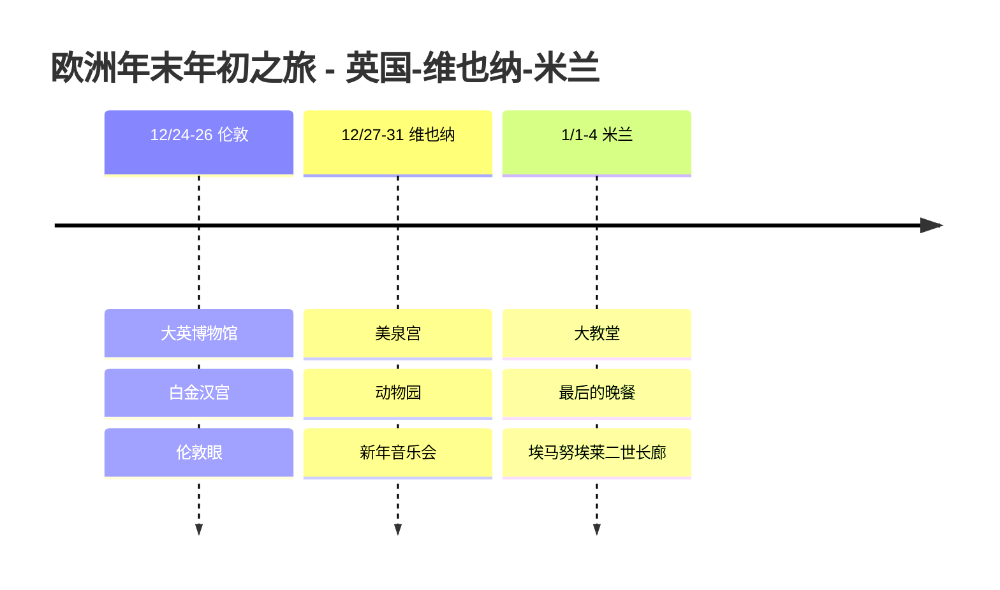

# 欧洲年末年初之旅:英国-维也纳-米兰

从2024年圣诞节到2025年1月4日,从伦敦出发,在维也纳迎接新年,在米兰收尾的欧洲横穿之旅游记。

## 📍 旅行概况

- **时间**: 2024年12月24日 ~ 2025年1月4日(12天)
- **国家**: 英国 🇬🇧 → 奥地利 🇦🇹 → 意大利 🇮🇹
- **亮点**: 维也纳新年音乐会 🎻

## 🗓️ 行程概要

| 日期 | 城市 | 主要行程 |
|------|------|----------|
| 12/24-26 | 伦敦 | 大英博物馆、白金汉宫、伦敦眼 |
| 12/27-31 | 维也纳 | 美泉宫、动物园、**新年音乐会** |
| 1/1-4 | 米兰 | 大教堂、最后的晚餐、埃马努埃莱二世长廊 |

## 行程时间线

## ✈️ 交通方式

1. **仁川 → 伦敦**: 大韩航空直飞(12小时)
2. **伦敦 → 维也纳**: 瑞安航空(2小时)
3. **维也纳 → 米兰**: ÖBB Nightjet 夜行列车(7小时)
4. **米兰 → 仁川**: 阿联酋航空(经迪拜中转)

## 💡 旅行小贴士

1. 单独购票有时比**欧洲铁路通票**更便宜
2. 维也纳新年音乐会需在**一年前抽签**申请
3. 最后的晚餐必须**提前2个月预约**
4. 12月底的欧洲天黑得早,要多安排博物馆和室内行程

---

难忘的欧洲年末年初!🎄🎆
