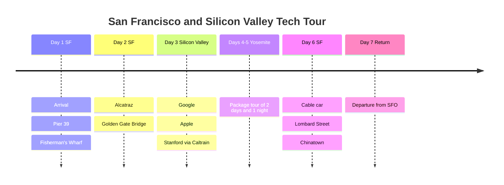

# San Francisco and Silicon Valley Tech Tour

A San Francisco trip for developers and tech geeks! Alcatraz and the Golden Gate Bridge, of course, plus the headquarters of Google, Apple and Microsoft, Stanford University and Yosemite.

## 📍 Trip Overview

- **Dates**: March 15 to 21, 2025 (7 days)
- **Theme**: Tech company tour + natural scenery
- **Transport**: Caltrain + rental car (Yosemite)

## 🗓️ Itinerary Summary

| Date | Area | Main Plans |
|------|------|----------|
| Day 1 | SF | Arrival, Pier 39, Fisherman's Wharf |
| Day 2 | SF | Alcatraz, Golden Gate Bridge |
| Day 3 | Silicon Valley | Google, Apple, Stanford (Caltrain) |
| Days 4-5 | Yosemite | Package tour (2 days, 1 night) |
| Day 6 | SF | Cable car, Lombard Street, Chinatown |
| Day 7 | Return home | Departure from SFO |

## Itinerary Timeline

## 💡 Pro Tips

1. **Alcatraz**: Reservations required two weeks ahead ([alcatrazcitycruises.com](https://alcatrazcitycruises.com))
2. **Caltrain**: Top up your Clipper card in advance
3. **Yosemite**: Chains are required in winter; spring is when the waterfalls are most spectacular
4. **Weather**: Still chilly in March, so layer up

---

🌉 A place every developer should visit at least once!
