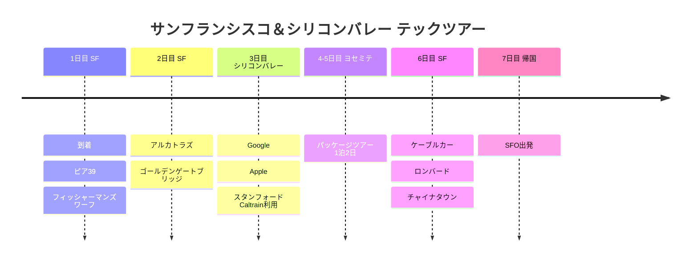

# サンフランシスコ＆シリコンバレー テックツアー

開発者・テック好きのためのサンフランシスコ旅行！アルカトラズやゴールデンゲートブリッジはもちろん、Google・Apple・MSの本社にスタンフォード大学、ヨセミテまで。

## 📍 旅行概要

- **期間**: 2025年3月15日〜21日（7日間）
- **テーマ**: テック企業ツアー + 自然景観
- **移動**: Caltrain + レンタカー（ヨセミテ）

## 🗓️ 旅程の概要

| 日付 | エリア | 主なスケジュール |
|------|------|----------|
| 1日目 | SF | 到着、ピア39、フィッシャーマンズワーフ |
| 2日目 | SF | アルカトラズ、ゴールデンゲートブリッジ |
| 3日目 | シリコンバレー | Google、Apple、スタンフォード（Caltrain） |
| 4-5日目 | ヨセミテ | パッケージツアー（1泊2日） |
| 6日目 | SF | ケーブルカー、ロンバード、チャイナタウン |
| 7日目 | 帰国 | SFO出発 |

## 旅程タイムライン

## 💡 お役立ちヒント

1. **アルカトラズ**: 2週間前までの予約が必須（[alcatrazcitycruises.com](https://alcatrazcitycruises.com)）
2. **Caltrain**: Clipperカードを事前にチャージ
3. **ヨセミテ**: 冬はチェーンが必須、滝が最も壮観なのは春
4. **気温**: 3月でも肌寒いので、重ね着が必須

---

🌉 開発者なら一度は行ってみたい場所！
