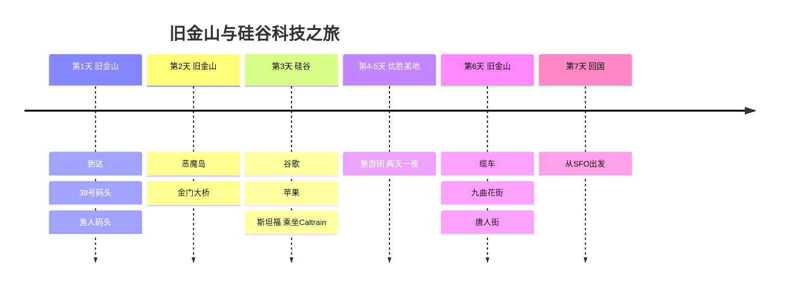

# 旧金山与硅谷科技之旅

写给开发者和科技迷的旧金山之旅！除了恶魔岛、金门大桥，还有谷歌、苹果、微软总部，斯坦福大学以及优胜美地。

## 📍 旅行概览

- **时间**: 2025年3月15日～21日（7天）
- **主题**: 科技公司之旅 + 自然风光
- **交通**: Caltrain + 租车（优胜美地）

## 🗓️ 行程概要

| 日期 | 地区 | 主要行程 |
|------|------|----------|
| 第1天 | 旧金山 | 到达、39号码头、渔人码头 |
| 第2天 | 旧金山 | 恶魔岛、金门大桥 |
| 第3天 | 硅谷 | 谷歌、苹果、斯坦福（Caltrain） |
| 第4-5天 | 优胜美地 | 旅游团（两天一夜） |
| 第6天 | 旧金山 | 缆车、九曲花街、唐人街 |
| 第7天 | 回国 | 从SFO出发 |

## 行程时间线

## 💡 实用小贴士

1. **恶魔岛**: 必须提前2周预约（[alcatrazcitycruises.com](https://alcatrazcitycruises.com)）
2. **Caltrain**: 提前给Clipper卡充值
3. **优胜美地**: 冬天必须带雪链，春天的瀑布最为壮观
4. **气温**: 3月也会很冷，务必多层叠穿

---

🌉 作为开发者，一定要去一次的地方！
