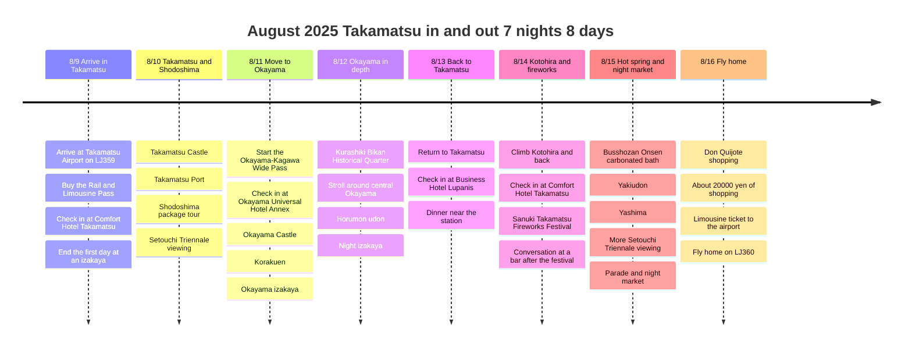
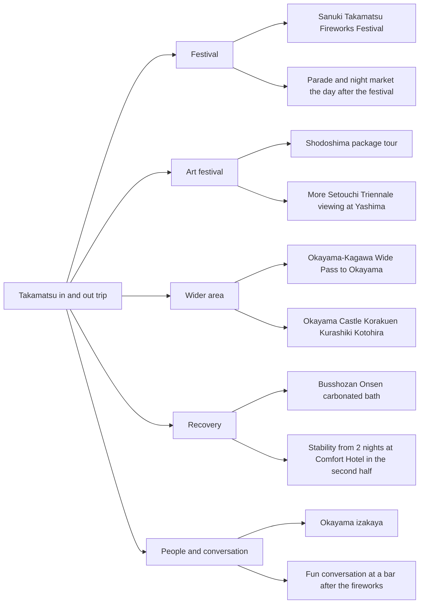

# August 2025 Takamatsu and Okayama: Setouchi Triennale Trip

An 8-day, 7-night trip that flew into Takamatsu on August 9, 2025 and left from Takamatsu Airport on August 16. The focus was the Setouchi Triennale, a Shodoshima package tour, Okayama and Kurashiki, Kotohira, the Sanuki Takamatsu Fireworks Festival, Busshozan Onsen, Yashima, and the parade and night market the day after the festival.

This is quite a good itinerary. The flights stay simple with a round trip to one city, the wide pass is used to cover Okayama broadly in the middle, and the second half closes with Kotohira, the festival, the hot spring and the night market back in Takamatsu. The hotel moves look frequent, but putting one night in front of the station on the way back from Okayama keeps the return route from breaking up.

## Trip Overview

- Dates: August 9 to August 16, 2025
- Format: Takamatsu in/out, 7 nights and 8 days
- Flights: Jin Air LJ359 and LJ360, round trip to Takamatsu
- Transport: Bought the Rail & Limousine Pass at Takamatsu Airport, then used the tabiwa Okayama-Kagawa Wide Pass from day 3
- Highlights: Setouchi Triennale, Shodoshima, Okayama, Kurashiki, Kotohira, Sanuki Takamatsu Fireworks Festival, Busshozan Onsen, Yashima, parade and night market
- Food memories: First-night izakaya, Okayama izakaya, horumon udon, bar after the festival, night market

## Transport Passes and Flight Notes

| Item | Recorded amount | Basis / notes |
|------|----------|----------|
| Rail & Limousine Pass | JPY 3,800 | A set ticket exclusive to Takamatsu Airport. 2 Kotoden limousine bus tickets and 2 Kotoden train 1-day tickets |
| Okayama-Kagawa Wide Pass | JPY 3,500 | A 3-day pass operated by tabiwa, a JR West group service. Covers travel to Kurashiki, Okayama, Takamatsu Station and Kotohira |
| Jin Air Takamatsu round trip | Amount not confirmed | The LJ359 and LJ360 pairing is also confirmed in the currently published Takamatsu Airport timetable |

## Sanuki Takamatsu Festival Reference

According to the official Takamatsu City guide, the Sanuki Takamatsu Festival is introduced as one of Shikoku's four major festivals and a midsummer festival in Takamatsu. The currently published guide for the 59th festival covers 3 days from August 12 to 14, 2026, with the main venues at Anabuki Arena Kagawa and the Sunport Takamatsu multipurpose plaza. Because this post is a record of the 2025 trip, the exact dates should be checked separately against the schedule at the time, but it is kept here as a reference for understanding how the festival is structured.

The official guide describes the fireworks as a roughly 6,000-shell show launched from the Tamamo breakwater at Takamatsu Port, with the area around Sunport Takamatsu and Mizukidori designated as free viewing areas. The Sō Odori dance `Kimai Warai Mai` is described as the climax of the 3-day festival, and since it is about a 4-minute walk from JR Takamatsu Station or Kotoden Takamatsu-Chikko Station, using public transport on festival days makes sense.

## Lodging Flow

| Segment | Lodging | Nights | Purpose |
|------|------|------|------|
| Early | Comfort Hotel Takamatsu | 2 nights | Base for Takamatsu city and the Shodoshima tour right after arrival |
| Middle | Okayama Universal Hotel Annex | 2 nights | Base for easily seeing Okayama Castle, Korakuen and Kurashiki |
| Return day | Business Hotel Lupanis | 1 night | A buffer on the way back from Okayama to Takamatsu, with a route in front of the station |
| Late | Comfort Hotel Takamatsu | 2 nights | Base for the second-half plans of Kotohira, the fireworks festival, Busshozan Onsen and Yashima |

## Itinerary Summary

| Date | Base | Time allocation | Main plans | Point |
|------|--------|----------|----------|--------|
| 8/9 | Takamatsu | Afternoon arrival, dinner | Arrive on LJ359, buy the Rail & Limousine Pass, check in at Comfort, izakaya | Start without overdoing it |
| 8/10 | Takamatsu | City in the morning, island tour at midday | Takamatsu Castle, Takamatsu Port, Shodoshima package tour | First pillar of the Setouchi Triennale |
| 8/11 | Okayama | Travel, afternoon sightseeing, dinner at night | Start of the Okayama-Kagawa Wide Pass, Okayama Castle, Korakuen, izakaya | Expanding from Takamatsu to Okayama |
| 8/12 | Okayama | Day trip nearby, food at night | Kurashiki Bikan Historical Quarter, Okayama at night, horumon udon | A change of city atmosphere |
| 8/13 | Takamatsu | Return, check-in, dinner | Back to Takamatsu, check in at Lupanis, dinner near the station | Returning from Okayama to the festival area |
| 8/14 | Takamatsu | Daytime outing, festival at night | Climb Kotohira and back, check in at Comfort, Sanuki Takamatsu Fireworks Festival, bar after the festival | The night highlight of the trip |
| 8/15 | Takamatsu | Hot spring, views, festival at night | Busshozan Onsen carbonated bath, yakiudon, Yashima, more Setouchi Triennale viewing, parade and night market | Back to the festival after recovering |
| 8/16 | Takamatsu | Shopping, airport transfer | Don Quijote shopping, return to Takamatsu Airport on the limousine ticket, fly home on LJ360 | A clean out after shopping |

## Itinerary Timeline

## Perspective Points

## 8/9 - Arriving in Takamatsu and the First Izakaya

The first day was the day we flew into Takamatsu Airport on Jin Air LJ359 and bought the Rail & Limousine Pass. It is a JPY 3,800 set with 2 Kotoden limousine bus tickets and 2 Kotoden train 1-day tickets, so the big picture of airport transfers and city train travel was settled from the very start.

The lodging was Comfort Hotel Takamatsu. Rather than cramming in many sights on the first day, it was better to unpack and finish at an izakaya. Considering the August heat and travel fatigue, opening lightly like this suits the next day's Shodoshima tour better.

## 8/10 - Takamatsu Castle and the Shodoshima Package Tour

The second day used both the city of Takamatsu and the island. The flow was to see Takamatsu Castle first, then continue through Takamatsu Port to the Shodoshima package tour.

Shodoshima is the card that fits the Setouchi Triennale best. Compared with matching public transport and boat times alone, using the package tour most likely reduced summer travel fatigue. This day opened up the sea, the island and the art festival all at once, an early highlight.

## 8/11 - To Okayama with the Okayama-Kagawa Wide Pass

From the third day we used the tabiwa Okayama-Kagawa Wide Pass and moved from Takamatsu to Okayama. The lodging was 2 nights at Okayama Universal Hotel Annex.

This pass is a 3-day ticket operated by tabiwa, a JR West group service, and costs JPY 3,500. It lets you tie together free travel to Kurashiki, Okayama, Takamatsu Station and Kotohira, which was the key transport ticket that greatly boosted the value of this itinerary.

Pairing Okayama Castle and Korakuen is a classic yet good choice. The mood shifts from the seaside feel of Takamatsu and Shodoshima to Okayama's castle and garden. Adding an Okayama izakaya at night keeps the travel day from feeling flat.

## 8/12 - Kurashiki Bikan Historical Quarter and Okayama Food

The advantage of 2 nights in Okayama is that Kurashiki fits in without strain. The Bikan Historical Quarter is nice for a daytime stroll, and the canal and old buildings create scenes completely different from Takamatsu or Shodoshima.

The memory of delicious horumon udon in Okayama also matters. This trip is not only about the art festival and festivals, as the fun of following local food stays quite alive.

## 8/13 - Back to Takamatsu and a Night at Lupanis

The day we returned from Okayama to Takamatsu and spent a night at Business Hotel Lupanis. With lodging in front of Takamatsu Station, the route after the 2 nights in Okayama does not break, and the base can be pulled back toward Takamatsu before moving on to Kotohira and the festival the next day.

It is natural to treat this day as a tidying day just before the festival highlights. It was the day we closed out the Okayama area, returned to central Takamatsu and got ready for Kotohira and the fireworks festival the next day.

## 8/14 - Kotohira and the Sanuki Takamatsu Fireworks Festival

We returned to Comfort Hotel Takamatsu to start the final 2 nights. This day is summarized as going to Kotohira and then, at night, going to see the Sanuki Takamatsu Fireworks Festival.

Kotohira is a course that takes stamina, so in August it is right to plan it around the morning. In return, the fireworks festival at night made this the most vivid day of the trip. Stairs and a shrine by day, fireworks and crowds by the harbor at night, and then the conversation that continued at a bar, with great scene changes.

According to the current official guide, the fireworks at the Sanuki Takamatsu Festival launch from the Tamamo breakwater at Takamatsu Port, and the area around Sunport Takamatsu and Mizukidori is the main viewing route. That makes this day's arrangement, with lodging in front of Takamatsu Station tied to movement around the harbor area, especially good.

The fireworks festival itself was great, but what is remembered even more is the fun conversation at the bar we stopped at after the festival. As a travel record, this was not just a drink but a scene where the festival led to meeting people. If the bar's name or location comes back to mind later, the density of this day will go up a lot.

## 8/15 - Busshozan Onsen, Yashima, Parade and Night Market

Putting Busshozan Onsen in the second half of the trip was very good. On a 7-night, 8-day trip, constant walking and moving builds up late fatigue, and the hot spring plays a recovery role. Especially, it was a day when eating yakiudon after coming out of the carbonated bath brought a sense of pure bliss.

Seeing more of the Setouchi Triennale at Yashima was also a good finish. We saw the island art festival on Shodoshima, and at Yashima we looked out over the Seto Inland Sea again and carried on the thread of the art festival, so the trip's theme does not scatter.

In the evening we also went to the parade and night market held the day after the festival. Thanks to this, the festival did not end with the 8/14 fireworks alone, and remains a 2-day experience that continued into the next day's street atmosphere, food and people watching.

In the official guide, the Sō Odori grand dance is described as the climax of the festival's second half. The detailed event names and dates by year need to be checked, but this day's memory is best kept as a scene that captured the energy of the street festival that followed the fireworks.

## 8/16 - Don Quijote Shopping and Back to Takamatsu Airport

On the last day we shopped for about JPY 20,000 at Don Quijote, then returned to Takamatsu Airport with the limousine ticket bought at the start. The Rail & Limousine Pass bought at the beginning also closes out the final transfer, so the whole route is clean.

The Don Quijote shopping is kept separately as this trip's last spending record. Since the amount is confirmed, it is also recorded in `expenses` as JPY 20,000 of shopping.

## Itinerary Evaluation

Overall it is a good itinerary. With Takamatsu in/out the flights are simple, Okayama in the middle widened the travel area, and returning to Takamatsu finished with Kotohira, the fireworks festival, the hot spring, and the parade and night market. The second half in particular has a lively rhythm of recovering or moving by day and taking in the festival mood at night.

If we had to name a downside, it is that we moved quite a lot through the August heat, across Shodoshima, Okayama, Kurashiki and Kotohira. Even so, Busshozan Onsen and the final 2 nights at Comfort give a recovery mechanism in the second half. If planning again, keep the overall framework and only set the Kotohira day more clearly with a morning start and a midday rest.

## To Fill in Next

- Actual flight payment amounts and departure/arrival times from the booking email
- The exact viewing spot for the Sanuki Takamatsu Fireworks Festival
- The name and location of the bar visited after the festival
- Detailed course of the Shodoshima package tour
- The name of the Okayama horumon udon restaurant
- A screenshot of the detailed usage sections of the Okayama-Kagawa Wide Pass
- Items bought at Don Quijote

## Reference Links

- [Setouchi Triennale 2025 official site](https://setouchi-artfest.jp/en/)
- [Takamatsu Airport Rail & Limousine Pass guide](https://www.takamatsu-airport.com/campaign/article/railandlimousinepass2023)
- [Takamatsu Airport international timetable](https://www.takamatsu-airport.com/timetable/int.php)
- [Okayama-Kagawa Wide Pass reference blog](https://blog.naver.com/sweet_recording/223760166142)
- [59th Sanuki Takamatsu Festival official website (Japanese)](https://www.city.takamatsu.kagawa.jp/smph/kanko/takamatsumatsuri/matsuri.html)
- [The 59th Sanuki Takamatsu Festival Official Website](https://www.city.takamatsu.kagawa.jp/kanko/takamatsumatsuri/matsurienglish.html)
