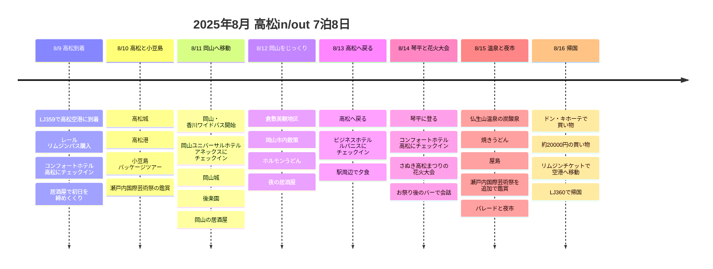
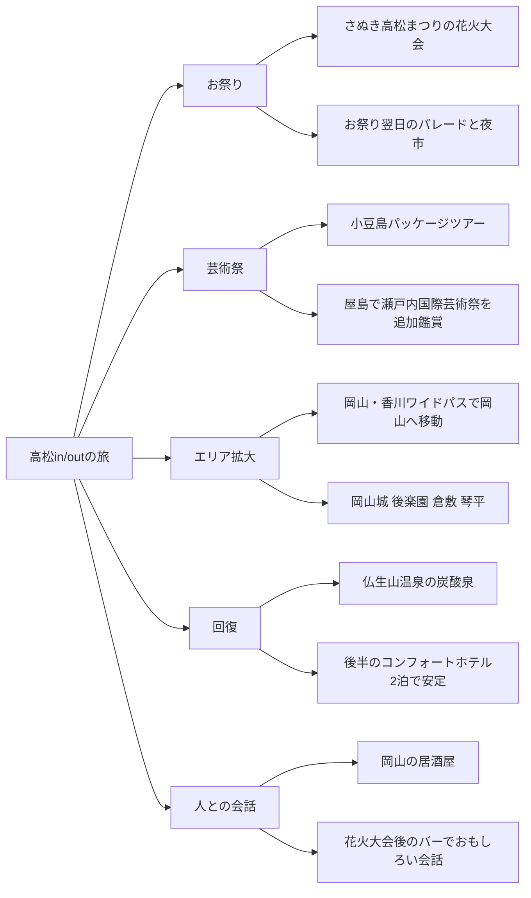

# 2025年8月 高松・岡山 瀬戸内国際芸術祭の旅

2025年8月9日に高松へ入り、8月16日に再び高松空港から出る7泊8日の旅程。中心は瀬戸内国際芸術祭、小豆島パッケージツアー、岡山と倉敷、琴平、さぬき高松まつりの花火大会、仏生山温泉、屋島、そしてお祭りの翌日のパレードと夜市です。

この旅程はなかなかいい。同じ都市への往復で航空券はシンプルにして、途中はワイドパスで岡山を広く使い、再び高松に戻って琴平とお祭り、温泉と夜市で後半を締めくくりました。宿の移動が多く見えますが、岡山から高松へ戻る途中に駅前で1泊を挟んだおかげで、帰りの動線が途切れません。

## 旅行の概要

- 期間：2025年8月9日〜8月16日
- 形態：高松in/out、7泊8日
- 航空：ジンエアー LJ359、LJ360で高松往復
- 交通：高松空港でレール＆リムジンパスを購入、3日目からtabiwa 岡山・香川ワイドパスを活用
- 核心：瀬戸内国際芸術祭、小豆島、岡山、倉敷、琴平、さぬき高松まつりの花火大会、仏生山温泉、屋島、パレードと夜市
- グルメの記憶：初日の居酒屋、岡山の居酒屋、ホルモンうどん、お祭り後のバー、夜市

## 交通券と航空のメモ

| 項目 | 記録金額 | 根拠・メモ |
|------|----------|----------|
| レール＆リムジンパス | 3,800円 | 高松空港限定のセット券。ことでんリムジンバス乗車券2枚とことでん電車1日乗車券2枚 |
| 岡山・香川ワイドパス | 3,500円 | 西日本JR系列のtabiwaが運営する3日間パス。倉敷、岡山、高松駅、琴平への移動をカバー |
| ジンエアー 高松往復 | 金額未確認 | 現在の高松空港の公開時刻表でもLJ359、LJ360の組み合わせを確認 |

## さぬき高松まつり 参考情報

高松市の公式案内によると、さぬき高松まつりは四国四大祭りのひとつとして紹介される高松の真夏のお祭りです。現在公開されている第59回の案内は2026年8月12日から8月14日までの3日間で、メイン会場はあなぶきアリーナ香川とサンポート高松多目的広場周辺とされています。この記事は2025年の旅行記録なので、細かい日付は当時の日程と別に確認が必要ですが、お祭りの構造を理解する参考として残しておきます。

公式案内の花火大会は、高松港の玉藻防波堤から打ち上げる6,000発規模で、サンポート高松周辺とみずきどおり一帯が無料観覧エリアとして案内されています。総おどり「喜舞笑舞（きまいわらいまい）」は3日間のお祭りのクライマックスとして説明されており、JR高松駅またはことでん高松築港駅から徒歩約4分の距離なので、お祭りの当日は公共交通機関を使うのが正解です。

## 宿泊の流れ

| 区間 | 宿 | 泊数 | 狙い |
|------|------|------|------|
| 序盤 | コンフォートホテル高松 | 2泊 | 到着直後の高松市内と小豆島ツアーの拠点 |
| 中盤 | 岡山ユニバーサルホテル アネックス | 2泊 | 岡山城、後楽園、倉敷を楽に回るための拠点 |
| 戻りの日 | ビジネスホテル ルパニス | 1泊 | 岡山から高松へ戻る途中のクッション、駅前の動線 |
| 後半 | コンフォートホテル高松 | 2泊 | 琴平、花火大会、仏生山温泉、屋島の後半日程の拠点 |

## 旅程の概要

| 日付 | 拠点 | 時間配分 | 主な予定 | ポイント |
|------|--------|----------|----------|--------|
| 8/9 | 高松 | 午後到着、夕食 | LJ359到着、レール＆リムジンパス購入、コンフォートにチェックイン、居酒屋 | 無理せずスタート |
| 8/10 | 高松 | 午前は市内、昼は島ツアー | 高松城、高松港、小豆島パッケージツアー | 瀬戸内国際芸術祭の最初の軸 |
| 8/11 | 岡山 | 移動、午後観光、夜食事 | 岡山・香川ワイドパス開始、岡山城、後楽園、居酒屋 | 高松から岡山へ拡大 |
| 8/12 | 岡山 | 昼は近郊、夜はグルメ | 倉敷美観地区、岡山の夜、ホルモンうどん | 街の雰囲気を切り替え |
| 8/13 | 高松 | 帰着、チェックイン、夕方 | 高松へ戻る、ルパニスにチェックイン、駅周辺で夕食 | 岡山からお祭りエリアへ戻る |
| 8/14 | 高松 | 昼は遠征、夜はお祭り | 琴平に登る、コンフォートにチェックイン、さぬき高松まつりの花火大会、お祭り後のバー | 旅の夜のハイライト |
| 8/15 | 高松 | 温泉、眺望、夜のお祭り | 仏生山温泉の炭酸泉、焼きうどん、屋島、瀬戸内国際芸術祭の鑑賞、パレードと夜市 | 回復してから再びお祭り |
| 8/16 | 高松 | 買い物、空港移動 | ドン・キホーテで買い物、リムジンチケットで高松空港へ、LJ360で帰国 | 買い物のあと、すっきりout |

## 旅程タイムライン

## 視点ポイント

## 8/9 - 高松到着と初日の居酒屋

初日はジンエアーLJ359で高松空港に入り、レール＆リムジンパスを買った日。ことでんリムジンバス乗車券2枚とことでん電車1日乗車券2枚がセットになった3,800円のパスで、スタートから空港移動と市内の電車移動の大枠が固まりました。

宿はコンフォートホテル高松。初日は無理に観光地を詰め込むより、荷物を置いて居酒屋で締めくくったのがよかったです。8月の暑さと移動の疲れを考えると、初日はこれくらい軽く始めるほうが、翌日の小豆島ツアーに合います。

## 8/10 - 高松城と小豆島パッケージツアー

2日目は高松市内と島を一緒に使った日。まず高松城を見て、高松港から小豆島パッケージツアーへとつながる流れです。

小豆島は瀬戸内国際芸術祭と最も相性のいいカードです。自分で公共交通機関と船の時間を合わせるより、パッケージツアーを使ったおかげで、夏場の移動の疲れが減った可能性が高いです。この日は海、島、芸術祭を一度に開いてくれた序盤のハイライトです。

## 8/11 - 岡山・香川ワイドパスで岡山へ移動

3日目からtabiwa 岡山・香川ワイドパスを使って、高松から岡山へ移ります。宿は岡山ユニバーサルホテル アネックスで2泊。

このパスは西日本JR系列のtabiwaが運営する3日券で、価格は3,500円。倉敷、岡山、高松駅、琴平まで乗り放題でまとめられるので、この旅程のコスパをぐっと引き上げた核となる交通券です。

岡山城と後楽園をセットにしたのは定番でありながらいい選択です。高松と小豆島の海の雰囲気から、岡山の城と庭園へと雰囲気が変わります。夜は岡山の居酒屋を入れて、移動日が単調にならず締めくくれました。

## 8/12 - 倉敷美観地区と岡山グルメ

岡山2泊の利点は、倉敷を無理なく組み込めること。美観地区は昼の散策にぴったりで、運河と古い建物の雰囲気のおかげで、高松や小豆島とはまったく違う景色になります。

岡山で食べたホルモンうどんがおいしかったという記憶も大切です。この旅は芸術祭やお祭りだけでなく、ご当地グルメを追いかける楽しみもしっかり生きています。

## 8/13 - 高松へ戻って、ルパニスで1泊

岡山から高松へ戻り、ビジネスホテル ルパニスに1泊した日。高松駅前に宿を取っておくと、岡山2泊のあとの動線が途切れず、翌日の琴平とお祭りへ向かう前に拠点を再び高松側へ引き戻せます。

この日はお祭りのハイライト直前の整理日にするのが自然です。岡山エリアを締めくくり、高松市内に戻って、翌日の琴平と花火大会を迎える準備をした日です。

## 8/14 - 琴平とさぬき高松まつりの花火大会

再びコンフォートホテル高松に戻り、後半の2泊が始まります。この日は琴平を訪れたあと、夜はさぬき高松まつりの花火大会を見に行った日としてまとめます。

琴平は体力を使うコースなので、8月は午前中心に組むのが正解です。その代わり夜に花火大会が入ることで、この日は旅の中で最も鮮明な一日になりました。昼は階段と神社、夜は港側の花火と人々、そのあとバーで続いた会話まで、場面の切り替わりがいいです。

現在の公式案内では、さぬき高松まつりの花火は高松港の玉藻防波堤から打ち上げられ、サンポート高松周辺とみずきどおり一帯が主な観覧動線です。だから、高松駅前の宿と港エリアへの移動を組み合わせたこの日の配置が特によかったです。

花火大会そのものもよかったですが、より記憶に残っているのは、お祭りが終わってから立ち寄ったバーでおもしろい話をたくさんしたことです。旅の記録として見ると、これは単なる一杯ではなく、お祭りが人との出会いにつながった場面です。あとでバーの名前や場所を思い出せたら、この日の密度がぐっと上がりそうです。

## 8/15 - 仏生山温泉、屋島、パレードと夜市

旅の後半に仏生山温泉を入れたのはとてもよかったです。7泊8日の旅でずっと歩いて移動していると後半に疲れがたまりますが、温泉が回復役を果たしてくれます。特に炭酸泉から上がって焼きうどんを食べたら、思わず幸せがこみ上げてきた日でした。

屋島で瀬戸内国際芸術祭をさらに鑑賞したのもいい締めくくりです。小豆島で島の芸術祭を見て、屋島で再び瀬戸内海を眺めながら芸術祭の流れをつなげた形なので、旅のテーマがぶれません。

そして夕方には、お祭りの翌日に続いたパレードと夜市にも行きました。おかげでお祭りが8/14の花火1回で終わらず、翌日の街の雰囲気や食べ物、人間観察まで続いた2日間の体験として残ります。

公式案内では、総おどりはお祭り後半のクライマックスとして説明されています。年ごとの細かいプログラム名や日付は確認が必要ですが、この日の記憶は、花火のあとに続いた街のお祭りのエネルギーを捉えた場面として残しておくといいでしょう。

## 8/16 - ドン・キホーテで買い物して高松空港へ

最終日はドン・キホーテで約20,000円分の買い物をして、最初に買っておいたリムジンチケットで高松空港に戻ります。最初に買ったレール＆リムジンパスが最後の移動まで締めてくれる構造なので、全体の動線がすっきりしています。

ドン・キホーテでの買い物は、この旅の最後の支出記録として別に残しておきます。金額が確認できた項目なので、`expenses`にも20,000円の買い物として記録しました。

## 旅程の評価

全体的にいい旅程です。高松in/outなので航空券はシンプルで、途中に岡山を入れて旅行エリアを広げ、再び高松に戻って琴平、花火大会、温泉、パレードと夜市で締めくくりました。特に後半は、昼は回復や移動、夜はお祭りの雰囲気を味わうという形で、リズムが生きています。

あえて惜しい点を挙げるなら、8月の暑さの中で小豆島、岡山、倉敷、琴平までかなり動き回ったことです。それでも仏生山温泉と最後のコンフォート2泊があるので、後半に回復の仕掛けがあります。組み直すなら、大枠は維持して、琴平の日だけ午前出発と昼の休憩をもっと明確に取ればいいでしょう。

## 次に埋める内容

- 航空券の実際の決済額と、予約メール基準の出発・到着時間
- さぬき高松まつりの花火大会の正確な観覧場所
- お祭り後に立ち寄ったバーの名前と場所
- 小豆島パッケージツアーの詳細コース
- 岡山のホルモンうどん店の名前
- 岡山・香川ワイドパスの詳しい利用区間のキャプチャ
- ドン・キホーテで買った品目

## 参考リンク

- [瀬戸内国際芸術祭2025 公式サイト](https://setouchi-artfest.jp/en/)
- [高松空港 レール＆リムジンパス案内](https://www.takamatsu-airport.com/campaign/article/railandlimousinepass2023)
- [高松空港 国際線時刻表](https://www.takamatsu-airport.com/timetable/int.php)
- [岡山・香川ワイドパス 参考ブログ](https://blog.naver.com/sweet_recording/223760166142)
- [第59回さぬき高松まつり 公式ホームページ](https://www.city.takamatsu.kagawa.jp/smph/kanko/takamatsumatsuri/matsuri.html)
- [The 59th Sanuki Takamatsu Festival Official Website](https://www.city.takamatsu.kagawa.jp/kanko/takamatsumatsuri/matsurienglish.html)
