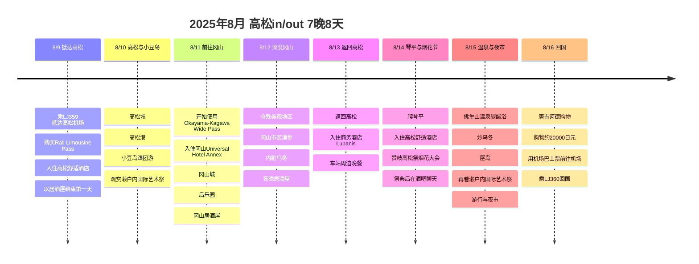
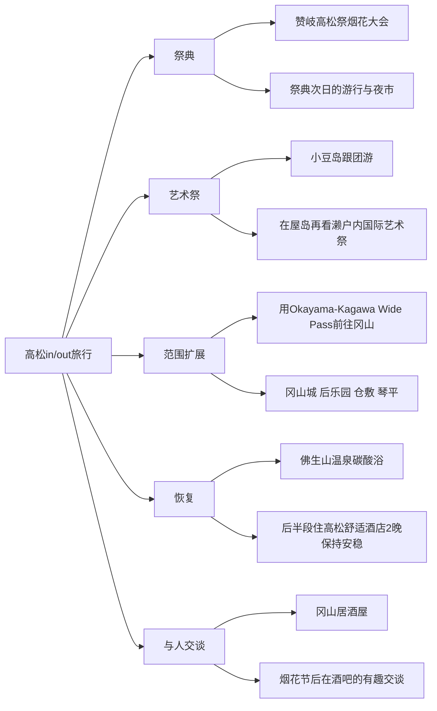

# 2025年8月 高松·冈山 濑户内国际艺术祭之旅

2025年8月9日抵达高松，8月16日再次从高松机场离开的7晚8天行程。核心是濑户内国际艺术祭、小豆岛跟团游、冈山和仓敷、琴平、赞岐高松祭烟花大会、佛生山温泉、屋岛，以及祭典次日的游行和夜市。

这个行程相当不错。往返同一城市，机票很简单，中间用Wide Pass把冈山玩得很开，再回到高松，以琴平和祭典、温泉和夜市收尾后半段。住宿换得多，看起来有点折腾，但从冈山回高松的途中在车站前住了1晚，所以返程动线没有被打断。

## 旅行概要

- 时间：2025年8月9日～8月16日
- 形式：高松往返，7晚8天
- 航班：真航空LJ359、LJ360往返高松
- 交通：在高松机场购买Rail & Limousine Pass，第3天起使用tabiwa Okayama-Kagawa Wide Pass
- 核心：濑户内国际艺术祭、小豆岛、冈山、仓敷、琴平、赞岐高松祭烟花大会、佛生山温泉、屋岛、游行和夜市
- 美食记忆：第一天的居酒屋、冈山居酒屋、内脏乌冬、祭典后的酒吧、夜市

## 交通券与航班备忘

| 项目 | 记录金额 | 依据/备注 |
|------|----------|----------|
| Rail & Limousine Pass | 3,800日元 | 高松机场限定套票。琴电机场巴士乘车券2张和琴电电车1日乘车券2张 |
| Okayama-Kagawa Wide Pass | 3,500日元 | 由西日本JR系列的tabiwa运营的3日通票。涵盖前往仓敷、冈山、高松站、琴平的交通 |
| 真航空高松往返 | 金额未确认 | 目前高松机场公开时刻表上也确认有LJ359、LJ360的组合 |

## 赞岐高松祭参考

根据高松市官方介绍，赞岐高松祭是被誉为四国四大祭典之一的高松盛夏祭典。目前公布的第59届介绍为2026年8月12日至8月14日共3天，主会场设在穴吹Arena香川和Sunport高松多功能广场一带。本文是2025年的旅行记录，具体日期需另行与当时行程核对，这里留作理解祭典结构的参考。

官方介绍中的烟花大会，是在高松港玉藻防波堤燃放约6,000发，Sunport高松周边和水木大道一带为免费观赏区。总舞蹈“喜舞笑舞”被介绍为3天祭典的高潮，从JR高松站或琴电高松筑港站步行约4分钟即可到达，所以祭典当天乘坐公共交通才是正确选择。

## 住宿安排

| 阶段 | 住宿 | 晚数 | 用意 |
|------|------|------|------|
| 前期 | 高松舒适酒店 | 2晚 | 抵达后游览高松市区和小豆岛旅游团的大本营 |
| 中期 | 冈山Universal Hotel Annex | 2晚 | 方便游览冈山城、后乐园、仓敷的大本营 |
| 返程日 | 商务酒店 Lupanis | 1晚 | 从冈山回高松途中的缓冲，车站前的动线 |
| 后期 | 高松舒适酒店 | 2晚 | 琴平、烟花节、佛生山温泉、屋岛后半段行程的大本营 |

## 行程概要

| 日期 | 大本营 | 时间安排 | 主要行程 | 看点 |
|------|--------|----------|----------|--------|
| 8/9 | 高松 | 下午抵达，晚餐 | 抵达LJ359，购买Rail & Limousine Pass，入住舒适酒店，居酒屋 | 轻松开始 |
| 8/10 | 高松 | 上午市区，白天岛游 | 高松城、高松港、小豆岛跟团游 | 濑户内国际艺术祭的第一条主线 |
| 8/11 | 冈山 | 移动，下午观光，晚上用餐 | 开始使用Okayama-Kagawa Wide Pass，冈山城、后乐园、居酒屋 | 从高松扩展到冈山 |
| 8/12 | 冈山 | 白天近郊，晚上美食 | 仓敷美观地区、冈山夜晚、内脏乌冬 | 切换城市氛围 |
| 8/13 | 高松 | 返回，入住，傍晚 | 返回高松，入住Lupanis，车站周边晚餐 | 从冈山回到祭典区域 |
| 8/14 | 高松 | 白天远行，夜晚祭典 | 爬琴平，入住舒适酒店，赞岐高松祭烟花大会，祭典后的酒吧 | 旅行的夜晚亮点 |
| 8/15 | 高松 | 温泉，眺望，夜晚祭典 | 佛生山温泉碳酸浴，炒乌冬，屋岛，观赏濑户内国际艺术祭，游行与夜市 | 恢复后再次投入祭典 |
| 8/16 | 高松 | 购物，前往机场 | 唐吉诃德购物，用机场巴士票返回高松机场，LJ360回国 | 购物后干净利落地out |

## 行程时间线

## 观察要点

## 8/9 - 抵达高松与第一家居酒屋

第一天乘真航空LJ359抵达高松机场，购买了Rail & Limousine Pass。这是捆绑了琴电机场巴士乘车券2张和琴电电车1日乘车券2张的3,800日元套票，一开始就定好了机场交通和市内电车交通的大框架。

住宿是高松舒适酒店。第一天与其勉强塞进很多景点，不如放好行李，以居酒屋收尾，这样更好。考虑到8月的酷暑和旅途疲劳，第一天这样轻松开场，更适合第二天的小豆岛旅游团。

## 8/10 - 高松城与小豆岛跟团游

第二天是同时用上高松市区和岛屿的一天。先看高松城，再经高松港接上小豆岛跟团游。

小豆岛是与濑户内国际艺术祭最搭的一张牌。比起自己配合公共交通和船班时间，用跟团游很可能减轻了夏季移动的疲劳。这一天是一次性打开海、岛屿和艺术祭的前期亮点。

## 8/11 - 用Okayama-Kagawa Wide Pass前往冈山

从第三天起使用tabiwa Okayama-Kagawa Wide Pass，从高松前往冈山。住宿是冈山Universal Hotel Annex，住2晚。

这张通票是由西日本JR系列的tabiwa运营的3日券，价格3,500日元。仓敷、冈山、高松站、琴平的交通都能免费覆盖，是大幅提升这个行程性价比的关键交通券。

把冈山城和后乐园串起来，既是经典搭配也是不错的选择。氛围从高松和小豆岛的海，转换成冈山的城和庭园。晚上安排冈山居酒屋，让移动日不至于平淡，圆满收尾。

## 8/12 - 仓敷美观地区与冈山美食

冈山住2晚的好处，是可以不勉强地加入仓敷。美观地区适合白天漫步，运河和老建筑的氛围，营造出与高松、小豆岛完全不同的画面。

在冈山吃到的内脏乌冬很好吃，这个记忆也很重要。这次旅行不只有艺术祭和祭典，追寻当地美食的乐趣也相当充足。

## 8/13 - 回高松，在Lupanis住1晚

从冈山回到高松，在商务酒店 Lupanis住1晚的一天。把住宿定在高松站前，冈山2晚之后的动线就不会中断，在前往第二天琴平和祭典之前，大本营也能重新拉回高松一侧。

这一天作为祭典亮点之前的整理日比较自然。收尾冈山一带，回到高松市区，为迎接第二天的琴平和烟花大会做准备。

## 8/14 - 琴平与赞岐高松祭烟花大会

再次回到高松舒适酒店，开始后半段的2晚。这一天整理为去琴平回来后，夜晚去看赞岐高松祭烟花大会的一天。

琴平是消耗体力的行程，8月以上午为主安排才对。作为交换，夜晚加入烟花大会，让这一天成为旅行中最鲜明的一天。白天是石阶和神社，夜晚是港口一侧的烟花和人群，之后在酒吧延续的交谈，场景转换很棒。

根据目前的官方介绍，赞岐高松祭的烟花在高松港玉藻防波堤燃放，Sunport高松周边和水木大道一带是主要观赏动线。所以这一天把高松站前住宿和港口区域的移动衔接起来的安排尤其好。

烟花节本身很好，但更让人难忘的，是祭典结束后去的酒吧里聊了很多有趣的话题。作为旅行记录来看，这不只是简单喝一杯，而是祭典延伸为与人相遇的场景。以后如果想起酒吧的名字或位置，这一天的内容会更加丰满。

## 8/15 - 佛生山温泉、屋岛、游行与夜市

旅行后半段安排佛生山温泉非常好。7晚8天的旅行中一直走路和移动，后半段疲劳会累积，温泉起到了恢复的作用。尤其是泡完碳酸浴出来吃炒乌冬，不由得涌起幸福感的一天。

在屋岛继续欣赏濑户内国际艺术祭也是不错的收尾。在小豆岛看了岛上的艺术祭，在屋岛又一次眺望濑户内海，延续艺术祭的脉络，所以旅行主题没有散掉。

而且傍晚还去了祭典次日的游行和夜市。多亏如此，祭典没有在8/14烟花一次就结束，而是延续到第二天的街头氛围、小吃和看人，成为2天的体验。

官方介绍中，总舞蹈被描述为祭典后半段的高潮。各年度的具体活动名称和日期需要确认，但这一天的记忆，可以留作捕捉到烟花之后延续的街头祭典能量的场景。

## 8/16 - 唐吉诃德购物后返回高松机场

最后一天在唐吉诃德买了约20,000日元的东西，用最初买好的机场巴士票回到高松机场。开始时买的Rail & Limousine Pass把最后一程移动也收尾，所以整体动线很干净。

唐吉诃德购物作为这次旅行最后的消费记录单独留存。这是金额已确认的项目，所以也在`expenses`中记录为20,000日元购物。

## 行程评价

整体是不错的行程。高松往返，机票简单，中间加入冈山扩大了旅行范围，再回到高松，以琴平、烟花节、温泉、游行与夜市收尾。尤其是后半段，白天恢复或移动，夜晚感受祭典氛围，节奏很有生命力。

硬要说遗憾，就是在8月的酷暑中，小豆岛、冈山、仓敷、琴平都跑了不少。不过有佛生山温泉和最后的舒适酒店2晚，后半段有恢复的缓冲。如果重新安排，保持大框架不变，只需要把琴平那天更明确地安排成上午出发、午间休息即可。

## 之后要补充的内容

- 机票的实际支付金额和以预订邮件为准的出发与到达时间
- 赞岐高松祭烟花大会的准确观赏位置
- 祭典后去的酒吧名称和位置
- 小豆岛跟团游的详细路线
- 冈山内脏乌冬餐厅的名称
- Okayama-Kagawa Wide Pass详细使用区间的截图
- 在唐吉诃德买的物品

## 参考链接

- [濑户内国际艺术祭2025官方网站](https://setouchi-artfest.jp/en/)
- [高松机场 Rail & Limousine Pass介绍](https://www.takamatsu-airport.com/campaign/article/railandlimousinepass2023)
- [高松机场国际航线时刻表](https://www.takamatsu-airport.com/timetable/int.php)
- [Okayama-Kagawa Wide Pass参考博客](https://blog.naver.com/sweet_recording/223760166142)
- [第59届赞岐高松祭官方网站](https://www.city.takamatsu.kagawa.jp/smph/kanko/takamatsumatsuri/matsuri.html)
- [The 59th Sanuki Takamatsu Festival Official Website](https://www.city.takamatsu.kagawa.jp/kanko/takamatsumatsuri/matsurienglish.html)
