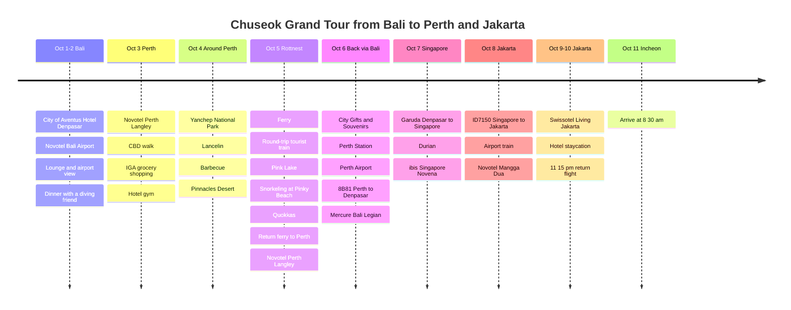

# The Chuseok Grand Tour: From Bali to Perth and Jakarta

This Chuseok holiday I set off on a slightly special route instead of the places everyone goes. It was a long journey of transfers: catching my breath in Bali, slowly taking in nature and city in Perth, Australia, and finishing with Singapore durian and a Jakarta hotel staycation.

## Trip Overview

- **Dates**: October 1-11, 2025
- **Route**: Incheon → Bali → Perth → Bali → Singapore → Jakarta → Incheon
- **Hotels**: City of Aventus Hotel - Denpasar, Novotel Bali Airport, Novotel Perth Langley, Mercure Bali Legian, ibis Singapore Novena, Novotel Jakarta Mangga Dua, Swissotel Living Jakarta
- **Themes**: layover rest and recharge, Perth nature tours, Rottnest quokkas, durian, Jakarta hotel staycation
- **Airfare paid**: KRW 442,763 + Rp 3,710,011
- **Accommodation paid**: KRW 951,594
- **Rottnest ferry**: AUD 118.71 (about KRW 110,400)
- **Pinnacles tour**: KRW 172,142
- **Singapore durian**: KRW 55,000
- **Jakarta airport train**: Rp 65,000 (about KRW 5,800)
- **Confirmed payments entered so far**: KRW 1,621,499 + AUD 118.71 + Rp 3,775,011
- **Approximate total converted to KRW**: about KRW 2,067,700
- **Total expenses**: to be updated after checking remaining meals and local transport

## Airfare Payment Records

| Segment | Airline / Flight | Schedule | Amount Paid |
|------|-------------|------|----------|
| Incheon → Denpasar, Denpasar → Singapore, Jakarta → Incheon | Garuda Indonesia | 10/1, 10/7, 10/10-11 | KRW 361,763 |
| Denpasar → Perth → Denpasar | 8B80, 8B81 | 10/3 09:05-12:55, 10/6 13:55-17:40 | Rp 3,710,011 |
| Singapore → Jakarta | ID7150 | 10/8 | KRW 81,000 |

## Accommodation Payment Records

| Date | Hotel | Room / Nights | Amount Paid |
|------|------|-----------|----------|
| 10/1 | City of Aventus Hotel - Denpasar | 1 night | KRW 36,000 |
| 10/2 | Novotel Bali Ngurah Rai Airport | 1 night | KRW 119,975 |
| 10/3-6 | Novotel Perth Langley | Executive Suite, 3 nights | KRW 414,154 |
| 10/6 | Mercure Bali Legian | 1 night | KRW 76,214 |
| 10/7 | ibis Singapore Novena | 1 night | KRW 120,471 |
| 10/8 | Novotel Jakarta Mangga Dua Square | 1 night | KRW 67,193 |
| 10/9 | Swissotel Living Jakarta Mega Kuningan | 1 night | KRW 117,587 |
| Total |  | 9 nights | KRW 951,594 |

## Transport and Activity Payment Records

| Date | Item | Amount Paid | KRW Equivalent |
|------|------|----------|-----------|
| 10/4 | Pinnacles Desert Sunset and Stargazing Tour | KRW 172,142 | KRW 172,142 |
| 10/5 | Perth-Rottnest Island round-trip ferry | AUD 118.71 | about KRW 110,400 |
| 10/8 | Jakarta Airport Railink | Rp 65,000 | about KRW 5,800 |

## Food Payment Records

| Date | Item | Amount Paid |
|------|------|----------|
| 10/7 | Singapore durian | KRW 55,000 |

## Itinerary Summary

| Date | Region | Main Activities |
|------|------|----------|
| 10/1-2 | Bali | City of Aventus Hotel - Denpasar, Novotel Bali Airport, lounge, dinner with my diving friend |
| 10/3 | Perth | Arrived in Perth, checked in at Novotel Perth Langley, CBD walk, IGA grocery shopping |
| 10/4 | Around Perth | Yanchep National Park, Lancelin, barbecue, Pinnacles Desert |
| 10/5 | Rottnest | Ferry from Perth, round-trip tourist train, Oliver Hill Battery, Pink Lake, snorkeling at Pinky Beach, quokkas, return ferry to Perth, one night at Novotel Perth Langley |
| 10/6 | Perth → Bali | City Gifts & Souvenirs, Perth Station, Perth Airport, flight 8B81 back to Bali, one night at Mercure Bali Legian |
| 10/7 | Bali → Singapore | Garuda Indonesia direct flight, Singapore durian, one night at ibis Novena |
| 10/8 | Singapore → Jakarta | Flight ID7150, airport train, one night at Novotel Mangga Dua |
| 10/9-10 | Jakarta | Swissotel Living Jakarta staycation, 23:15 return flight |
| 10/11 | Incheon | Arrived at Incheon at 08:30 |

## Itinerary Timeline

## Intro

The highlight of this trip doesn't come down to a single scene. The moment I played hide-and-seek with a quokka on Rottnest Island, the cityscape from the Perth sunset ferry, the foilboard that glided across the river as if floating, and the rich durian I ate in Singapore. It was a long grand tour that filled the whole Chuseok holiday.

## A Layover in Bali

The first destination was Bali. It was really just a stop before Perth, so on the first day I rested lightly at City of Aventus Hotel - Denpasar and the next day moved to Novotel Bali Airport, inside the airport. I ate cake and light food in the lounge, and seeing the airport view outside the window finally made it feel like I was traveling.

After arriving, I met my diving master friend. It was hard to dive before or after the flight, so this time we only ate meat together and promised to meet again soon and get into the Bali sea. Next time I want to film the underwater scenery of Bali together.

## Arriving in Perth

I finally arrived in Perth, Australia. This time I stayed in a suite at Novotel Perth Langley. The separate living room and bedroom made it really comfortable to rest after a long journey.

After checking in, I walked around downtown Perth, and the buildings, the sea and the street atmosphere were all lovely. It was a city where even the air felt different.

## Surviving in Perth

For a traveler, prices are what matter. I stopped by the nearby IGA supermarket and looked around at things like ice cream, fruit, coconut water and sandwiches. Ice cream was on the pricey side, but the fruit quality was good, and I liked the strawberries so much that I bought two packs.

Coconut water is a must too. I always buy it whenever I travel, and the coconut water I had in Perth was satisfying as well. Ingredients like beef and ham felt cheaper than in Korea, so buying a sandwich and eating it by the sea was just right.

Back at the hotel, a welcome gift of wine and water was waiting. It was a small treat from my Accor Platinum membership, and moments like these wash away the fatigue of a long journey. The hotel gym had a great view too, so during the day I could exercise while looking at the sea.

## Yanchep, Lancelin and the Pinnacles

For the tour around Perth, I combined Yanchep National Park, Lancelin and the Pinnacles Desert. At Yanchep I saw koalas, and at Lancelin I enjoyed the stunning scenery where the sea meets the river.

In the evening I ate the barbecue our guide prepared. The beef grilled on the campsite's free grill was far better than expected, and dinner in nature made it even more memorable.

The highlight of the tour was the Pinnacles Desert. The endless sandstone pillars exposed as the sand eroded away really looked like another planet.

## Rottnest Island and the Quokkas

The day I looked forward to most was the trip to Rottnest Island. Heading to the island by ferry, the leisurely feel of seeing the city skyline was wonderful.

On the island, I rode the tourist train round trip and toured the area of the former fortress. We also passed the Pink Lake along the way, and apparently you only see a deep pink at the right time of year. Majestic guns, Australian animals that are hard to see in Korea, and the island's distinctive terrain made for scenery I couldn't take my eyes off.

I also went snorkeling at Pinky Beach. After seeing Rottnest's clear water myself, I felt even more strongly that it is not an island just for seeing quokkas but a place where you can enjoy the sea too.

And then I finally met the star of the island, the quokka. Its smiling face is charming, but touching them carries a fine, so I only admired them with my eyes. Just seeing them up close was cute enough.

After the island itinerary ended, I took the ferry back to Perth and stayed one more night at Novotel Perth Langley. Since Rottnest was a one-day round trip, the next move was not going directly from the island to Bali, but returning to downtown Perth, resting for a day and then moving on.

## Goodbye Perth, Hello Singapore Durian

On the way back after finishing the Perth leg, I enjoyed the sunset on the ferry. In the distance I saw someone riding a foilboard, and it was fascinating to watch them glide above the water.

On October 6, I bought souvenirs at Perth City Gifts & Souvenirs and headed to the airport from Perth Station. Then I flew from Perth Airport on flight 8B81 back to Bali. I stayed one night at Mercure Bali Legian to rest for the day, and on October 7 I arrived in Singapore on a Garuda Indonesia direct flight.

In Singapore I stayed one night at ibis Singapore Novena. Prices felt higher than in Australia, but here there is the durian I love. Perhaps because only good quality durian is imported, Singapore durian had a less overpowering smell and a rich sweetness. I laughed at the price of KRW 55,000, but the taste was definitely memorable.

## The Final Leg, Jakarta

The last city was Jakarta. On October 8 I moved from Singapore to Jakarta on flight ID7150 and took the airport train from the airport. The infrastructure was really well developed, better than I expected. It was clean and comfortable, so the ride itself was quite easy.

The first night I stayed at Novotel Jakarta Mangga Dua, and the next day I moved to Swissotel Living Jakarta. With its marble interiors and a suite with a separate living room and bedroom, I ended the long trip in proper luxury.

At 23:15 on the night of October 10, I left Jakarta on a Garuda Indonesia direct flight and arrived at Incheon at 08:30 on the morning of October 11. It was the true full stop to the long, long Chuseok grand tour.

## Epilogue

The tickets entered so far are three Garuda Indonesia legs for KRW 361,763, the Bali-Perth round trip for Rp 3,710,011 and Singapore-Jakarta for KRW 81,000. Accommodation totals KRW 951,594 for 9 nights, the Pinnacles tour is KRW 172,142 after the coupon, the Rottnest round-trip ferry is AUD 118.71, Singapore durian is KRW 55,000 and the Jakarta airport train is Rp 65,000. Converted roughly, the ferry is about KRW 110,400 and the airport train about KRW 5,800. I plan to check card statements and receipts once more and reflect the remaining local transport and meals in the total expenses.

Booking accommodation in advance, making active use of public transport and eating out less made it quite a good-value trip given the long distance and duration.

Working as a developer, burnout sometimes hits, and stepping out into the world every now and then to see new scenes is what gives me the energy to write code again. Perth's wind, Rottnest's quokkas, Singapore's durian and a comfortable last night in Jakarta made it a Chuseok trip I will remember for a long time.
