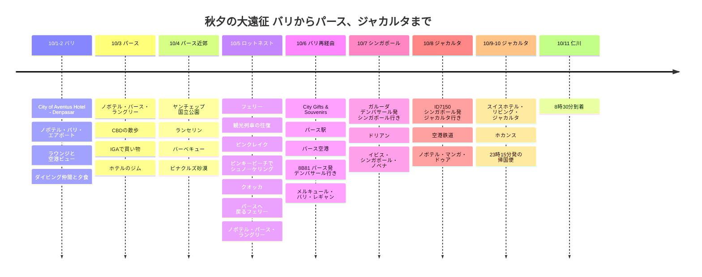

# 秋夕の大遠征 バリからパース、ジャカルタまで

今年の秋夕連休は、みんなが行く場所ではなく、少し特別なルートで出かけました。バリでひと息つき、オーストラリアのパースで自然と街をゆっくり眺め、シンガポールのドリアンとジャカルタのホカンスで締めくくった、長い移動の旅です。

## 旅行の概要

- **期間**: 2025年10月1日 ~ 11日
- **ルート**: 仁川 → バリ → パース → バリ → シンガポール → ジャカルタ → 仁川
- **宿泊**: City of Aventus Hotel - Denpasar、ノボテル・バリ・エアポート、ノボテル・パース・ラングリー、メルキュール・バリ・レギャン、イビス・シンガポール・ノベナ、ノボテル・ジャカルタ・マンガ・ドゥア、スイスホテル・リビング・ジャカルタ
- **テーマ**: レイオーバーでヒーリング、パースの自然ツアー、ロットネストのクオッカ、ドリアン、ジャカルタのホカンス
- **航空券の決済**: 442,763ウォン + Rp 3,710,011
- **宿泊費の決済**: 951,594ウォン
- **ロットネストのフェリー**: AUD 118.71（約110,400ウォン）
- **ピナクルズのツアー**: 172,142ウォン
- **シンガポールのドリアン**: 55,000ウォン
- **ジャカルタの空港鉄道**: Rp 65,000（約5,800ウォン）
- **現在入力済みの確定決済**: 1,621,499ウォン + AUD 118.71 + Rp 3,775,011
- **全体のおおよその韓国ウォン換算合計**: 約2,067,700ウォン
- **総費用**: 残りの食費と現地交通費まで確認した後に更新予定

## 航空券の決済記録

| 区間 | 航空会社/便名 | 日程 | 決済金額 |
|------|-------------|------|----------|
| 仁川 → デンパサール、デンパサール → シンガポール、ジャカルタ → 仁川 | ガルーダ・インドネシア航空 | 10/1、10/7、10/10-11 | 361,763ウォン |
| デンパサール → パース → デンパサール | 8B80、8B81 | 10/3 09:05-12:55、10/6 13:55-17:40 | Rp 3,710,011 |
| シンガポール → ジャカルタ | ID7150 | 10/8 | 81,000ウォン |

## 宿泊費の決済記録

| 日付 | 宿 | 部屋/泊数 | 決済金額 |
|------|-----------|-----------|----------|
| 10/1 | City of Aventus Hotel - Denpasar | 1泊 | 36,000ウォン |
| 10/2 | ノボテル・バリ・ングラ・ライ・エアポート | 1泊 | 119,975ウォン |
| 10/3-6 | ノボテル・パース・ラングリー | エグゼクティブスイート3泊 | 414,154ウォン |
| 10/6 | メルキュール・バリ・レギャン | 1泊 | 76,214ウォン |
| 10/7 | イビス・シンガポール・ノベナ | 1泊 | 120,471ウォン |
| 10/8 | ノボテル・ジャカルタ・マンガ・ドゥア・スクエア | 1泊 | 67,193ウォン |
| 10/9 | スイスホテル・リビング・ジャカルタ・メガ・クニンガン | 1泊 | 117,587ウォン |
| 合計 |  | 9泊 | 951,594ウォン |

## 交通・アクティビティの決済記録

| 日付 | 項目 | 決済金額 | ウォン換算 |
|------|------|----------|-----------|
| 10/4 | ピナクルズ砂漠 夕焼けと星空ツアー | 172,142ウォン | 172,142ウォン |
| 10/5 | パース-ロットネスト島 往復フェリー | AUD 118.71 | 約110,400ウォン |
| 10/8 | ジャカルタ空港鉄道 | Rp 65,000 | 約5,800ウォン |

## 食費の決済記録

| 日付 | 項目 | 決済金額 |
|------|------|----------|
| 10/7 | シンガポールのドリアン | 55,000ウォン |

## 旅程の概要

| 日付 | 地域 | 主な予定 |
|------|------|----------|
| 10/1-2 | バリ | City of Aventus Hotel - Denpasar、ノボテル・バリ・エアポート、ラウンジ、ダイビング仲間と夕食 |
| 10/3 | パース | パース到着、ノボテル・パース・ラングリーにチェックイン、CBDの散歩、IGAで買い物 |
| 10/4 | パース近郊 | ヤンチェップ国立公園、ランセリン、バーベキュー、ピナクルズ砂漠 |
| 10/5 | ロットネスト | パース出発のフェリー、観光列車の往復、オリバーヒル砲台、ピンクレイク、ピンキービーチでシュノーケリング、クオッカ、パースへ戻るフェリー、ノボテル・パース・ラングリーで1泊 |
| 10/6 | パース→バリ | City Gifts & Souvenirs、パース駅、パース空港、8B81便でバリへ帰還、メルキュール・バリ・レギャンで1泊 |
| 10/7 | バリ→シンガポール | ガルーダ・インドネシア航空の直行便、シンガポールのドリアン、イビス・ノベナで1泊 |
| 10/8 | シンガポール→ジャカルタ | ID7150便、空港鉄道、ノボテル・マンガ・ドゥアで1泊 |
| 10/9-10 | ジャカルタ | スイスホテル・リビング・ジャカルタでホカンス、23:15発の帰国便 |
| 10/11 | 仁川 | 08:30に仁川到着 |

## 旅程タイムライン

## イントロ

今回の旅のハイライトは、ひとつの場面では終わりません。ロットネスト島でクオッカとかくれんぼをするように出会った瞬間、パースのサンセットフェリーの上から見た都心の風景、川の上を浮かぶように通り過ぎていったフォイルボード、そしてシンガポールで食べた濃厚なドリアンまで。秋夕連休をぎっしり埋めた、長い大遠征でした。

## バリでのレイオーバー

最初の目的地はバリでした。実のところ、パースへ行く前にしばらく滞在する区間なので、初日はCity of Aventus Hotel - Denpasarで軽く休み、翌日は空港の中にあるノボテル・バリ・エアポートに移りました。ラウンジでケーキと軽食をいただき、窓の外に見える空港の景色を眺めて、ようやく旅に来た実感が湧きました。

到着してからはダイビングマスターの友人に会いました。フライトの前後にダイビングをするのは難しいので、今回は肉を一緒に食べただけで、近いうちにまた会ってバリの海に入ろうと約束しました。次回はバリの海の中の映像も一緒に撮ってみたいです。

## パース入り

ついにオーストラリアのパースに到着しました。今回の宿はノボテル・パース・ラングリーのスイートルーム。リビングと寝室が分かれていて、長い移動の後に休むのが本当に快適でした。

チェックイン後にパースの街を歩いてみたのですが、建物も海も通りの雰囲気もすべてがきれいでした。空気から違って感じられる街でした。

## パースでサバイバル

旅行者にとって大事なのはやはり物価です。近くのIGAスーパーに立ち寄って、アイスクリーム、果物、ココナッツウォーター、サンドイッチなどを見て回りました。アイスクリームは高めでしたが、果物は品質がよく、特にイチゴが気に入って2パックも食べてしまいました。

ココナッツウォーターも欠かせません。旅行のたびに必ず飲むほうですが、パースで飲んだココナッツウォーターも満足でした。牛肉やハムなどの食材は韓国より安く感じられたので、サンドイッチをひとつ買って、海を見ながら食べるのにぴったりでした。

宿に戻ると、ウェルカムギフトとしてワインと水が用意されていました。アコー・プラチナム会員の特典でいただいた小さなおもてなしですが、こういう瞬間が長い移動の疲れをすっかり癒してくれます。ホテルのジムからの眺めもよく、昼間は海を見ながら運動することができました。

## ヤンチェップ、ランセリン、ピナクルズ

パース近郊のツアーとして、ヤンチェップ国立公園、ランセリン、ピナクルズ砂漠をまとめて回りました。ヤンチェップではコアラに会い、ランセリンでは海と川が出会う絶景を楽しみました。

夕方にはガイドさんが用意してくれたバーベキューをいただきました。キャンプ場の無料グリルで焼いた牛肉が思っていたよりずっとおいしく、自然の中で食べる夕食だったのでいっそう記憶に残りました。

ツアーのハイライトはピナクルズ砂漠でした。砂が削られて現れた砂岩の柱が果てしなく立ち並ぶ風景は、本当に別の惑星のようでした。

## ロットネスト島とクオッカ

いちばん楽しみにしていたのは、ロットネスト島に行く日でした。フェリーで島に向かうとき、都心の景観が見えるそのゆとりがとても心地よかったです。

島では観光列車で往復して、かつて要塞だったエリアを巡りました。途中でピンクレイクも通りましたが、時期がうまく合わないと濃いピンク色は見られないそうです。雄大な大砲、韓国では見られないオーストラリアの動物、島ならではの地形まで、目が離せない風景が続きました。

ピンキービーチではシュノーケリングもしました。ロットネスト島の澄んだ水の色を直接見ると、クオッカだけを見に行く島ではなく、海まで一緒に楽しめる場所なのだという印象がいっそう強く残りました。

そして、ついに会えた島の主役、クオッカ。笑顔が魅力的ですが、触ると罰金があるので目で愛でるだけにしました。それでも、近くで見るだけで十分にかわいかったです。

島の日程が終わった後は、再びフェリーでパースに戻り、ノボテル・パース・ラングリーにもう一泊しました。ロットネストは日帰りの往復コースで行ってきた日程なので、次の移動は島からそのままバリへ向かったのではなく、パース市内に戻って1日休んでから動く流れでした。

## さよならパース、そしてシンガポールのドリアン

パースでの旅を終えて戻る道、フェリーの上でサンセットを楽しみました。遠くにフォイルボードに乗っている人が見えたのですが、水の上に浮かんで進んでいく姿が不思議でした。

10月6日にはパースのCity Gifts & Souvenirsでお土産を買い、パース駅から空港へ移動しました。その後パース空港から8B81便に乗って、再びバリへ戻ってきました。この日はメルキュール・バリ・レギャンで1泊してひと休みし、10月7日にガルーダ・インドネシア航空の直行便でシンガポールに到着しました。

シンガポールではイビス・シンガポール・ノベナで1泊しました。物価はオーストラリアより高く感じられましたが、ここには私の大好きなドリアンがあります。シンガポールのドリアンは良い品質のものだけが入ってくるからか、香りも気にならず、甘さが濃厚でした。値段は55,000ウォンで思わず笑ってしまいましたが、味だけは確かに記憶に残りました。

## 最後の旅程、ジャカルタ

最後の都市はジャカルタでした。10月8日、ID7150便でシンガポールからジャカルタへ移動し、空港では空港鉄道を利用しました。思っていた以上にインフラがしっかり整っていました。清潔で快適で、移動そのものがかなり楽でした。

初日はノボテル・ジャカルタ・マンガ・ドゥアで1泊し、翌日はスイスホテル・リビング・ジャカルタに移りました。大理石のインテリアと、リビングと寝室が分かれたスイートルームのおかげで、長い旅の最後をたっぷり贅沢に締めくくることができました。

10月10日の夜23時15分にはガルーダ・インドネシア航空の直行便でジャカルタを発ち、10月11日の朝8時30分に仁川に到着しました。長い長い秋夕の大遠征の、本当の終止符でした。

## エピローグ

現在入力済みの航空券は、ガルーダ・インドネシア航空3区間が361,763ウォン、バリ-パース往復がRp 3,710,011、シンガポール-ジャカルタが81,000ウォンです。宿泊費は9泊合計で951,594ウォン、ピナクルズのツアーはクーポン適用後172,142ウォン、ロットネスト往復フェリーはAUD 118.71、シンガポールのドリアンは55,000ウォン、ジャカルタの空港鉄道はRp 65,000として整理しました。おおよその換算では、フェリーは約110,400ウォン、空港鉄道は約5,800ウォン程度です。残りの現地交通費と食費は、カードの明細とレシートをもう一度確認してから総費用に反映する予定です。

宿泊を事前に押さえ、公共交通機関を積極的に利用し、外食を減らしたおかげで、長い移動距離と期間のわりにかなりコスパのよい旅でした。

開発者として働いていると、燃え尽きてしまうこともありますが、こうして時々世界の外に出て新しい風景を見ることが、再びコードを書く原動力になります。パースの風、ロットネストのクオッカ、シンガポールのドリアン、ジャカルタの心地よい最後の夜まで、長く記憶に残る秋夕の旅でした。
