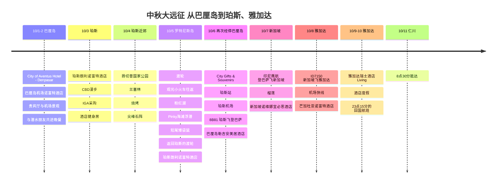

# 中秋大远征 从巴厘岛到珀斯、雅加达

这次中秋假期，没有去大家都去的地方，而是选了一条有点特别的路线。先在巴厘岛稍作休整，再在澳大利亚珀斯慢慢欣赏自然与城市，最后以新加坡榴莲和雅加达的酒店度假收尾，是一次漫长的移动之旅。

## 旅行概览

- **时间**：2025年10月1日 ~ 11日
- **路线**：仁川 → 巴厘岛 → 珀斯 → 巴厘岛 → 新加坡 → 雅加达 → 仁川
- **住宿**：City of Aventus Hotel - Denpasar、巴厘岛机场诺富特酒店、珀斯朗利诺富特酒店、巴厘岛勒吉安美居酒店、新加坡诺维娜宜必思酒店、雅加达芒加杜亚诺富特酒店、雅加达瑞士酒店 Living
- **主题**：中转疗愈、珀斯自然之旅、罗特尼斯岛短尾矮袋鼠、榴莲、雅加达酒店度假
- **机票支付**：442,763韩元 + Rp 3,710,011
- **住宿费支付**：951,594韩元
- **罗特尼斯岛渡轮**：AUD 118.71（约110,400韩元）
- **尖峰石阵之旅**：172,142韩元
- **新加坡榴莲**：55,000韩元
- **雅加达机场快线**：Rp 65,000（约5,800韩元）
- **目前录入的确定支付**：1,621,499韩元 + AUD 118.71 + Rp 3,775,011
- **整体大致韩元换算合计**：约2,067,700韩元
- **总花费**：确认剩余餐饮费和当地交通费后更新

## 机票支付记录

| 航段 | 航空公司/航班号 | 日程 | 支付金额 |
|------|-------------|------|----------|
| 仁川 → 登巴萨、登巴萨 → 新加坡、雅加达 → 仁川 | 印尼鹰航 | 10/1、10/7、10/10-11 | 361,763韩元 |
| 登巴萨 → 珀斯 → 登巴萨 | 8B80、8B81 | 10/3 09:05-12:55、10/6 13:55-17:40 | Rp 3,710,011 |
| 新加坡 → 雅加达 | ID7150 | 10/8 | 81,000韩元 |

## 住宿费支付记录

| 日期 | 住宿 | 房型/晚数 | 支付金额 |
|------|-----------|-----------|----------|
| 10/1 | City of Aventus Hotel - Denpasar | 1晚 | 36,000韩元 |
| 10/2 | 巴厘岛伍拉·赖机场诺富特酒店 | 1晚 | 119,975韩元 |
| 10/3-6 | 珀斯朗利诺富特酒店 | 行政套房3晚 | 414,154韩元 |
| 10/6 | 巴厘岛勒吉安美居酒店 | 1晚 | 76,214韩元 |
| 10/7 | 新加坡诺维娜宜必思酒店 | 1晚 | 120,471韩元 |
| 10/8 | 雅加达芒加杜亚广场诺富特酒店 | 1晚 | 67,193韩元 |
| 10/9 | 雅加达梅加古宁安瑞士酒店 Living | 1晚 | 117,587韩元 |
| 合计 |  | 9晚 | 951,594韩元 |

## 交通与活动支付记录

| 日期 | 项目 | 支付金额 | 韩元换算 |
|------|------|----------|-----------|
| 10/4 | 尖峰石阵沙漠日落与星空之旅 | 172,142韩元 | 172,142韩元 |
| 10/5 | 珀斯-罗特尼斯岛往返渡轮 | AUD 118.71 | 约110,400韩元 |
| 10/8 | 雅加达机场快线 | Rp 65,000 | 约5,800韩元 |

## 餐饮支付记录

| 日期 | 项目 | 支付金额 |
|------|------|----------|
| 10/7 | 新加坡榴莲 | 55,000韩元 |

## 行程概要

| 日期 | 地区 | 主要行程 |
|------|------|----------|
| 10/1-2 | 巴厘岛 | City of Aventus Hotel - Denpasar、巴厘岛机场诺富特酒店、贵宾厅、与潜水朋友共进晚餐 |
| 10/3 | 珀斯 | 抵达珀斯、入住珀斯朗利诺富特酒店、CBD漫步、IGA采购 |
| 10/4 | 珀斯近郊 | 扬切普国家公园、兰塞林、烧烤、尖峰石阵 |
| 10/5 | 罗特尼斯岛 | 从珀斯出发的渡轮、观光小火车往返、奥利弗山炮台、粉红湖、Pinky海滩浮潜、短尾矮袋鼠、返回珀斯的渡轮、珀斯朗利诺富特酒店住1晚 |
| 10/6 | 珀斯→巴厘岛 | City Gifts & Souvenirs、珀斯站、珀斯机场、乘8B81航班返回巴厘岛、巴厘岛勒吉安美居酒店住1晚 |
| 10/7 | 巴厘岛→新加坡 | 印尼鹰航直飞、新加坡榴莲、诺维娜宜必思酒店住1晚 |
| 10/8 | 新加坡→雅加达 | ID7150航班、机场快线、芒加杜亚诺富特酒店住1晚 |
| 10/9-10 | 雅加达 | 雅加达瑞士酒店 Living 酒店度假、23:15的回国航班 |
| 10/11 | 仁川 | 08:30抵达仁川 |

## 行程时间线

## 前言

这次旅行的亮点不止一个画面。在罗特尼斯岛和短尾矮袋鼠玩捉迷藏般相遇的瞬间，在珀斯日落渡轮上看到的市区风景，像漂浮在河面上滑过的水翼板，还有在新加坡吃到的浓郁榴莲。这是一次把中秋假期塞得满满的漫长大远征。

## 巴厘岛中转

第一个目的地是巴厘岛。其实这是前往珀斯之前短暂停留的一段，所以第一天在City of Aventus Hotel - Denpasar轻松休息，第二天搬到了机场内的巴厘岛机场诺富特酒店。在贵宾厅吃了蛋糕和简餐，看着窗外的机场景观，这才真切感受到自己是出来旅行了。

抵达后见了潜水教练朋友。航班前后很难潜水，所以这次只一起吃了肉，约定近期再见面，一起下巴厘岛的海。下次还想一起拍下巴厘岛海底的画面。

## 抵达珀斯

终于抵达了澳大利亚珀斯。这次的住处是珀斯朗利诺富特酒店的套房。客厅和卧室分开，长途奔波后休息真的很舒适。

办理入住后在珀斯市区走了走，建筑、大海和街道氛围都很美。是一座连空气都感觉不一样的城市。

## 在珀斯生存指南

对旅行者来说，重要的还是物价。我去附近的IGA超市逛了逛冰淇淋、水果、椰子水、三明治之类的东西。冰淇淋偏贵，但水果品质很好，尤其喜欢草莓，一口气买了两盒吃。

椰子水也不能少。每次旅行我都一定要买来喝，在珀斯喝的椰子水也很让人满意。牛肉、火腿之类的食材感觉比韩国便宜，买个三明治边看海边吃正合适。

回到住处，发现欢迎礼是准备好的葡萄酒和水。这是雅高铂金会员权益带来的小小招待，这样的瞬间能让长途奔波的疲惫一扫而空。酒店健身房的景观也很棒，白天可以边看海边运动。

## 扬切普、兰塞林、尖峰石阵

珀斯近郊的旅游团把扬切普国家公园、兰塞林和尖峰石阵串在了一起。在扬切普看到了树袋熊，在兰塞林欣赏了海与河交汇的绝美风景。

晚上吃了导游准备的烧烤。用露营地免费烤架烤的牛肉比想象中好吃得多，在大自然中吃晚餐，所以更加难忘。

旅游团的亮点是尖峰石阵。沙子被风蚀后露出的砂岩石柱无尽林立的风景，真的像另一个星球。

## 罗特尼斯岛与短尾矮袋鼠

最期待的一天，是前往罗特尼斯岛的日子。乘渡轮驶向小岛，能看到市区景观的那份悠闲实在太好了。

在岛上乘观光小火车往返，游览了曾是要塞的区域。途中还经过了粉红湖，据说时机合适才能看到浓郁的粉红色。雄伟的大炮、在韩国很难见到的澳大利亚动物，还有海岛特有的地形，让人移不开眼的风景接连不断。

在Pinky海滩还浮潜了。亲眼看到罗特尼斯岛清澈的海水颜色后，更强烈地觉得这里不只是看短尾矮袋鼠的岛，而是连大海也能一起享受的地方。

然后是终于见到的岛上主角，短尾矮袋鼠。笑脸很迷人，但触摸会被罚款，所以只用眼睛欣赏。不过光是近距离看着就已经足够可爱。

岛上的行程结束后，再次乘渡轮回到珀斯，在珀斯朗利诺富特酒店又住了一晚。罗特尼斯岛是当天往返的行程，所以接下来的移动不是从岛上直接飞往巴厘岛，而是先回到珀斯市区休息一天再出发。

## 再见珀斯，还有新加坡榴莲

结束珀斯的行程返回的路上，我在渡轮上欣赏了日落。远处能看到有人在玩水翼板，浮在水面上滑过的样子很神奇。

10月6日在珀斯City Gifts & Souvenirs买了纪念品，从珀斯站前往机场。之后在珀斯机场乘8B81航班再次回到巴厘岛。这天在巴厘岛勒吉安美居酒店住了1晚稍作休息，10月7日乘印尼鹰航直飞航班抵达新加坡。

在新加坡住了一晚新加坡诺维娜宜必思酒店。物价感觉比澳大利亚更高，但这里有我最爱的榴莲。新加坡的榴莲大概因为只进口品质好的，味道没那么冲，甜度很浓。价格是55,000韩元，让我忍不住笑了出来，但味道确实让人难忘。

## 最后一站，雅加达

最后的城市是雅加达。10月8日乘ID7150航班从新加坡前往雅加达，在机场乘坐了机场快线。基础设施比想象中好得多，干净又舒适，移动本身相当轻松。

第一天在雅加达芒加杜亚诺富特酒店住了1晚，第二天换到了雅加达瑞士酒店 Living。大理石内饰和客厅卧室分开的套房，让这次漫长旅行的最后一段过得无比奢华。

10月10日晚23点15分乘印尼鹰航直飞航班离开雅加达，10月11日早上8点30分抵达仁川。这是漫长的中秋大远征真正的句号。

## 尾声

目前录入的机票有：印尼鹰航3段361,763韩元，巴厘岛-珀斯往返Rp 3,710,011，新加坡-雅加达81,000韩元。住宿费9晚合计951,594韩元，尖峰石阵之旅使用优惠券后172,142韩元，罗特尼斯岛往返渡轮AUD 118.71，新加坡榴莲55,000韩元，雅加达机场快线Rp 65,000。大致换算，渡轮约110,400韩元，机场快线约5,800韩元左右。其余的当地交通费和餐饮费，打算再核对一遍银行卡明细和收据后计入总花费。

提前订好住宿，积极乘坐公共交通，减少外出就餐，所以相对于漫长的路程和时间，这是一次相当划算的旅行。

做开发者难免会有倦怠的时候，像这样偶尔走出世界之外，看看崭新的风景，就是重新写代码的动力。珀斯的风、罗特尼斯岛的短尾矮袋鼠、新加坡的榴莲，再到雅加达舒适的最后一夜，是一次会长久留在记忆里的中秋之旅。
