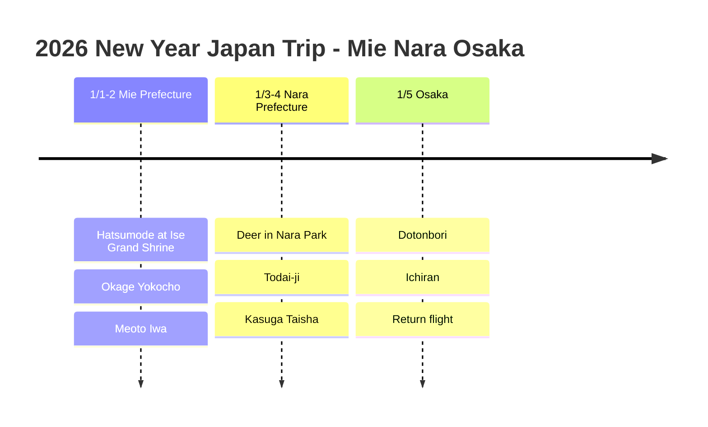

# 2026 New Year Japan Trip: Mie, Nara and Osaka

A record of welcoming 2026 in Japan: the first shrine visit of the new year (hatsumode) at Ise Grand Shrine, followed by Nara and Osaka.

## 📍 Trip Overview

- **Dates**: January 1 to 5, 2026 (5 days)
- **Route**: Centrair in → Mie → Nara → Osaka → Kansai Airport out
- **Theme**: New Year shrine visit + shrines and temples + eating

## 🗓️ Itinerary Summary

| Date | Area | Main plans |
|------|------|----------|
| 1/1-2 | Mie Prefecture | **Hatsumode at Ise Grand Shrine**, Okage Yokocho, Meoto Iwa |
| 1/3-4 | Nara Prefecture | **Deer in Nara Park**, Todai-ji, Kasuga Taisha |
| 1/5 | Osaka | Dotonbori, Ichiran, **return flight** |

## Itinerary Timeline

## ⛩️ Highlights

### Hatsumode at Ise Grand Shrine (1/1)
- The first prayers of the new year at Japan's foremost shrine
- A special experience of praying for good fortune in the new year
- Akafuku mochi is a must!

### Nara Park (1/3)
- Bond with the adorable deer
- See the Great Buddha at Todai-ji
- Try crawling through the pillar hole!

### Eating Through Dotonbori (1/5)
- Sweep up Osaka's street food on the last day
- Takoyaki, okonomiyaki and kushikatsu

## 💡 Tips

1. **Hatsumode**: The crowds are huge during the first three days of the year. Going early in the morning is recommended
2. **Nara deer**: Keep your crackers hidden (the deer will follow you!)
3. **Getting around**: The Kintetsu Rail Pass is efficient

---

Our first fortune of the new year was **Daikichi (great blessing)**! 🎍
