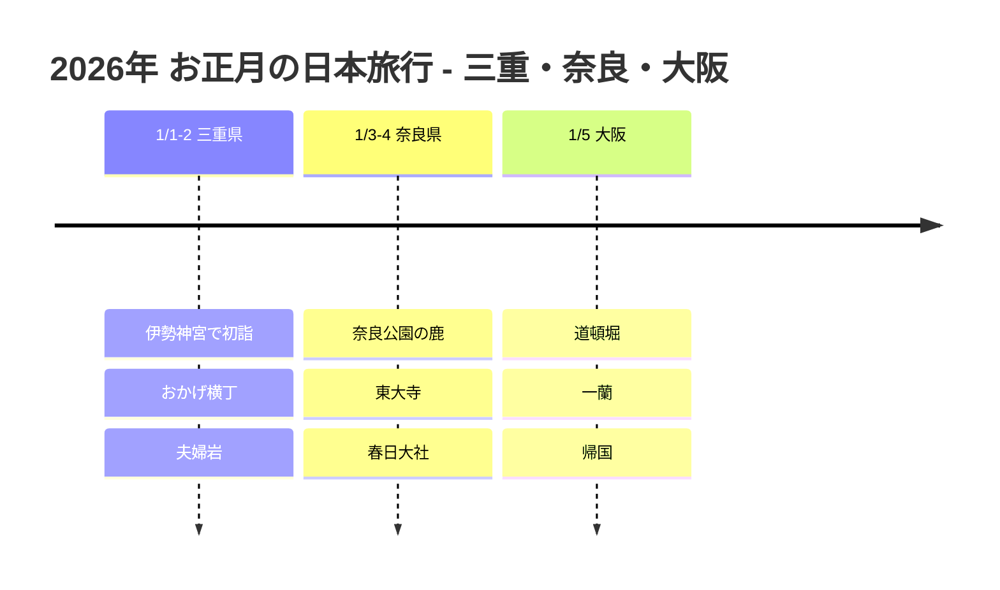

# 2026年 お正月の日本旅行：三重・奈良・大阪

2026年の新年を日本で迎え、伊勢神宮で初詣をして、奈良と大阪を旅した記録です。

## 📍 旅行概要

- **期間**: 2026年1月1日 ~ 5日（5日間）
- **ルート**: セントレア IN → 三重 → 奈良 → 大阪 → 関西空港 OUT
- **テーマ**: 初詣 + 神社・お寺 + グルメ

## 🗓️ 旅程の概要

| 日付 | エリア | 主な予定 |
|------|------|----------|
| 1/1-2 | 三重県 | **伊勢神宮で初詣**、おかげ横丁、夫婦岩 |
| 1/3-4 | 奈良県 | **奈良公園の鹿**、東大寺、春日大社 |
| 1/5 | 大阪 | 道頓堀、一蘭、**帰国** |

## 旅程タイムライン

## ⛩️ ハイライト

### 伊勢神宮の初詣（1/1）
- 日本最高峰の神社で新年最初の参拝
- 新年の幸せを祈る特別な体験
- 赤福餅は必食！

### 奈良公園（1/3）
- かわいい鹿たちとふれあい
- 東大寺の大仏を鑑賞
- 柱の穴くぐりに挑戦！

### 道頓堀グルメ（1/5）
- 最終日は大阪グルメを食べ尽くす
- たこ焼き、お好み焼き、串カツ

## 💡 ヒント

1. **初詣**: 新年最初の3日間はものすごい人出。早朝がおすすめ
2. **奈良の鹿**: 鹿せんべいは隠し持つこと（鹿がついてきます！）
3. **移動**: 近鉄レールパスが効率的

---

新年最初のおみくじは**大吉**！🎍
