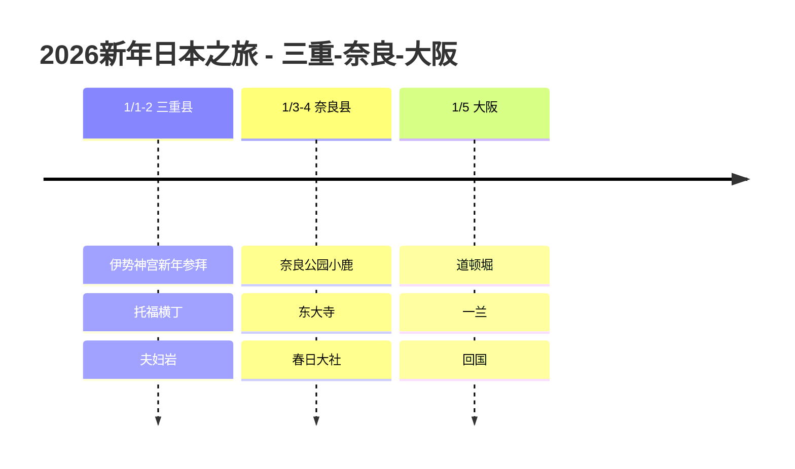

# 2026新年日本之旅：三重-奈良-大阪

在日本迎接2026年新年，在伊势神宫进行新年首次参拜（初诣），并游览奈良和大阪的记录。

## 📍 旅行概览

- **时间**：2026年1月1日 ~ 5日（5天）
- **路线**：Centrair 入境 → 三重 → 奈良 → 大阪 → 关西机场出境
- **主题**：新年参拜 + 神社/寺庙 + 吃吃吃

## 🗓️ 行程概要

| 日期 | 地区 | 主要行程 |
|------|------|----------|
| 1/1-2 | 三重县 | **伊势神宫新年参拜**、托福横丁、夫妇岩 |
| 1/3-4 | 奈良县 | **奈良公园小鹿**、东大寺、春日大社 |
| 1/5 | 大阪 | 道顿堀、一兰、**回国** |

## 行程时间线

## ⛩️ 亮点

### 伊势神宫初诣（1/1）
- 在日本最高等级的神社进行新年首次参拜
- 祈求新年好运的特别体验
- 赤福年糕必吃！

### 奈良公园（1/3）
- 与可爱的小鹿亲密互动
- 欣赏东大寺大佛
- 挑战穿过柱子洞！

### 道顿堀美食（1/5）
- 最后一天把大阪美食一网打尽
- 章鱼烧、大阪烧、炸串

## 💡 贴士

1. **初诣**：新年前3天人潮汹涌，推荐清晨前往
2. **奈良小鹿**：鹿仙贝要藏好拿着（小鹿会跟着你！）
3. **交通**：近铁周游券很划算

---

新年第一支签是**大吉**！🎍
