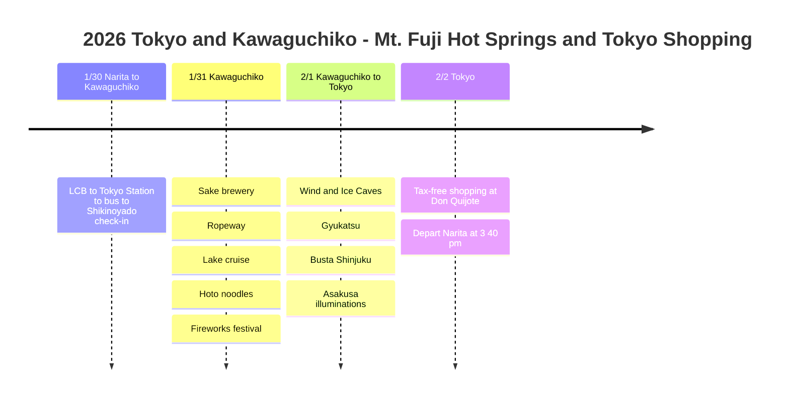

# 2026 Tokyo and Kawaguchiko: Mt. Fuji Hot Springs and Tokyo Shopping

Relax at a Kawaguchiko hot spring ryokan with a view of Mt. Fuji, explore caves, watch a fireworks festival, then enjoy winter illuminations and good food in Tokyo's Asakusa!

## 📍 Trip Overview

- **Dates**: January 30 to February 2, 2026 (3 nights, 4 days)
- **Route**: Arrive Narita → Tokyo Station → Kawaguchiko (2 nights) → Shinjuku → Asakusa (1 night) → Depart Narita
- **Theme**: Hot spring relaxation + Mt. Fuji views + cave exploration + Tokyo shopping
- **Transport**: No rental car, public transport only!

## 🗓️ Itinerary Summary

| Date | Area | Main plans |
|------|------|----------|
| 1/30 | Narita to Kawaguchiko | LCB → Tokyo Station → bus → **Check in at Shikinoyado** |
| 1/31 | Kawaguchiko | Sake brewery, ropeway, cruise, hoto, **fireworks festival** |
| 2/1 | Kawaguchiko to Tokyo | **Wind and Ice Caves**, gyukatsu, Busta Shinjuku, **Asakusa illuminations** |
| 2/2 | Tokyo | **Tax-free shopping at Don Quijote**, depart Narita (15:40) |

## Itinerary Timeline

## 💰 Transport Costs

| Leg | Transport | Cost |
|------|--------|------|
| Narita → Tokyo Station | LCB bus | JPY 1,500 |
| Tokyo Station → Kawaguchiko | Express bus (15:30) | JPY 2,300 |
| Kawaguchiko Station → lodging | Shuyu sightseeing bus | JPY 180 |
| 2-day bus pass + ropeway + cruise | Set pass | JPY 3,300 |
| Wind Cave + Ice Cave | Combo ticket | JPY 600 |
| Kawaguchiko → Busta Shinjuku | Express bus (booked in advance) | JPY 2,000 |
| Tokyo subway | 24-hour pass | JPY 800 |
| Asakusa → Narita | Narita Access Express (using the 24-hour pass) | JPY 1,000 |

> 📌 **Shuyu bus info**: https://www.fujikyubus.co.jp/shuyu

## 🗻 Highlights

### Shikinoyado (1/30-2/1, 2 nights)
- Kawaguchiko hot spring ryokan
- Relax in the public bath and foot bath
- Reached by Shuyu bus for JPY 180

### Ide Sake Brewery Tour (1/31)
- Tour starts at 9:30 AM (JPY 1,500)
- Sake tasting with sake made from Mt. Fuji groundwater

### Ropeway and Cruise (1/31)
- Great value with the 2-day bus pass set!
- Panoramic Mt. Fuji views from Kachi-Kachi Yama

### Hoto Restaurant (1/31)
- 甲州ほうとう小作 河口湖店
- Niku hoto + tempura set
- About a 30-minute wait (popular spot!)

### Kawaguchiko Fireworks Festival (1/31)
- 8:00 to 8:20 PM
- Fantastic fireworks with Mt. Fuji as the backdrop
- Watched while eating yakisoba from a food truck

### Wind Cave and Ice Cave (2/1)
- Took the 9:18 AM first bus (Green Line)
- Combo ticket JPY 600
- Returned on the Blue Line from the Ice Cave

### Gyukatsu Restaurant - Koshuya 甲州家 (2/1)
- Highly rated, yet no line, so we walked right in
- The gyukatsu was really good!

### Asakusa Illuminations and Ushimitsu (2/1)
- Traveled with the Tokyo subway 24-hour pass
- Saw Senso-ji and the illuminations
- Dinner of a beef rice bowl at Ushimitsu

## 💡 Tips

1. **Kawaguchiko pass**: The 2-day bus pass + ropeway + cruise set for JPY 3,300 is the best value!
2. **Cave combo ticket**: Wind Cave + Ice Cave combo for JPY 600 (JPY 700 if bought separately)
3. **Express bus reservation**: Booking ahead is cheaper
4. **Fireworks festival**: It is cold, so hand warmers are a must! There are food trucks too
5. **Getting home**: The Narita Access Express is cheap and fast

---

Hot springs under Mt. Fuji, cave exploration, a fireworks festival, and great Tokyo food! 🗻✨
