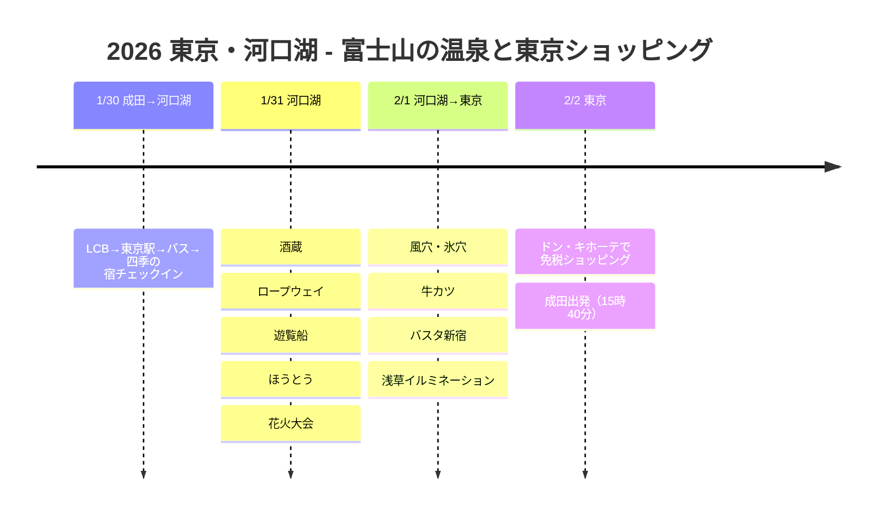

# 2026 東京・河口湖：富士山の温泉と東京ショッピング

富士山が見える河口湖の温泉旅館でヒーリング、洞窟めぐり、花火大会、そして東京・浅草では冬のイルミネーションとグルメ巡り！

## 📍 旅行の概要

- **期間**：2026年1月30日〜2月2日（3泊4日）
- **ルート**：成田IN → 東京駅 → 河口湖（2泊） → 新宿 → 浅草（1泊） → 成田OUT
- **テーマ**：温泉ヒーリング＋富士山の眺望＋洞窟めぐり＋東京ショッピング
- **交通**：レンタカーなし、公共交通機関で！

## 🗓️ 旅程の概要

| 日付 | エリア | 主な予定 |
|------|------|----------|
| 1/30 | 成田→河口湖 | LCB→東京駅→バス→**四季の宿チェックイン** |
| 1/31 | 河口湖 | 酒蔵、ロープウェイ、遊覧船、ほうとう、**花火大会** |
| 2/1 | 河口湖→東京 | **風穴・氷穴**、牛カツ、バスタ新宿、**浅草イルミネーション** |
| 2/2 | 東京 | **ドン・キホーテで免税ショッピング**、成田出発（15:40） |

## 旅程タイムライン

## 💰 交通費まとめ

| 区間 | 交通手段 | 料金 |
|------|--------|------|
| 成田 → 東京駅 | LCBバス | 1,500円 |
| 東京駅 → 河口湖 | 高速バス（15:30） | 2,300円 |
| 河口湖駅 → 宿 | 周遊バス | 180円 |
| 2日間バスパス＋ロープウェイ＋遊覧船 | セットパス | 3,300円 |
| 風穴＋氷穴 | セット入場券 | 600円 |
| 河口湖 → バスタ新宿 | 高速バス（事前予約） | 2,000円 |
| 東京メトロ | 24時間券 | 800円 |
| 浅草 → 成田 | 成田アクセス特急（24時間券利用後） | 1,000円 |

> 📌 **周遊バス情報**：https://www.fujikyubus.co.jp/shuyu

## 🗻 ハイライト

### 四季の宿（1/30〜2/1、2泊）
- 河口湖の温泉旅館
- 大浴場＆足湯でヒーリング
- 周遊バスで180円で移動

### 井出醸造店の酒蔵見学（1/31）
- 午前9時30分にツアー開始（1,500円）
- 富士山の地下水で造った日本酒を試飲

### ロープウェイ＆遊覧船（1/31）
- 2日間バスパスのセットでコスパよく！
- カチカチ山から富士山のパノラマ眺望

### ほうとうの名店（1/31）
- 甲州ほうとう小作 河口湖店
- 肉ほうとう＋天ぷらセット
- 待ち時間は約30分（人気店！）

### 河口湖冬花火（1/31）
- 午後8時〜8時20分
- 富士山を背景に広がる幻想的な花火
- フードトラックの焼きそばを食べながら鑑賞

### 風穴＆氷穴（2/1）
- 午前9時18分の始発（グリーンライン）を利用
- セット入場券600円
- 氷穴からブルーラインで戻る

### 牛カツの名店 - 甲州家（2/1）
- 評価が高いのに行列がなく、すぐ入店
- 牛カツ、本当においしかった！

### 浅草イルミネーション＆牛光（2/1）
- 東京メトロ24時間券で移動
- 浅草寺とイルミネーションを見物
- 牛光で牛丼の夕食

## 💡 ヒント

1. **河口湖パス**：2日間バスパス＋ロープウェイ＋遊覧船のセット3,300円がコスパ最強！
2. **洞窟セット券**：風穴＋氷穴セット600円（別々に買うと700円）
3. **高速バスの予約**：事前予約のほうがお得です
4. **花火大会**：寒いのでカイロ必須！フードトラックもあります
5. **帰国時の交通**：成田アクセス特急が安くて速い

---

富士山のふもとの温泉、洞窟めぐり、花火大会、そして東京グルメまで！🗻✨
