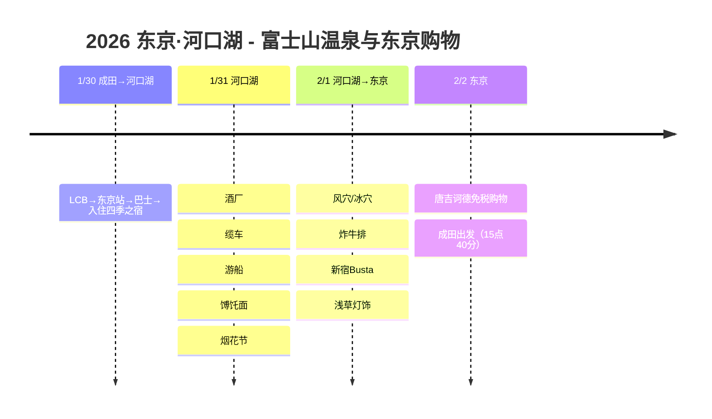

# 2026 东京·河口湖：富士山温泉与东京购物

在能看到富士山的河口湖温泉旅馆疗愈身心，探访洞窟、观赏烟花节，再到东京浅草欣赏冬季灯饰、探寻美食！

## 📍 旅行概要

- **时间**：2026年1月30日～2月2日（3晚4天）
- **路线**：成田入境 → 东京站 → 河口湖（2晚） → 新宿 → 浅草（1晚） → 成田出境
- **主题**：温泉疗愈 + 富士山美景 + 洞窟探访 + 东京购物
- **交通**：不租车，全程公共交通！

## 🗓️ 行程概要

| 日期 | 地区 | 主要行程 |
|------|------|----------|
| 1/30 | 成田→河口湖 | LCB→东京站→巴士→**入住四季之宿** |
| 1/31 | 河口湖 | 酒厂、缆车、游船、馎饦面、**烟花节** |
| 2/1 | 河口湖→东京 | **风穴/冰穴**、炸牛排、新宿Busta、**浅草灯饰** |
| 2/2 | 东京 | **唐吉诃德免税购物**、成田出发（15:40） |

## 行程时间线

## 💰 交通费汇总

| 路段 | 交通方式 | 费用 |
|------|--------|------|
| 成田 → 东京站 | LCB巴士 | 1,500日元 |
| 东京站 → 河口湖 | 高速巴士（15:30） | 2,300日元 |
| 河口湖站 → 住宿处 | 周游巴士 | 180日元 |
| 2日巴士通票+缆车+游船 | 套票 | 3,300日元 |
| 风穴+冰穴 | 套票 | 600日元 |
| 河口湖 → 新宿Busta | 高速巴士（提前预订） | 2,000日元 |
| 东京地铁 | 24小时券 | 800日元 |
| 浅草 → 成田 | 成田Access特快（用完24小时券后） | 1,000日元 |

> 📌 **周游巴士信息**：https://www.fujikyubus.co.jp/shuyu

## 🗻 亮点

### 四季之宿（1/30-2/1，2晚）
- 河口湖温泉旅馆
- 大浴场&足浴疗愈
- 乘周游巴士180日元即可到达

### 井出酿造店酒厂参观（1/31）
- 上午9点30分开始参观（1,500日元）
- 品尝用富士山地下水酿造的清酒

### 缆车&游船（1/31）
- 用2日巴士通票套票，更划算！
- 在卡奇卡奇山眺望富士山全景

### 馎饦面名店（1/31）
- 甲州馎饦小作 河口湖店
- 牛肉馎饦+天妇罗套餐
- 等位约30分钟（人气名店！）

### 河口湖冬季烟花节（1/31）
- 晚上8点至8点20分
- 以富士山为背景绽放的梦幻烟花
- 边吃餐车炒面边观赏

### 风穴&冰穴（2/1）
- 乘上午9点18分的首班车（绿线）
- 套票600日元
- 从冰穴乘蓝线返回

### 炸牛排名店 - 甲州家（2/1）
- 评分很高却不用排队，直接入座
- 炸牛排真的很好吃！

### 浅草灯饰&牛光（2/1）
- 使用东京地铁24小时券前往
- 参观浅草寺和灯饰
- 在牛光吃牛肉盖饭当晚餐

## 💡 小贴士

1. **河口湖通票**：2日巴士通票+缆车+游船套票3,300日元，性价比最高！
2. **洞窟套票**：风穴+冰穴套票600日元（分开买要700日元）
3. **高速巴士预订**：提前预订更便宜
4. **烟花节**：天气冷，暖宝宝必备！还有餐车
5. **回国交通**：成田Access特快又便宜又快

---

富士山下的温泉、洞窟探访、烟花节，还有东京美食！🗻✨
