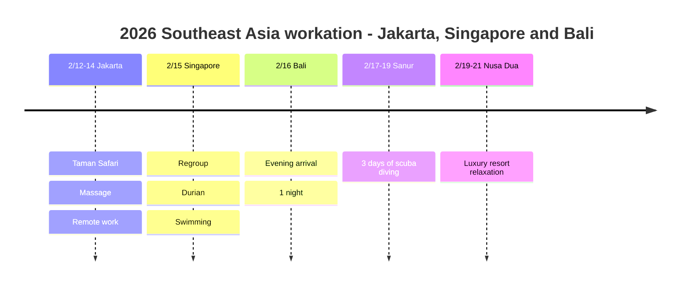

# 2026 Southeast Asia Workation: Jakarta, Singapore and Bali

Remote work and safari in Jakarta, durian and a reset in Singapore, scuba diving in Bali! A travelogue of a three-country Southeast Asia workation.

## 📍 Trip Overview

- **Dates**: February 12-21, 2026 (10 days)
- **Route**: Jakarta (3 nights) → Singapore (1 night) → Bali (5 nights)
- **Theme**: Workation + safari + scuba diving + luxury relaxation

## 🗓️ Itinerary Summary

| Date | Area | Hotel | Highlights |
|------|------|------|----------|
| 2/12-14 | Jakarta | - | **Taman Safari**, massage, remote work |
| 2/15 | Singapore | - | Regroup, **durian**, swimming |
| 2/16 | Bali | Novotel Airport | Evening arrival, 1 night |
| 2/17-19 | Sanur | Mercure Sanur | **3 days of scuba diving** |
| 2/19-21 | Nusa Dua | Sofitel Bali | **Luxury resort relaxation** |

## Itinerary Timeline

## 🦁 Highlights

### Taman Safari Indonesia (2/13)
- Indonesia's largest safari park
- Observe wildlife on a drive-through route
- More than 2,500 species of animals

### Jakarta Workation (2/12-14)
- Remote work by day
- Massage and local exploring in the evening
- Relax with a Balinese massage

### Singapore Stopover (2/15)
- Taking on the king of fruits 🍈 durian!
- Relax at the hotel pool
- Regroup for the next leg of the trip

### Scuba Diving in Sanur (2/17-19)
- Three days of focused diving
- Observe Bali's rich marine life
- Comfortable rest at Mercure Sanur

### Sofitel Bali Resort (2/19-21)
- Nusa Dua private beach
- Finish with relaxation at a luxury resort
- Infinity pool and spa

## 💡 Tips

1. **Taman Safari**: Morning visits recommended, when the animals are active
2. **Durian**: Not allowed into hotels! Eat it on site
3. **Diving**: Discovery dives are available even without a certification
4. **Getting around**: Jakarta → Singapore → Bali by plane

---

Workation + safari + scuba diving + luxury resort! A complete Southeast Asia sweep 🌴🦁🤿
