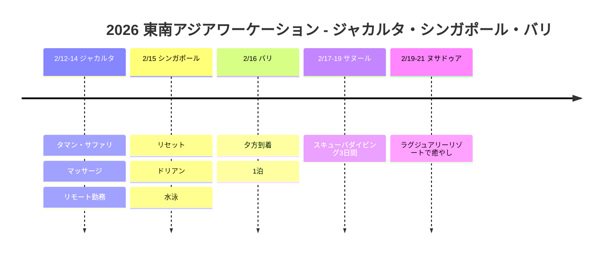

# 2026 東南アジアワーケーション：ジャカルタ・シンガポール・バリ

ジャカルタでのリモートワークとサファリ、シンガポールでのドリアンとリセット、バリでのスキューバダイビングまで！東南アジア3カ国のワーケーション旅行記。

## 📍 旅行概要

- **期間**: 2026年2月12日～21日（10日間）
- **ルート**: ジャカルタ（3泊） → シンガポール（1泊） → バリ（5泊）
- **テーマ**: ワーケーション + サファリ + スキューバダイビング + ラグジュアリーな癒やし

## 🗓️ 旅程の概要

| 日付 | エリア | 宿泊 | 主な予定 |
|------|------|------|----------|
| 2/12-14 | ジャカルタ | - | **タマン・サファリ**、マッサージ、リモート勤務 |
| 2/15 | シンガポール | - | リセット、**ドリアン**、水泳 |
| 2/16 | バリ | ノボテル エアポート | 夕方到着、1泊 |
| 2/17-19 | サヌール | メルキュール サヌール | **スキューバダイビング3日間** |
| 2/19-21 | ヌサドゥア | ソフィテル バリ | **ラグジュアリーリゾートで癒やし** |

## 旅程タイムライン

## 🦁 ハイライト

### タマン・サファリ・インドネシア (2/13)
- インドネシア最大規模のサファリパーク
- ドライブスルーで野生動物を観察
- 2,500種以上の動物

### ジャカルタ ワーケーション (2/12-14)
- 昼はリモートワーク
- 夜はマッサージと現地散策
- バリ式マッサージで癒やし

### シンガポール経由 (2/15)
- 果物の王様 🍈 ドリアンに挑戦！
- ホテルのプールでひと休み
- 次の旅程に向けてリセット

### サヌール スキューバダイビング (2/17-19)
- 3日間集中ダイビング
- バリの豊かな海洋生物を観察
- メルキュール サヌールで快適に休息

### ソフィテル バリ リゾート (2/19-21)
- ヌサドゥアのプライベートビーチ
- ラグジュアリーリゾートで締めくくりの癒やし
- インフィニティプールとスパ

## 💡 ヒント

1. **タマン・サファリ**: 午前中の訪問がおすすめ、動物たちが活発
2. **ドリアン**: ホテルへの持ち込み不可！現地で食べましょう
3. **ダイビング**: ライセンスがなくても体験ダイビングが可能
4. **移動**: ジャカルタ→シンガポール→バリは航空便を利用

---

ワーケーション + サファリ + スキューバダイビング + ラグジュアリーリゾート！東南アジア完全制覇 🌴🦁🤿
