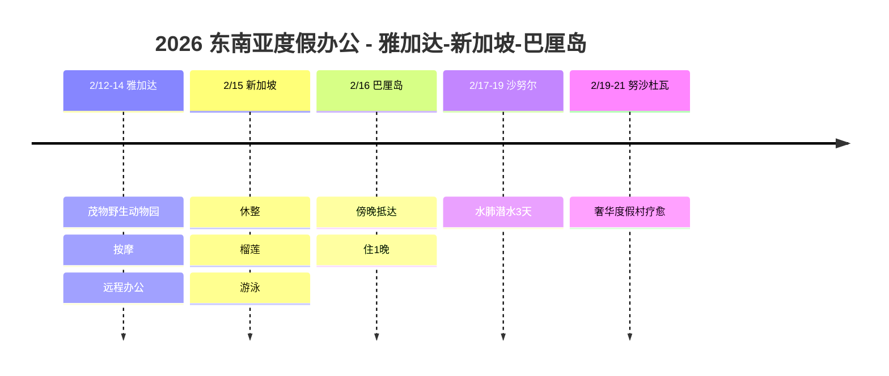

# 2026 东南亚度假办公：雅加达-新加坡-巴厘岛

在雅加达远程办公和游览野生动物园，在新加坡品尝榴莲并休整，在巴厘岛水肺潜水！东南亚三国度假办公游记。

## 📍 旅行概览

- **时间**: 2026年2月12日～21日（10天）
- **路线**: 雅加达（3晚） → 新加坡（1晚） → 巴厘岛（5晚）
- **主题**: 度假办公 + 野生动物园 + 水肺潜水 + 奢华疗愈

## 🗓️ 行程概要

| 日期 | 地区 | 住宿 | 主要行程 |
|------|------|------|----------|
| 2/12-14 | 雅加达 | - | **茂物野生动物园**、按摩、远程办公 |
| 2/15 | 新加坡 | - | 休整、**榴莲**、游泳 |
| 2/16 | 巴厘岛 | 机场诺富特 | 傍晚抵达，住1晚 |
| 2/17-19 | 沙努尔 | 沙努尔美居 | **水肺潜水3天** |
| 2/19-21 | 努沙杜瓦 | 巴厘岛索菲特 | **奢华度假村疗愈** |

## 行程时间线

## 🦁 亮点

### 印尼茂物野生动物园 (2/13)
- 印度尼西亚规模最大的野生动物园
- 驾车观察野生动物
- 2,500多种动物

### 雅加达度假办公 (2/12-14)
- 白天远程办公
- 晚上按摩和探索当地
- 用巴厘岛式按摩放松身心

### 新加坡中转 (2/15)
- 水果之王 🍈 挑战榴莲！
- 在酒店泳池休息
- 为下一段旅程休整

### 沙努尔水肺潜水 (2/17-19)
- 三天集中潜水
- 观察巴厘岛丰富的海洋生物
- 在沙努尔美居舒适休息

### 巴厘岛索菲特度假村 (2/19-21)
- 努沙杜瓦私人海滩
- 在奢华度假村中收尾疗愈
- 无边泳池和水疗

## 💡 小贴士

1. **茂物野生动物园**: 建议上午前往，动物更活跃
2. **榴莲**: 不能带入酒店！请在当地食用
3. **潜水**: 没有证书也可以体验潜水
4. **交通**: 雅加达→新加坡→巴厘岛乘坐飞机

---

度假办公 + 野生动物园 + 水肺潜水 + 奢华度假村！全面征服东南亚 🌴🦁🤿
