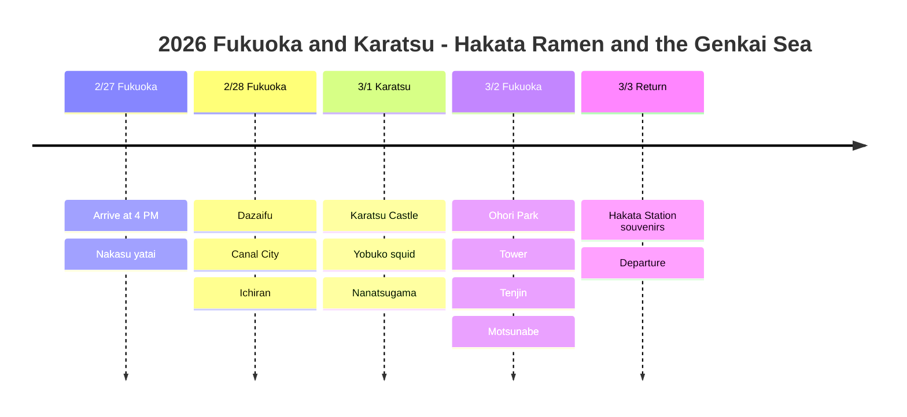

# 2026 Fukuoka and Karatsu: Hakata Ramen and the Genkai Sea

A Kyushu food trip enjoying the flavors of Fukuoka and the sea of Karatsu!

## 📍 Trip Overview

- **Dates**: February 27 to March 3, 2026 (5 days)
- **Route**: Fukuoka (2 nights) → Karatsu (1 night) → Fukuoka (1 night) → home
- **Theme**: Hakata ramen + yatai + Karatsu seafood + Dazaifu

## 🗓️ Itinerary Summary

| Date | Area | Lodging | Main Plans |
|------|------|------|----------|
| 2/27 | Fukuoka | Comfort Hakata | Arrive at 4 PM, **Nakasu yatai** |
| 2/28 | Fukuoka | Comfort Hakata | **Dazaifu**, Canal City, **Ichiran** |
| 3/1 | Karatsu | Mercure Karatsu | **Karatsu Castle**, **Yobuko squid**, Nanatsugama |
| 3/2 | Fukuoka | Comfort Hakata | Ohori Park, tower, Tenjin, **motsunabe** |
| 3/3 | Return home | - | Hakata Station souvenirs, departure |

## Itinerary Timeline

## 🍜 Highlights

### Nakasu Yatai (2/27)
- Fukuoka's famous food-stall street
- Ramen, oden and yakitori shoulder to shoulder with locals
- The Naka River riverside atmosphere is the best!

### Dazaifu Tenmangu (2/28)
- Shrine dedicated to Sugawara no Michizane, the god of learning
- Umegae mochi (plum-blossom rice cake) along the approach is a must!
- Visit the Starbucks designed by Kengo Kuma

### Ichiran Ramen Main Branch (2/28)
- Fukuoka is the home of Ichiran!
- The taste of original tonkotsu ramen
- Focus on your noodles in a partitioned booth

### Karatsu and Yobuko (3/1)
- 🏯 View of the Genkai Sea from Karatsu Castle
- 🦑 Live squid sashimi at the Yobuko Morning Market
- 🚢 Nanatsugama Caves boat tour

### Downtown Fukuoka (3/2)
- Lakeside walk at Ohori Park
- Fukuoka Tower observation deck
- Shopping in the Tenjin underground mall
- Finish with motsunabe!

## 💡 Tips

1. **Yatai**: Best after 7 PM on weekdays; very crowded on weekends
2. **Yobuko squid**: Visit around lunchtime; the morning market atmosphere is the best
3. **Airport access**: 5 minutes by subway from Hakata Station! Very close to downtown
4. **Souvenirs**: Buy Hakata Toorimon and mentaiko at the station rather than the airport

---

Ramen, squid, yatai! Fukuoka is truly a foodie paradise 🍜🦑
