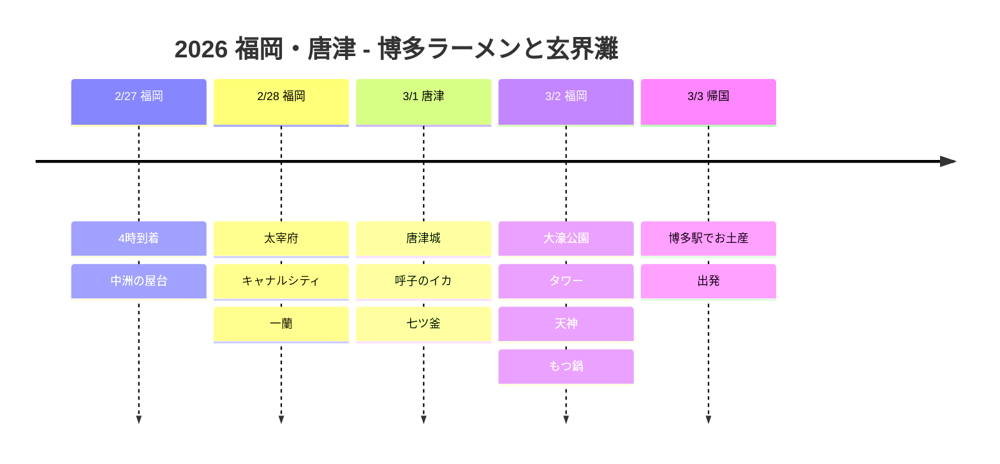

# 2026 福岡・唐津：博多ラーメンと玄界灘

福岡の味と唐津の海を楽しむ九州グルメ旅！

## 📍 旅行概要

- **期間**: 2026年2月27日〜3月3日（5日間）
- **ルート**: 福岡（2泊）→ 唐津（1泊）→ 福岡（1泊）→ 帰国
- **テーマ**: 博多ラーメン + 屋台 + 唐津の海の幸 + 太宰府

## 🗓️ 旅程の概要

| 日付 | エリア | 宿泊 | 主なスケジュール |
|------|------|------|----------|
| 2/27 | 福岡 | コンフォート博多 | 4時到着、**中洲の屋台** |
| 2/28 | 福岡 | コンフォート博多 | **太宰府**、キャナルシティ、**一蘭** |
| 3/1 | 唐津 | メルキュール唐津 | **唐津城**、**呼子のイカ**、七ツ釜 |
| 3/2 | 福岡 | コンフォート博多 | 大濠公園、タワー、天神、**もつ鍋** |
| 3/3 | 帰国 | - | 博多駅でお土産、出発 |

## 旅程タイムライン

## 🍜 ハイライト

### 中洲の屋台 (2/27)
- 福岡名物の屋台街
- 地元の人と肩を寄せ合って、ラーメン、おでん、焼き鳥
- 那珂川沿いの雰囲気は最高！

### 太宰府天満宮 (2/28)
- 学問の神・菅原道真公を祀る神社
- 参道の梅ヶ枝餅は必食！
- 隈研吾設計のスターバックスに立ち寄る

### 一蘭 本店 (2/28)
- 福岡が一蘭の本店！
- 元祖とんこつラーメンの味
- 仕切り席で麺に集中して味わう

### 唐津＆呼子 (3/1)
- 🏯 唐津城から玄界灘を一望
- 🦑 呼子朝市で生きたイカの刺身
- 🚢 七ツ釜の洞窟遊覧船

### 福岡市内 (3/2)
- 大濠公園の湖畔散歩
- 福岡タワーの展望台
- 天神地下街でショッピング
- もつ鍋で締めくくり！

## 💡 ヒント

1. **屋台**: 平日の夜7時以降がおすすめ、週末はとても混雑
2. **呼子のイカ**: 昼に訪れるのがおすすめ、午前の市場の雰囲気が最高
3. **空港へのアクセス**: 博多駅から地下鉄で5分！市内にとても近い
4. **お土産**: 博多通りもん、明太子は空港より駅で購入

---

ラーメン、イカ、屋台！福岡はやっぱりグルメ天国 🍜🦑
