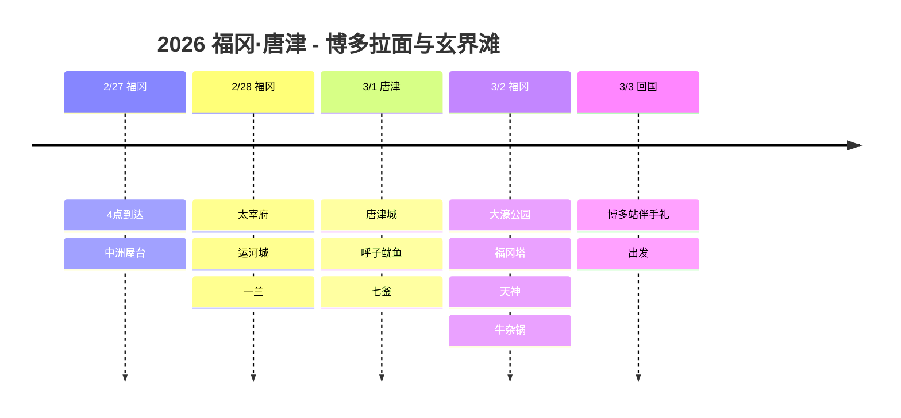

# 2026 福冈·唐津：博多拉面与玄界滩

享受福冈的美味与唐津的大海的九州美食之旅！

## 📍 旅行概览

- **时间**: 2026年2月27日～3月3日（5天）
- **路线**: 福冈（2晚）→ 唐津（1晚）→ 福冈（1晚）→ 回国
- **主题**: 博多拉面 + 屋台 + 唐津海鲜 + 太宰府

## 🗓️ 行程概要

| 日期 | 地区 | 住宿 | 主要行程 |
|------|------|------|----------|
| 2/27 | 福冈 | 舒适博多 | 4点到达，**中洲屋台** |
| 2/28 | 福冈 | 舒适博多 | **太宰府**、运河城、**一兰** |
| 3/1 | 唐津 | 美居唐津 | **唐津城**、**呼子鱿鱼**、七釜 |
| 3/2 | 福冈 | 舒适博多 | 大濠公园、福冈塔、天神、**牛杂锅** |
| 3/3 | 回国 | - | 博多站买伴手礼，出发 |

## 行程时间线

## 🍜 亮点

### 中洲屋台 (2/27)
- 福冈名物屋台街
- 和当地人肩并肩，享用拉面、关东煮、烤鸡肉串
- 那珂川畔的氛围一流！

### 太宰府天满宫 (2/28)
- 供奉学问之神菅原道真的神社
- 参道上的梅枝饼必吃！
- 造访隈研吾设计的星巴克

### 一兰拉面 本店 (2/28)
- 福冈就是一兰的本店所在！
- 元祖豚骨拉面的味道
- 在隔板座位上专心品尝面条

### 唐津和呼子 (3/1)
- 🏯 在唐津城眺望玄界滩
- 🦑 在呼子早市品尝现捞活鱿鱼刺身
- 🚢 七釜洞穴游船

### 福冈市区 (3/2)
- 大濠公园湖畔漫步
- 福冈塔观景台
- 天神地下街购物
- 以牛杂锅收尾！

## 💡 小贴士

1. **屋台**: 推荐工作日晚上7点以后去，周末非常拥挤
2. **呼子鱿鱼**: 建议中午前往，上午的市场氛围最棒
3. **机场交通**: 从博多站坐地铁5分钟！离市区非常近
4. **伴手礼**: 博多通りもん、明太子建议在车站买，而不是机场

---

拉面、鱿鱼、屋台！福冈果然是吃货天堂 🍜🦑
