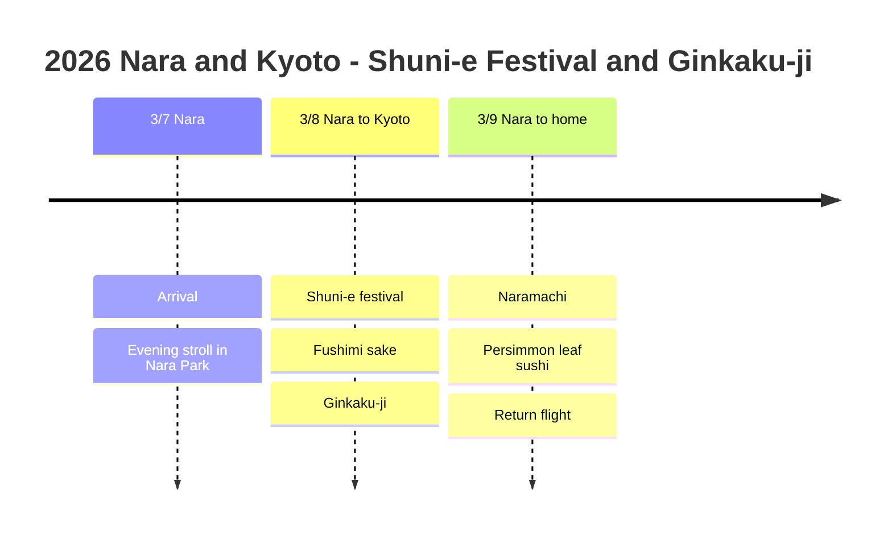

# 2026 Nara and Kyoto: Shuni-e Festival and Ginkaku-ji

Join the Shuni-e festival that announces spring in Nara, then enjoy sake and Ginkaku-ji in Kyoto!

## 📍 Trip Overview

- **Dates**: March 7 to 9, 2026 (3 days)
- **Route**: KIX in → Nara (2 nights) → Kyoto day trip → KIX out
- **Theme**: Shuni-e festival + sake tour + Ginkaku-ji

## 🗓️ Itinerary Summary

| Date | Area | Hotel | Main plans |
|------|------|------|----------|
| 3/7 | Nara | Novotel Nara | Arrival, evening stroll in Nara Park |
| 3/8 | Nara→Kyoto | Novotel Nara | **Shuni-e festival**, **Fushimi sake**, **Ginkaku-ji** |
| 3/9 | Nara→Home | - | Naramachi, persimmon leaf sushi, return flight |

## Itinerary Timeline

## 🔥 Highlights

### Shuni-e Festival (3/8)
- A 1,200-year-old spring festival held at **Todai-ji's Nigatsu-do**
- A spectacular scene of monks running across the veranda with giant torches (Otaimatsu)
- Held every year from March 1 to 14, starting around 7 pm
- It is said that spring comes to Kansai once the ceremony ends

### Fushimi Sake Tour (3/8)
- The Fushimi sake brewery district in southern Kyoto
- Free tastings at the Gekkeikan Okura Sake Museum
- Tours of famous breweries such as Kikumasamune
- 🍶 Buy bottles of sake to take home!

### Ginkaku-ji (3/8)
- The wabi-sabi aesthetic, in contrast to Kinkaku-ji
- The Ginshadan sand garden is impressive
- A walk along the Philosopher's Path is recommended

### Naramachi and Persimmon Leaf Sushi (3/9)
- Stroll the traditional machiya alleys
- Try Nara's famous kakinoha-zushi (persimmon leaf sushi)

## 💡 Tips

1. **Shuni-e**: Otaimatsu starts around 7 pm, so arrive early to get a spot
2. **Getting to Kyoto**: The JR Miyakoji Rapid takes about 45 minutes from Nara to Kyoto
3. **Fushimi**: It lies between Nara and Kyoto, so visiting on the way back is recommended
4. **Buying sake**: Bringing sake into Korea is duty-free up to 1 L per person

---

Spring's fire, fragrant sake and tranquil Ginkaku-ji! 🔥🍶⛩️
