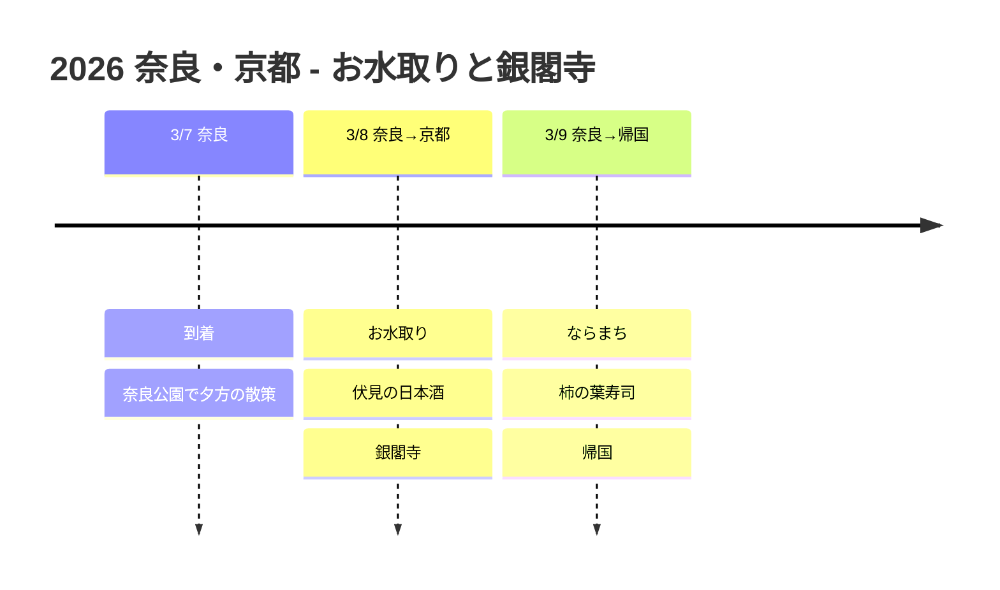

# 2026 奈良・京都: お水取りと銀閣寺

奈良の春を告げるお水取りに参加し、京都で日本酒と銀閣寺を満喫する旅です!

## 📍 旅行の概要

- **期間**: 2026年3月7日 ~ 9日 (3日間)
- **ルート**: KIX IN → 奈良(2泊) → 京都日帰り → KIX OUT
- **テーマ**: お水取り + 酒蔵めぐり + 銀閣寺

## 🗓️ 旅程の概要

| 日付 | エリア | 宿 | 主な日程 |
|------|------|------|----------|
| 3/7 | 奈良 | ノボテル奈良 | 到着、奈良公園で夕方の散策 |
| 3/8 | 奈良→京都 | ノボテル奈良 | **お水取り**、**伏見の日本酒**、**銀閣寺** |
| 3/9 | 奈良→帰国 | - | ならまち、柿の葉寿司、帰国 |

## 旅程タイムライン

## 🔥 ハイライト

### お水取り (3/8)
- **東大寺二月堂**で行われる、1,200年の伝統を持つ春迎えの行事
- 巨大な松明(お松明)を持って舞台を駆け抜ける壮観
- 毎年3月1日~14日に開催、夜7時ごろに開始
- これが終わると関西に春が来るといわれる

### 伏見の酒蔵めぐり (3/8)
- 京都南部の伏見酒蔵地区
- 月桂冠大倉記念館で無料試飲
- 菊正宗などの有名な酒蔵を見学
- 🍶 日本酒を買ってお土産に!

### 銀閣寺 (3/8)
- 金閣寺と対照的な、わびさびの美学
- 銀沙灘の砂の庭が印象的
- 哲学の道の散策がおすすめ

### ならまちと柿の葉寿司 (3/9)
- 伝統的な町家の路地を散策
- 奈良名物の柿の葉寿司を味わう

## 💡 ヒント

1. **お水取り**: お松明は夜7時ごろに始まるので、早めに行って場所を確保
2. **京都への移動**: JRみやこ路快速で奈良→京都は約45分
3. **伏見**: 奈良↔京都の途中にあるので、帰り道に立ち寄るのがおすすめ
4. **日本酒の購入**: 韓国に持ち込む場合、1人1Lまで免税

---

春を告げる炎、香り高い日本酒、静かな銀閣寺! 🔥🍶⛩️
