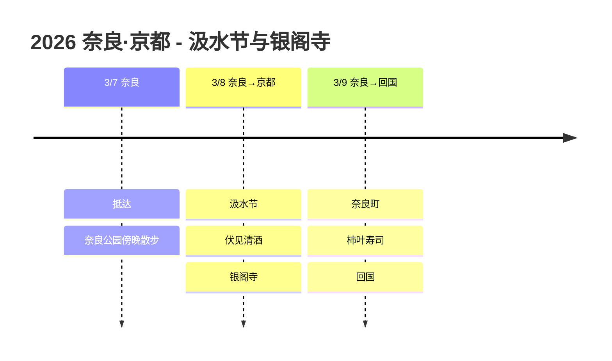

# 2026 奈良·京都: 汲水节与银阁寺

参加宣告奈良春天到来的汲水节，在京都尽情享受清酒与银阁寺的旅行!

## 📍 旅行概要

- **时间**: 2026年3月7日 ~ 9日 (3天)
- **路线**: KIX IN → 奈良(2晚) → 京都一日游 → KIX OUT
- **主题**: 汲水节 + 酒藏之旅 + 银阁寺

## 🗓️ 行程概要

| 日期 | 地区 | 住宿 | 主要行程 |
|------|------|------|----------|
| 3/7 | 奈良 | 奈良诺富特酒店 | 抵达，奈良公园傍晚散步 |
| 3/8 | 奈良→京都 | 奈良诺富特酒店 | **汲水节**、**伏见清酒**、**银阁寺** |
| 3/9 | 奈良→回国 | - | 奈良町、柿叶寿司、回国 |

## 行程时间线

## 🔥 亮点

### 汲水节 (3/8)
- 在**东大寺二月堂**举行的、有1200年传统的迎春节日
- 手持巨大火把(大松明)奔跑在舞台上的壮观景象
- 每年3月1日~14日举行，晚上7点左右开始
- 据说这个仪式结束后关西就迎来春天

### 伏见酒藏之旅 (3/8)
- 京都南部的伏见酒藏区
- 在月桂冠大仓纪念馆免费品尝
- 参观菊正宗等著名酒藏
- 🍶 买清酒带回去!

### 银阁寺 (3/8)
- 与金阁寺形成对比的侘寂之美
- 银沙滩沙庭令人印象深刻
- 推荐在哲学之道散步

### 奈良町与柿叶寿司 (3/9)
- 漫步传统町家小巷
- 品尝奈良名吃柿叶寿司

## 💡 小贴士

1. **汲水节**: 大松明晚上7点左右开始，要早点去占位置
2. **前往京都**: 乘JR都路快速，奈良到京都约45分钟
3. **伏见**: 位于奈良↔京都的途中，推荐回来的路上顺道参观
4. **购买清酒**: 带入韩国时每人限1L免税

---

宣告春天的火焰、芳香的清酒、宁静的银阁寺! 🔥🍶⛩️
