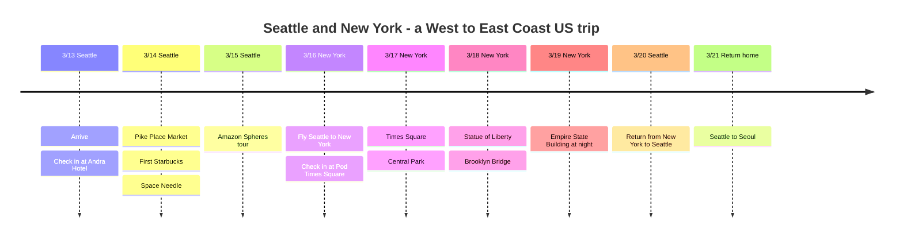

# Seattle & New York: A West-to-East Coast US Trip

A trip planned for March 2026, starting in Seattle on the US West Coast and crossing the country to New York on the East Coast!

## 📍 Trip Overview

- **Dates**: March 13-21, 2026 (9 days)
- **Route**: Seoul → Seattle (3 nights) → New York (3 nights) → Seattle (1 night) → Seoul
- **Theme**: Tech company tour + East Coast sightseeing

## 🗓️ Itinerary Summary

| Date | City | Highlights |
|------|------|----------|
| 3/13 | Seattle | Arrive, check in at Andra Hotel |
| 3/14 | Seattle | Pike Place Market, first Starbucks, Space Needle |
| 3/15 | Seattle | Amazon Spheres tour |
| 3/16 | New York | Fly Seattle → New York, check in at Pod Times Square |
| 3/17 | New York | Times Square, Central Park |
| 3/18 | New York | Statue of Liberty, Brooklyn Bridge |
| 3/19 | New York | Empire State Building at night |
| 3/20 | Seattle | Return from New York to Seattle |
| 3/21 | Return home | Seattle → Seoul |

## Itinerary Timeline

## ✈️ Flights

1. **Seoul → Seattle**: 3/13 nonstop
2. **Seattle → New York**: 3/16 domestic flight (about 5 hours)
3. **New York → Seattle**: 3/20 domestic flight
4. **Seattle → Seoul**: 3/21 nonstop

## 🏨 Accommodation

- **Seattle**: Andra Hotel (3/13-16, 3/20)
- **New York**: Pod Times Square (3/16-19, 3 nights)

---

The full US coast-to-coast experience! 🇺🇸
