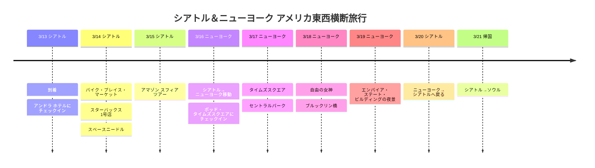

# シアトル＆ニューヨーク アメリカ東西横断旅行

2026年3月、アメリカ西部のシアトルから東部のニューヨークまで横断する旅行プラン！

## 📍 旅行概要

- **期間**: 2026年3月13日～21日（9日間）
- **ルート**: ソウル → シアトル（3泊） → ニューヨーク（3泊） → シアトル（1泊） → ソウル
- **テーマ**: テック企業ツアー + アメリカ東部観光

## 🗓️ 旅程の概要

| 日付 | 都市 | 主な予定 |
|------|------|----------|
| 3/13 | シアトル | 到着、アンドラ ホテルにチェックイン |
| 3/14 | シアトル | パイク・プレイス・マーケット、スターバックス1号店、スペースニードル |
| 3/15 | シアトル | アマゾン スフィア ツアー |
| 3/16 | ニューヨーク | シアトル→ニューヨーク移動、ポッド・タイムズスクエアにチェックイン |
| 3/17 | ニューヨーク | タイムズスクエア、セントラルパーク |
| 3/18 | ニューヨーク | 自由の女神、ブルックリン橋 |
| 3/19 | ニューヨーク | エンパイア・ステート・ビルディングの夜景 |
| 3/20 | シアトル | ニューヨーク→シアトルへ戻る |
| 3/21 | 帰国 | シアトル→ソウル |

## 旅程タイムライン

## ✈️ 航空便

1. **ソウル → シアトル**: 3/13 直行便
2. **シアトル → ニューヨーク**: 3/16 国内線（約5時間）
3. **ニューヨーク → シアトル**: 3/20 国内線
4. **シアトル → ソウル**: 3/21 直行便

## 🏨 宿泊

- **シアトル**: アンドラ ホテル（3/13-16、3/20）
- **ニューヨーク**: ポッド・タイムズスクエア（3/16-19、3泊）

---

アメリカ東西を完全制覇！ 🇺🇸
