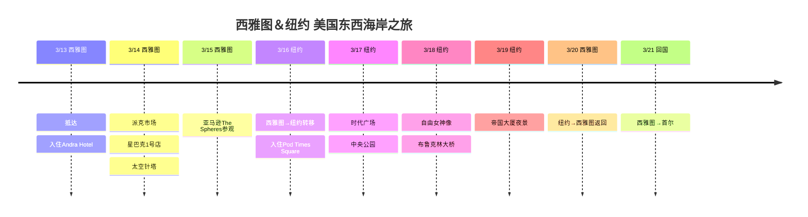

# 西雅图＆纽约 美国东西海岸之旅

2026年3月，从美国西部的西雅图出发，横跨至东部纽约的旅行计划！

## 📍 旅行概览

- **时间**: 2026年3月13日～21日（9天）
- **路线**: 首尔 → 西雅图（3晚） → 纽约（3晚） → 西雅图（1晚） → 首尔
- **主题**: 科技企业参观 + 美国东部观光

## 🗓️ 行程概要

| 日期 | 城市 | 主要行程 |
|------|------|----------|
| 3/13 | 西雅图 | 抵达，入住Andra Hotel |
| 3/14 | 西雅图 | 派克市场、星巴克1号店、太空针塔 |
| 3/15 | 西雅图 | 亚马逊The Spheres参观 |
| 3/16 | 纽约 | 西雅图→纽约转移，入住Pod Times Square |
| 3/17 | 纽约 | 时代广场、中央公园 |
| 3/18 | 纽约 | 自由女神像、布鲁克林大桥 |
| 3/19 | 纽约 | 帝国大厦夜景 |
| 3/20 | 西雅图 | 纽约→西雅图返回 |
| 3/21 | 回国 | 西雅图→首尔 |

## 行程时间线

## ✈️ 航班

1. **首尔 → 西雅图**: 3/13 直飞
2. **西雅图 → 纽约**: 3/16 国内航班（约5小时）
3. **纽约 → 西雅图**: 3/20 国内航班
4. **西雅图 → 首尔**: 3/21 直飞

## 🏨 住宿

- **西雅图**: Andra Hotel（3/13-16、3/20）
- **纽约**: Pod Times Square（3/16-19，3晚）

---

全面征服美国东西海岸！ 🇺🇸
