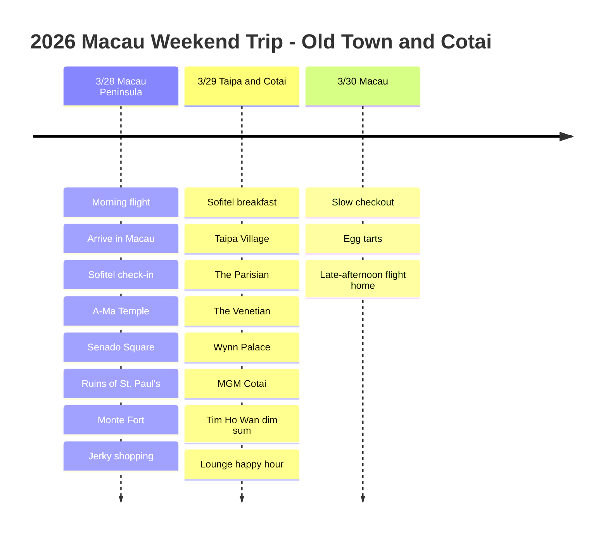

# 2026 Macau Weekend Trip: The Old Town and Cotai

A three-day, two-night trip to Macau at the end of March on a morning Air Macau flight. We stayed at Sofitel Macau at Ponte 16, spent the first day in the old town on the Macau Peninsula, and devoted the second day to Taipa and the Cotai resort district.

## Trip Overview

- Dates: March 28-30, 2026
- Flight: Air Macau
- Hotel: Sofitel Macau at Ponte 16
- Perks: ALL Accor Platinum breakfast and lounge happy hour
- Route: Incheon -> Macau -> Incheon

## Itinerary Summary

| Date | Area | Highlights |
|------|------|----------|
| 3/28 | Macau Peninsula | Morning flight, arrive in Macau, Sofitel check-in, A-Ma Temple, Senado Square, Ruins of St. Paul's, Monte Fort, jerky shopping |
| 3/29 | Taipa and Cotai | Sofitel breakfast, Taipa Village, The Parisian, The Venetian, Wynn Palace, MGM Cotai, Tim Ho Wan dim sum, lounge happy hour |
| 3/30 | Macau | Slow checkout, egg tarts, late-afternoon flight home |

## Itinerary Timeline

## 3/28 - Arriving in Macau on a Morning Flight

We left on a morning Air Macau flight and reached Macau around lunchtime. After heading from the airport to the Macau Peninsula and dropping our bags at Sofitel Macau at Ponte 16, we spent the first day strolling slowly around the old town near the hotel.

Sofitel is well placed for getting to Senado Square and the Ruins of St. Paul's, which makes it an efficient base for a short three-day, two-night trip. With ALL Accor Platinum status we could use the breakfast and lounge happy hour, so it was also a comfortable place to rest between outings.

The first day's route was a walk across the Macau Peninsula, starting at A-Ma Temple and continuing to Senado Square, the Ruins of St. Paul's and Monte Fort. Portuguese-style paving patterns, old church ruins and narrow lanes make this stretch feel like Macau right away. Near Senado Square it is easy to fit in some light snack shopping, such as Koi Kei Bakery's jerky.

## 3/29 - Taipa and a Tour of the Cotai Resorts

The second day began with breakfast at Sofitel, then we moved on to Taipa Village. Taipa Village is pleasant to walk, with egg tarts and small shops, and it is close to the Cotai resort district, so it links easily into the route.

In the afternoon we toured the big resorts on the Cotai Strip: The Parisian Macao, The Venetian Macao, Wynn Palace and MGM Cotai. The fun of a Macau trip is how the low lanes of the old town give way to Cotai's giant resorts within a single day.

For the meal we ate dim sum at Tim Ho Wan. Baked char siu buns and har gow are easy to share among several dishes, and returning to the Sofitel lounge happy hour afterward wrapped up the day without overdoing it.

## 3/30 - Egg Tarts and a Late-Afternoon Flight Home

With a late-afternoon flight on the last day, there was no need to rush the morning. We took breakfast and checkout at an easy pace, picked up the remaining snacks and egg tarts, and then headed to Macau International Airport.

Fitting the old town, Taipa and Cotai into three days and two nights gave a quick look at the city's contrasts. Old streets, big resorts, dim sum and egg tarts made it a short but packed weekend trip.
