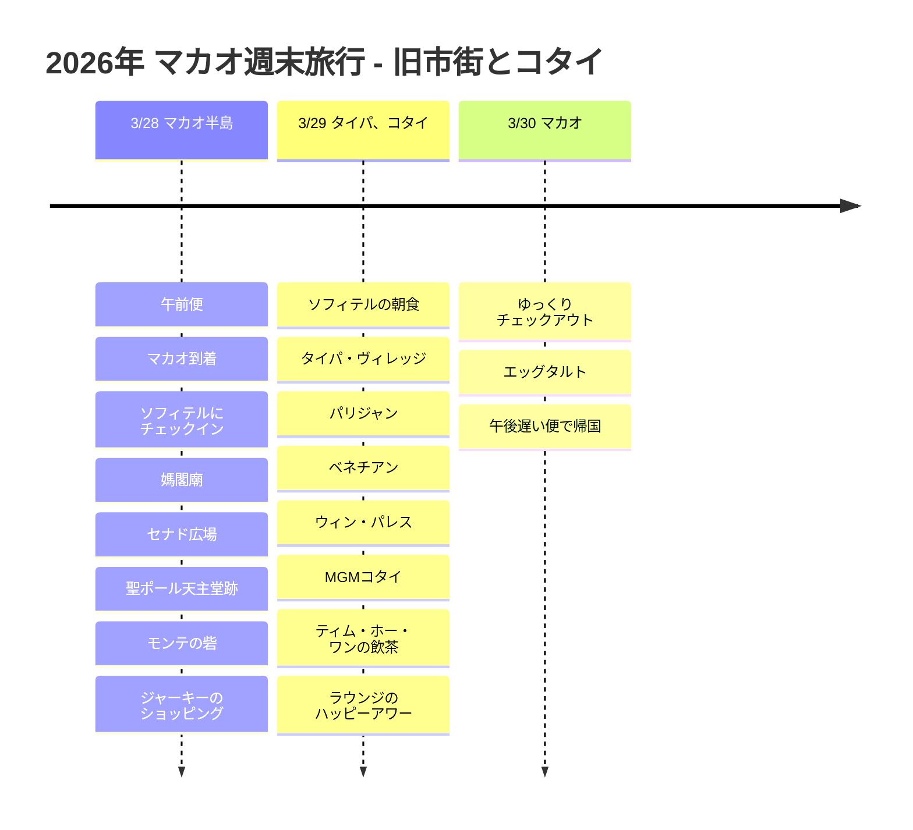

# 2026年 マカオ週末旅行:旧市街とコタイ

3月末、エアマカオの午前便で出発した2泊3日のマカオ旅行。宿はソフィテル・マカオ・アット・ポンテ16にして、初日はマカオ半島の旧市街、2日目はタイパとコタイのリゾートエリアを巡る流れにしました。

## 旅行概要

- 期間: 2026年3月28日 ~ 30日
- 航空: エアマカオ
- 宿泊: ソフィテル・マカオ・アット・ポンテ16
- 特典: アコー・プラチナの朝食とラウンジのハッピーアワー
- ルート: 仁川 -> マカオ -> 仁川

## 旅程の概要

| 日付 | エリア | 主な予定 |
|------|------|----------|
| 3/28 | マカオ半島 | 午前便、マカオ到着、ソフィテルにチェックイン、媽閣廟、セナド広場、聖ポール天主堂跡、モンテの砦、ジャーキーのショッピング |
| 3/29 | タイパ、コタイ | ソフィテルの朝食、タイパ・ヴィレッジ、パリジャン、ベネチアン、ウィン・パレス、MGMコタイ、ティム・ホー・ワンの飲茶、ラウンジのハッピーアワー |
| 3/30 | マカオ | ゆっくりチェックアウト、エッグタルト、午後遅い便で帰国 |

## 旅程タイムライン

## 3/28 - 午前便でマカオ到着

エアマカオの午前便で出発し、お昼ごろにマカオへ到着する日程。空港からマカオ半島側へ移動してソフィテル・マカオ・アット・ポンテ16に荷物を預け、初日はホテル周辺の旧市街を中心にのんびり歩きました。

ソフィテルはセナド広場や聖ポール天主堂跡へ移動しやすい立地なので、短い2泊3日の旅程では効率のよい拠点になります。アコー・プラチナ特典で朝食とラウンジのハッピーアワーを利用できるため、旅程の合間に休むのにも便利な宿でした。

初日のコースは媽閣廟から始まり、セナド広場、聖ポール天主堂跡、モンテの砦へとつながるマカオ半島の散策。ポルトガル風の床の模様や古い教会跡、細い路地が続き、マカオに来たという実感がすぐに湧く区間です。セナド広場の近くでは、鉅記のジャーキーのようなおやつのショッピングも気軽に組み込めます。

## 3/29 - タイパとコタイのリゾート巡り

2日目はソフィテルの朝食で始まり、タイパ・ヴィレッジへ移動しました。タイパ・ヴィレッジはエッグタルトや小さなお店をのぞきながら歩くのにぴったりで、コタイのリゾートエリアにも近く、動線をつなげやすい場所です。

午後はパリジャン・マカオ、ベネチアン・マカオ、ウィン・パレス、MGMコタイを回り、コタイ・ストリップの大型リゾートを見て歩きました。旧市街の低い路地と、コタイの巨大なリゾートが1日のうちにがらりと入れ替わるのが、マカオ旅行の面白さです。

食事はティム・ホー・ワンで飲茶をいただく流れにしました。焼きチャーシューバオや海老餃子のように、いろいろなメニューをシェアしやすく、その後ソフィテルのラウンジ・ハッピーアワーに戻れば、1日の旅程が無理なく締めくくれます。

## 3/30 - エッグタルトと午後遅い便での帰国

最終日は午後遅い便なので、朝を急ぐ必要のない日程。朝食とチェックアウトをゆっくり済ませ、残りのおやつのショッピングやエッグタルトを楽しんだあと、マカオ国際空港へ移動しました。

2泊3日の中に旧市街、タイパ、コタイをすべて入れた旅程なので、街の対比を手早く味わえました。古い街並みと大型リゾート、飲茶とエッグタルトまで、短いながらも密度の濃い週末旅行でした。
