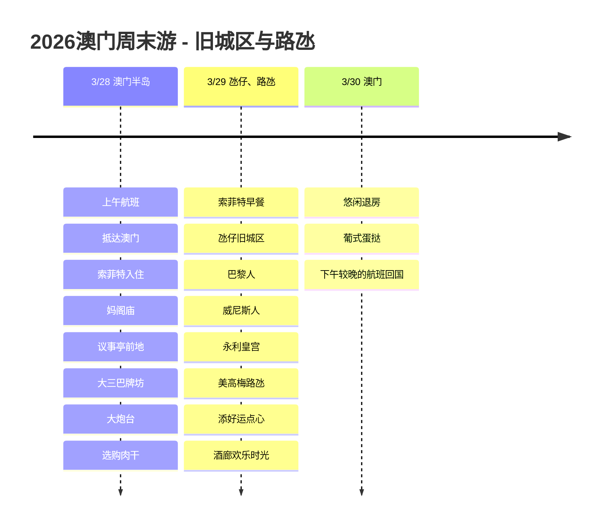

# 2026澳门周末游:旧城区与路氹

3月底,搭乘澳门航空上午航班出发的3天2晚澳门之旅。住宿定在澳门十六浦索菲特大酒店,第一天游览澳门半岛旧城区,第二天游览氹仔和路氹度假区。

## 旅行概况

- 时间: 2026年3月28日 ~ 30日
- 航空: 澳门航空
- 住宿: 澳门十六浦索菲特大酒店
- 福利: 雅高铂金会员早餐和酒廊欢乐时光
- 路线: 仁川 -> 澳门 -> 仁川

## 行程概要

| 日期 | 地区 | 主要行程 |
|------|------|----------|
| 3/28 | 澳门半岛 | 上午航班、抵达澳门、索菲特入住、妈阁庙、议事亭前地、大三巴牌坊、大炮台、选购肉干 |
| 3/29 | 氹仔、路氹 | 索菲特早餐、氹仔旧城区、巴黎人、威尼斯人、永利皇宫、美高梅(路氹)、添好运点心、酒廊欢乐时光 |
| 3/30 | 澳门 | 悠闲退房、葡式蛋挞、下午较晚的航班回国 |

## 行程时间线

## 3/28 - 搭上午航班抵达澳门

搭乘澳门航空上午航班出发,中午前后抵达澳门。从机场前往澳门半岛一侧,在澳门十六浦索菲特大酒店寄存行李后,第一天以酒店周边的旧城区为中心慢慢逛。

索菲特的位置便于前往议事亭前地和大三巴牌坊,对于短短的3天2晚行程来说是个高效的据点。凭雅高铂金会员福利可以享用早餐和酒廊欢乐时光,在行程中途休息也很不错。

第一天的路线从妈阁庙出发,经议事亭前地、大三巴牌坊,再到大炮台,是一段澳门半岛的漫步。葡式的地面图案、古老的教堂遗址和狭窄的小巷接连出现,让人立刻有了身在澳门的感觉。在议事亭前地附近,还可以顺便轻松选购钜记饼家肉干之类的零食。

## 3/29 - 氹仔与路氹度假村之旅

第二天从索菲特早餐开始,前往氹仔旧城区。氹仔旧城区适合边逛葡式蛋挞和各种小店边散步,而且靠近路氹度假区,路线很容易衔接。

下午游览了澳门巴黎人、澳门威尼斯人、永利皇宫、澳门美高梅(路氹),参观路氹金光大道上的大型度假村。旧城区低矮的小巷与路氹巨大的度假村在一天之内迅速切换,正是澳门之旅的乐趣所在。

午餐安排在添好运吃点心。酥皮焗叉烧包和虾饺等菜品很适合多人分享,之后回到索菲特酒廊享受欢乐时光,一天的行程便不会过于紧凑地收尾。

## 3/30 - 葡式蛋挞与下午返程

最后一天的航班在下午较晚的时间,所以早晨不必匆忙。悠闲地吃完早餐、办理退房,买完剩下的零食或吃过葡式蛋挞后,前往澳门国际机场。

3天2晚的行程里把旧城区、氹仔、路氹全都安排了进去,能快速感受这座城市的反差。从老街到大型度假村,再到点心和葡式蛋挞,是一次短暂却内容紧凑的周末旅行。
