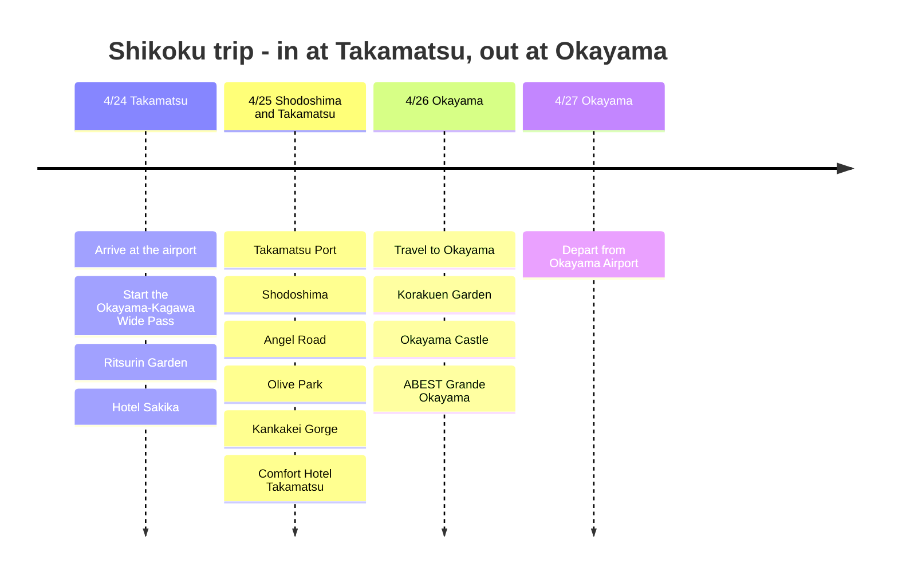

# Shikoku Trip: In at Takamatsu, Out at Okayama

A 4-day, 3-night itinerary in late April, flying into Takamatsu and out of Okayama. The key was buying the Okayama-Kagawa Wide Pass and linking Takamatsu with Shodoshima.

## Trip Overview

- Dates: April 24-27, 2026
- Route: Arrive Takamatsu → Shodoshima → Depart Okayama
- Pass: Okayama-Kagawa Wide Pass
- Hotels: Hotel Sakika, Comfort Hotel Takamatsu, ABEST Grande Okayama

## Itinerary Summary

| Date | Area | Highlights |
|------|------|----------|
| 4/24 | Takamatsu | Arrive at the airport, start the Okayama-Kagawa Wide Pass, Ritsurin Garden, Hotel Sakika |
| 4/25 | Shodoshima / Takamatsu | Takamatsu Port, Shodoshima, Angel Road, Olive Park, Kankakei Gorge, Comfort Hotel Takamatsu |
| 4/26 | Okayama | Travel to Okayama, Korakuen Garden, Okayama Castle, ABEST Grande Okayama |
| 4/27 | Okayama | Depart from Okayama Airport |

## Itinerary Timeline

## 4/24 - Arriving in Takamatsu and Settling In

Flew into Takamatsu Airport and headed into the city. Since buying the Okayama-Kagawa Wide Pass was the point of this trip, the route was planned around Takamatsu Station and the port from day one.

Given travel fatigue, the first day was a light look around Takamatsu. Ritsurin Garden is the safest first stop in Takamatsu. The garden is large and the mountain backdrop is part of the view, so even on a short trip it feels like the Kagawa journey has begun.

## 4/25 - Shodoshima Day Trip

Shodoshima is the heart of this trip. The plan was to take the ferry from Takamatsu Port and arrive at Tonosho Port. Thanks to the Okayama-Kagawa Wide Pass, the ferry and local transport could be used as part of the trip itself.

On Shodoshima, the notes center on Angel Road, Olive Park and Kankakei Gorge. Angel Road is a sea path that opens when the tide is right, and Olive Park is a great place to see the island's signature olives and Mediterranean-style scenery. Kankakei is the mountain side of the island, which adds depth compared with a day that ends with only the sea and olives.

In the evening, returned to Takamatsu and stayed one night at Comfort Hotel Takamatsu. It was a full day that covered the port, the island, the mountains and the sea.

## 4/26 - Heading to Okayama

Moved from Takamatsu to Okayama, the last city of the trip, for a change of mood. In Okayama, Korakuen and Okayama Castle are best seen together. Korakuen is a spacious garden, and Okayama Castle's black exterior makes a good contrast when viewed alongside it.

The hotel was ABEST Grande Okayama. Since the next day's flight leaves from Okayama Airport, it felt natural to spend the last night in central Okayama, where getting around is easy.

## 4/27 - Departing from Okayama

On the last day, flew out of Okayama Airport. Arriving at Takamatsu, passing through Shodoshima and leaving from Okayama made good use of the Seto Inland Sea route.
