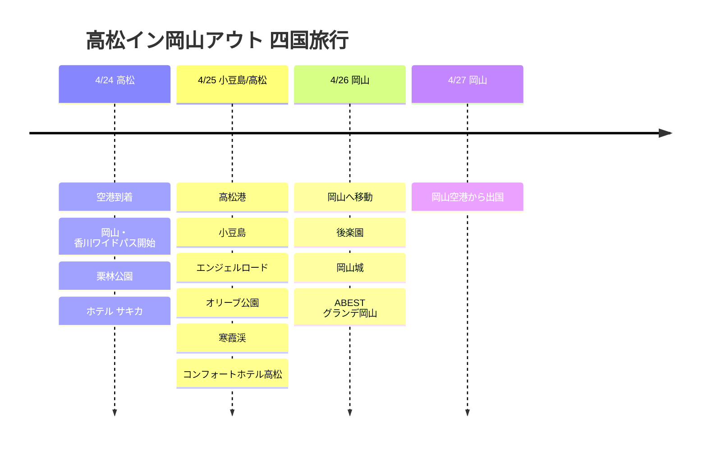

# 高松イン岡山アウト 四国旅行

4月末、高松から入って岡山から出る3泊4日の旅程。ポイントは、岡山・香川ワイドパスを購入して高松と小豆島をまとめて動いたことです。

## 旅行概要

- 期間：2026年4月24日～27日
- ルート：高松イン → 小豆島 → 岡山アウト
- パス：岡山・香川ワイドパス
- 宿泊：ホテル サキカ、コンフォートホテル高松、ABEST グランデ岡山

## 旅程の概要

| 日付 | エリア | 主な予定 |
|------|------|----------|
| 4/24 | 高松 | 空港到着、岡山・香川ワイドパス開始、栗林公園、ホテル サキカ |
| 4/25 | 小豆島/高松 | 高松港、小豆島、エンジェルロード、オリーブ公園、寒霞渓、コンフォートホテル高松 |
| 4/26 | 岡山 | 岡山へ移動、後楽園、岡山城、ABEST グランデ岡山 |
| 4/27 | 岡山 | 岡山空港から出国 |

## 旅程タイムライン

## 4/24 - 高松到着と市内で足慣らし

高松空港に到着して市内へ移動。今回の旅行は岡山・香川ワイドパスを購入したことがポイントなので、初日から高松駅と港を基準に動線を組みました。

初日は移動の疲れを考えて、高松市内を軽く見て回る構成。栗林公園は高松で最も安心できる最初のコースです。庭園の規模が大きく、山を背景にした景色まで一緒に楽しめるので、短い日程でも香川旅行が始まったという実感があります。

## 4/25 - 小豆島日帰り

この旅の中心は小豆島。高松港からフェリーで入り、土庄港に到着する流れで組みました。岡山・香川ワイドパスのおかげで、フェリーや地域内の移動も旅の一部として使えました。

小豆島ではエンジェルロード、オリーブ公園、寒霞渓を中心に記録しました。エンジェルロードは潮の満ち引きが合えば道が現れる海の道で、オリーブ公園は小豆島の象徴であるオリーブと地中海風の景色が楽しめる場所です。寒霞渓は島の山側の風景なので、海とオリーブだけで終わる日程より立体感が生まれます。

夜は高松に戻り、コンフォートホテル高松で1泊。1日のうちに港、島、山、海をすべて押さえた、かなり充実した日でした。

## 4/26 - 岡山へ移動

高松から岡山へ移り、旅の最後の街として雰囲気を変えました。岡山では後楽園と岡山城をセットで見るのがおすすめです。後楽園は広い庭園で、岡山城は黒い外観が特徴的なので、後楽園と合わせて見るとコントラストが際立ちます。

宿はABEST グランデ岡山。翌日に岡山空港から出発する日程なので、最後の夜は移動しやすい岡山市内にとるのが自然な構成です。

## 4/27 - 岡山アウト

最終日は岡山空港から出国。高松から入って小豆島を経由し、岡山から出る、瀬戸内海エリアの動線をうまく活かした旅程でした。
