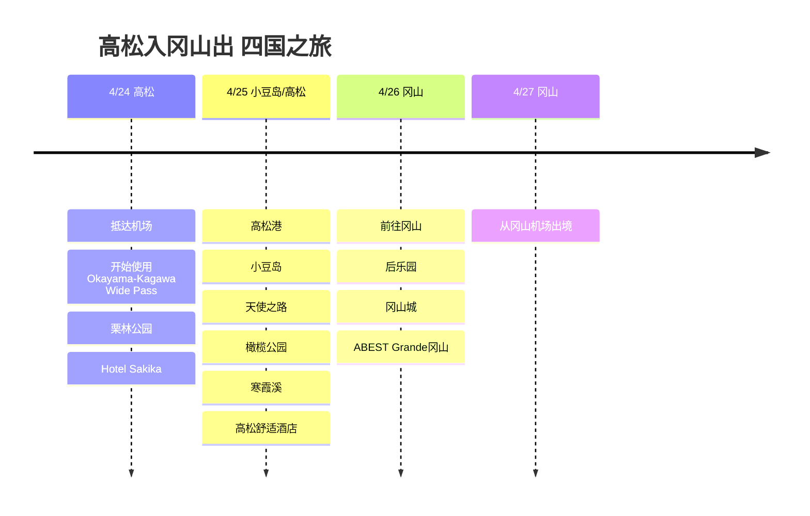

# 高松入冈山出 四国之旅

4月底，从高松入境、冈山出境的4天3晚行程。重点是购买了Okayama-Kagawa Wide Pass，将高松和小豆岛串联起来游览。

## 旅行概览

- 时间：2026年4月24日～27日
- 路线：高松入境 → 小豆岛 → 冈山出境
- 通票：Okayama-Kagawa Wide Pass
- 住宿：Hotel Sakika、高松舒适酒店、ABEST Grande冈山

## 行程概要

| 日期 | 地区 | 主要行程 |
|------|------|----------|
| 4/24 | 高松 | 抵达机场、开始使用Okayama-Kagawa Wide Pass、栗林公园、Hotel Sakika |
| 4/25 | 小豆岛/高松 | 高松港、小豆岛、天使之路、橄榄公园、寒霞溪、高松舒适酒店 |
| 4/26 | 冈山 | 前往冈山、后乐园、冈山城、ABEST Grande冈山 |
| 4/27 | 冈山 | 从冈山机场出境 |

## 行程时间线

## 4/24 - 抵达高松，适应市区

从高松机场入境后前往市区。这次旅行的重点是购买了Okayama-Kagawa Wide Pass，所以从第一天起就以高松站和港口为基准安排动线。

第一天考虑到旅途疲劳，安排为轻松游览高松市区。栗林公园是高松最稳妥的第一站。园区规模大，还能一并欣赏远山背景，即使行程很短，也能感受到香川之旅已经开始。

## 4/25 - 小豆岛一日游

这次旅行的核心是小豆岛。路线安排为从高松港乘渡轮出发，抵达土庄港。多亏购买了Okayama-Kagawa Wide Pass，渡轮和当地交通都可以当作旅行的一部分来使用。

在小豆岛主要记录了天使之路、橄榄公园和寒霞溪。天使之路是潮汐合适时就会出现道路的海中之路，橄榄公园则是欣赏小豆岛代表形象橄榄和地中海风光的好地方。寒霞溪是岛上山区一侧的风景，比起只看大海和橄榄的行程，更有层次感。

晚上回到高松，在高松舒适酒店住1晚。一天之内把港口、海岛、山和大海全都拍到了，是相当充实的一天。

## 4/26 - 前往冈山

从高松转到冈山，作为旅行的最后一座城市，换了一种氛围。在冈山适合把后乐园和冈山城放在一起游览。后乐园是宽阔的庭园，冈山城因黑色外观，与后乐园一同欣赏时对比鲜明。

住宿选在ABEST Grande冈山。因为第二天要从冈山机场出发，把最后一晚安排在交通方便的冈山市区比较自然。

## 4/27 - 冈山出境

最后一天从冈山机场出境。从高松入境、途经小豆岛、再从冈山出境，充分利用了濑户内海一带的动线。
