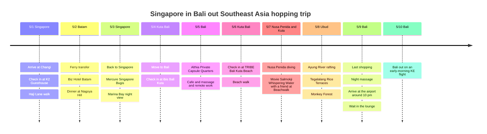

# Singapore In, Bali Out: A Southeast Asia Hopping Trip

A long hopping trip in early May that enters through Singapore and leaves from Bali by way of Batam. The itinerary contrasts a first half full of city transfers with a second half that slows down near Kuta Beach.

## Trip Overview

- Dates: May 1 to 10, 2026
- Route: Singapore → Batam → Singapore → Bali
- Lodging: K2 Guesthouse, Biz Hotel Batam, Mercure Singapore Bugis, ibis Bali Kuta, Althia Private Capsule Quarters, TRIBE Bali Kuta Beach
- Note: The last day had no lodging. After a massage on the night of 5/9, rested in the airport lounge and left on an early-morning KE flight on 5/10

## Itinerary Summary

| Date | Area | Lodging / transport |
|------|------|----------|
| 5/1 | Singapore | Arrive at Changi, check in at K2 Guesthouse, stroll Haji Lane |
| 5/2 | Batam | Ferry, Biz Hotel Batam, dinner at Nagoya Hill |
| 5/3 | Singapore | Back to Singapore, Mercure Singapore Bugis, Marina Bay night view |
| 5/4 | Kuta, Bali | Move to Bali, check in at ibis Bali Kuta |
| 5/5 | Bali | Althia Private Capsule Quarters, cafe / massage / remote work |
| 5/6 | Kuta, Bali | Check in at TRIBE Bali Kuta Beach, beach walk |
| 5/7 | Nusa Penida / Kuta | Nusa Penida diving, movie 'Salmokji: Whispering Water' with a friend at Beachwalk |
| 5/8 | Ubud | Ayung River rafting, Tegalalang Rice Terraces, Monkey Forest |
| 5/9 | Bali | Last shopping, night massage, arrive at the airport around 22:00, wait in the lounge |
| 5/10 | Bali | Bali out on an early-morning KE flight |

## Itinerary Timeline

## 5/1 - Arriving in Singapore

Fly into Changi Airport and spend the first day easing into the city. Drop your bags at K2 Guesthouse and walk around Bugis, Haji Lane and Arab Street, which is light for an arrival day. Finish dinner at a hawker center or a nearby local restaurant, as only Singapore can offer.

## 5/2 - By Ferry to Batam

The day of taking the ferry from HarbourFront across to Batam. We stayed one night at Biz Hotel Batam. Because the hotel is in the Nagoya area, it is easy to reach from Harbour Bay Ferry Terminal, and it is convenient to combine a shopping mall, a massage and dinner around Nagoya Hill.

## 5/3 - Back to Singapore and Bugis

After the short one-night stay in Batam, we returned to Singapore. After checking in at Mercure Singapore Bugis, it is a good day to take a slow look around Bugis and City Hall by day and continue to the Marina Bay night view at night.

## 5/4 - Moving to Bali

Finishing the Singapore leg, we moved on to Bali. After arriving at Ngurah Rai International Airport, the first lodging was ibis Bali Kuta. The airport transfer and check-in alone are enough for this day, so having dinner around Kuta and resting is about right.

## 5/5 - Capsule Stay and a Relaxed Day

One night at Althia Private Capsule Quarters. In the middle of a trip with a lot of moving, it is a good day to rest at a cafe, do a bit of remote work, or recover with a massage.

## 5/6 - Kuta Beach Base

The main base for the second half of the trip was TRIBE Bali Kuta Beach. With Kuta Beach right in front, it is easy to repeat morning walks, sunsets, the Beachwalk shopping mall, the hotel pool and cafes at a relaxed pace.

## 5/7 - Nusa Penida Diving and a Movie at Beachwalk

5/7 was not a rest day in Kuta but a day out at sea. We moved toward Sanur Harbor, took a boat and dived around Nusa Penida. Nusa Penida's water color and terrain are completely different from mainland Bali, making this the most activity-filled day of the trip.

After the dive, we returned to Kuta and also watched the movie 'Salmokji: Whispering Water' with a friend at Beachwalk. The flow of spending the day at sea and then stepping into a mall cinema stayed with us as a strangely realistic breather on the trip.

## 5/8 - Ubud Tour

5/8 was the day we went up to Ubud. We started with Ayung River rafting, saw the rice terrace scenery, and finally tied in the Monkey Forest. If the day before was the sea, this day was entirely inland Bali.

Ayung River rafting runs along the forest and river, so it was physically fun in a way unlike Kuta's beach atmosphere. The Tegalalang Rice Terraces are the green scene of Bali we had seen so often in photos, and the Monkey Forest was a course where we could also feel Ubud's distinctive temple and forest atmosphere.

## 5/9-5/10 - Massage, Lounge, Early-Morning KE Departure

The last day passed without lodging. After finishing last shopping and packing around Kuta, we spent the night time on a massage and loosened up.

After the massage we arrived at Ngurah Rai International Airport around 10 PM and waited in the lounge. Since we left Bali on an early-morning KE flight on 5/10, the real last night of the trip ended not in a hotel but in an airport lounge.
