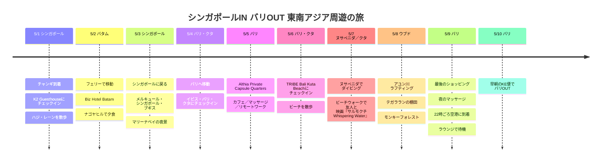

# シンガポールIN バリOUT 東南アジア周遊の旅

5月初め、シンガポールに入り、バタムを経てバリから出る長い周遊の旅。都市間の移動が多い前半と、クタ・ビーチの近くでペースを落とす後半が対照的な日程です。

## 旅行の概要

- 期間：2026年5月1日〜10日
- ルート：シンガポール → バタム → シンガポール → バリ
- 宿：K2 Guesthouse、Biz Hotel Batam、メルキュール・シンガポール・ブギス、イビス・バリ・クタ、Althia Private Capsule Quarters、TRIBE Bali Kuta Beach
- メモ：最終日は宿泊せず、5/9の夜にマッサージを受けたあと空港ラウンジで休み、5/10の早朝のKE便で出国

## 旅程の概要

| 日付 | エリア | 宿／移動 |
|------|------|----------|
| 5/1 | シンガポール | チャンギ到着、K2 Guesthouseにチェックイン、ハジ・レーンを散歩 |
| 5/2 | バタム | フェリーで移動、Biz Hotel Batam、ナゴヤヒルで夕食 |
| 5/3 | シンガポール | シンガポールに戻る、メルキュール・シンガポール・ブギス、マリーナベイの夜景 |
| 5/4 | バリ・クタ | バリへ移動、イビス・バリ・クタにチェックイン |
| 5/5 | バリ | Althia Private Capsule Quarters、カフェ／マッサージ／リモートワーク |
| 5/6 | バリ・クタ | TRIBE Bali Kuta Beachにチェックイン、ビーチを散歩 |
| 5/7 | ヌサペニダ／クタ | ヌサペニダでダイビング、ビーチウォークで友人と映画『サルモクチ Whispering Water』 |
| 5/8 | ウブド | アユン川ラフティング、テガラランの棚田、モンキーフォレスト |
| 5/9 | バリ | 最後のショッピング、夜のマッサージ、22時ごろ空港に到着、ラウンジで待機 |
| 5/10 | バリ | 早朝のKE便でバリOUT |

## 旅程タイムライン

## 5/1 - シンガポール到着

チャンギ空港から入り、初日はシンガポール市内に軽く慣れる日。K2 Guesthouseに荷物を置いて、ブギス、ハジ・レーン、アラブ・ストリート方面を歩けば、到着日にしては負担が少ない。夕食はシンガポールらしく、ホーカーセンターか近くのローカル食堂で締めくくり。

## 5/2 - フェリーでバタムへ

ハーバーフロントからフェリーに乗ってバタムへ渡る日。バタムではBiz Hotel Batamに1泊する。宿がナゴヤ地区にあるので、ハーバーベイ・フェリーターミナルから動きやすく、ナゴヤヒル周辺でショッピングモール、マッサージ、夕食をまとめやすい。

## 5/3 - シンガポールに戻ってブギスへ

短いバタム1泊を終えて、再びシンガポールに戻る。メルキュール・シンガポール・ブギスにチェックインしたあと、昼はブギスとシティホール方面をゆっくり見て、夜はマリーナベイの夜景まで足を延ばすのによい日だ。

## 5/4 - バリへ移動

シンガポールでの区間を終えて、バリへ移動。ングラ・ライ国際空港に到着したあとの最初の宿はイビス・バリ・クタ。この日は空港への移動とチェックインだけでも十分なので、クタ周辺で夕食をとって休む程度がよい。

## 5/5 - カプセル宿とゆるやかな1日

Althia Private Capsule Quartersで1泊。移動が多い日程の途中なので、カフェで休む、短くリモートワークをする、マッサージでコンディションを回復する日にするのがよい。

## 5/6 - クタ・ビーチの拠点

旅の後半のメインの拠点はTRIBE Bali Kuta Beach。クタ・ビーチがすぐ目の前なので、朝の散歩、夕日、ビーチウォーク・ショッピングモール、ホテルのプール、カフェをゆるく繰り返すのによい。

## 5/7 - ヌサペニダのダイビングとビーチウォークで映画

5/7はクタで休む日ではなく、海に出た日。サヌール港方面へ移動してボートに乗り、ヌサペニダ周辺でダイビングをした。ヌサペニダはバリ本島とは水の色も地形もガラッと違っていて、今回の旅でいちばんアクティビティらしい1日だった。

ダイビングのあとはクタに戻って、ビーチウォークで友人と映画『サルモクチ Whispering Water』も観た。海で1日を過ごしてからショッピングモールの映画館に入る流れが、妙に現実的な旅の句読点として心に残った。

## 5/8 - ウブドツアー

5/8はウブドへ上がった日。アユン川ラフティングで始めて、棚田の景色を眺め、最後にモンキーフォレストまでまとめた。前日が海だったとすれば、この日はまったくの内陸のバリだった。

アユン川ラフティングは森と川に沿って下るコースで、クタのビーチの雰囲気とは違って、体を動かす楽しさがあった。テガラランの棚田は写真でよく見るバリの緑の光景で、モンキーフォレストはウブドならではの寺院と森の雰囲気も一緒に感じられるコースだった。

## 5/9-5/10 - マッサージ、ラウンジ、早朝のKEで出国

最終日は宿泊なしで過ごす日程。クタ周辺で最後のショッピングと荷物の整理を終えたあと、夜はマッサージで時間を過ごして体をほぐした。

マッサージのあと、夜10時ごろにングラ・ライ国際空港に到着してラウンジで待機。5/10の早朝のKE便でバリを発つ流れなので、実際の旅の最後の夜はホテルではなく空港ラウンジで締めくくったことになる。
