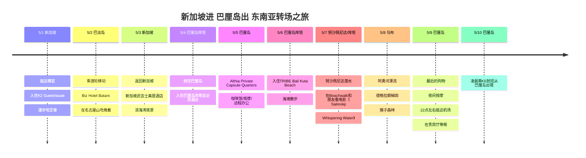

# 新加坡进 巴厘岛出 东南亚转场之旅

5月初，从新加坡入境，途经巴淡岛，再从巴厘岛出境的长途转场之旅。城市间移动较多的前半段，与在库塔海滩附近放慢节奏的后半段形成对比。

## 旅行概况

- 期间：2026年5月1日～10日
- 路线：新加坡 → 巴淡岛 → 新加坡 → 巴厘岛
- 住宿：K2 Guesthouse、Biz Hotel Batam、新加坡武吉士美居酒店、巴厘岛库塔宜必思酒店、Althia Private Capsule Quarters、TRIBE Bali Kuta Beach
- 备注：最后一天不住宿，5/9晚按摩后在机场贵宾厅休息，5/10凌晨乘KE航班出境

## 行程概要

| 日期 | 地区 | 住宿/移动 |
|------|------|----------|
| 5/1 | 新加坡 | 抵达樟宜，入住K2 Guesthouse，漫步哈芝巷 |
| 5/2 | 巴淡岛 | 乘渡轮移动，Biz Hotel Batam，在名古屋山吃晚餐 |
| 5/3 | 新加坡 | 返回新加坡，新加坡武吉士美居酒店，滨海湾夜景 |
| 5/4 | 巴厘岛库塔 | 前往巴厘岛，入住巴厘岛库塔宜必思酒店 |
| 5/5 | 巴厘岛 | Althia Private Capsule Quarters，咖啡馆/按摩/远程办公 |
| 5/6 | 巴厘岛库塔 | 入住TRIBE Bali Kuta Beach，海滩散步 |
| 5/7 | 努沙佩尼达/库塔 | 努沙佩尼达潜水，在Beachwalk和朋友看电影《Salmokji: Whispering Water》 |
| 5/8 | 乌布 | 阿勇河漂流，德格拉朗梯田，猴子森林 |
| 5/9 | 巴厘岛 | 最后的购物，夜间按摩，22点左右抵达机场，在贵宾厅等候 |
| 5/10 | 巴厘岛 | 凌晨乘KE航班从巴厘岛出境 |

## 行程时间线

## 5/1 - 抵达新加坡

从樟宜机场入境，第一天是在新加坡市区轻松适应的一天。把行李放在K2 Guesthouse，在武吉士、哈芝巷、阿拉伯街一带走走，对抵达日来说负担很小。晚餐就按新加坡的方式，在熟食中心或附近的当地餐馆收尾。

## 5/2 - 乘渡轮去巴淡岛

从港湾坊乘渡轮前往巴淡岛的一天。在巴淡岛住Biz Hotel Batam 1晚。住处在名古屋区，从海湾渡轮码头出发很方便，在名古屋山购物中心周边可以把购物中心、按摩和晚餐安排在一起。

## 5/3 - 回到新加坡，住武吉士

结束短短1晚的巴淡岛之行，再次回到新加坡。入住新加坡武吉士美居酒店后，白天慢慢逛武吉士和市政厅一带，晚上可以继续看滨海湾夜景，是很合适的一天。

## 5/4 - 前往巴厘岛

结束新加坡的行程，前往巴厘岛。抵达伍拉·赖国际机场后，第一个住处是巴厘岛库塔宜必思酒店。这一天光是前往机场和办理入住就已足够，在库塔周边吃个晚饭休息一下就好。

## 5/5 - 胶囊旅馆与悠闲的一天

在Althia Private Capsule Quarters住1晚。正处于移动频繁的行程中间，适合安排成在咖啡馆休息、短时间远程办公，或者用按摩恢复状态的一天。

## 5/6 - 库塔海滩据点

旅行后半段的主要据点是TRIBE Bali Kuta Beach。库塔海滩就在眼前，适合悠闲地反复安排早晨散步、日落、Beachwalk购物中心、酒店泳池和咖啡馆。

## 5/7 - 努沙佩尼达潜水与Beachwalk看电影

5/7不是在库塔休息的一天，而是出海的一天。前往沙努尔港一带，乘船在努沙佩尼达周边潜水。努沙佩尼达的水色和地形与巴厘岛本岛截然不同，是这次旅行中最像户外活动的一天。

潜水之后回到库塔，在Beachwalk和朋友看了电影《Salmokji: Whispering Water》。在海上度过一天后走进购物中心的电影院，这样的流程像是旅途中一个格外真实的逗号，留在了记忆里。

## 5/8 - 乌布一日游

5/8是前往乌布的一天。从阿勇河漂流开始，欣赏梯田风光，最后再逛猴子森林，串成了一整天。如果说前一天是海，这一天就是完完全全的内陆巴厘岛。

阿勇河漂流是沿着森林和河流顺流而下的路线，与库塔的海滩氛围不同，有活动身体的乐趣。德格拉朗梯田是在照片里常见的巴厘岛绿色景象，猴子森林则是能同时感受到乌布特有的寺庙和森林氛围的路线。

## 5/9-5/10 - 按摩、贵宾厅、凌晨乘KE出境

最后一天是不住宿的行程。在库塔周边完成最后的购物和整理行李之后，晚上用按摩打发时间、放松身体。

按摩后，晚上10点左右抵达伍拉·赖国际机场，在贵宾厅等候。因为是5/10凌晨乘KE航班离开巴厘岛，所以实际旅行的最后一晚，是在机场贵宾厅而不是酒店收尾的。
