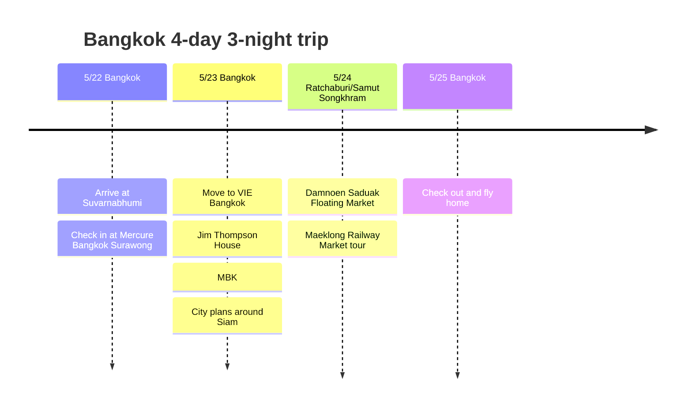

# Bangkok 4-Day, 3-Night Trip

A four-day, three-night round trip to Bangkok at the end of May. The first day starts lightly in Surawong, and after that the trip combines the city and day tours from a base at VIE Bangkok in Ratchathewi.

## Trip Overview

- Dates: May 22 to 25, 2026
- Route: Round trip to Bangkok
- Hotels: Mercure Bangkok Surawong for 1 night, VIE Bangkok for 2 nights
- Highlights: Damnoen Saduak Floating Market, Maeklong Railway Market, shopping in Siam

## Itinerary Summary

| Date | Area | Main plans |
|------|------|----------|
| 5/22 | Bangkok | Arrive at Suvarnabhumi, check in at Mercure Bangkok Surawong |
| 5/23 | Bangkok | Move to VIE Bangkok, Jim Thompson House, MBK, city plans around Siam |
| 5/24 | Ratchaburi/Samut Songkhram | Tour of Damnoen Saduak Floating Market and Maeklong Railway Market |
| 5/25 | Bangkok | Check out and fly home |

## Itinerary Timeline

## 5/22 - Starting in Surawong

The first night after arriving in Bangkok is at Mercure Bangkok Surawong. On a long travel day, rather than an overly tight schedule, it works better to eat lightly near the hotel and get in shape to start moving the next day.

## 5/23 - Move to VIE Bangkok

The second hotel is VIE Hotel Bangkok - MGallery. It is near Ratchathewi BTS, so it is easy to get to Siam, and it is a good location for mixing in shopping malls, massages and cafes. In Bangkok, a well-located hotel like this takes a good deal of the fatigue out of the itinerary.

After moving hotels, the day is set up as a loose look around Ratchathewi and Siam. See Jim Thompson House near VIE Bangkok first, then move on to MBK and Siam for shopping malls, cafes and meals. With the day trip the next day, this is a day that is closer to getting used to the city than to pushing hard.

## 5/24 - Damnoen Saduak Floating Market and Maeklong Railway Market

The day trip of this itinerary. Head southwest out of Bangkok to see Damnoen Saduak Floating Market first, then continue to Maeklong Railway Market.

At Damnoen Saduak, the signature scene is boats moving along the canal with vendors selling fruit, snacks and souvenirs from their boats. It has become a touristy market, so it is best to watch prices, but it definitely delivers the scenery of a Bangkok day trip.

Maeklong Railway Market is a place where a train passes through the middle of the market. Before the train arrives, vendors fold their awnings and tidy their goods, and once the train passes, the market spreads out again, which is the key sight. Because timing around the train schedule matters on the tour, a guided tour suits this day well.

## 5/25 - Return

On the last day, check out of VIE Bangkok and head to Suvarnabhumi Airport. For a four-day, three-night trip, it is a short but dense Bangkok itinerary that mixes two city hotels with one day tour.
