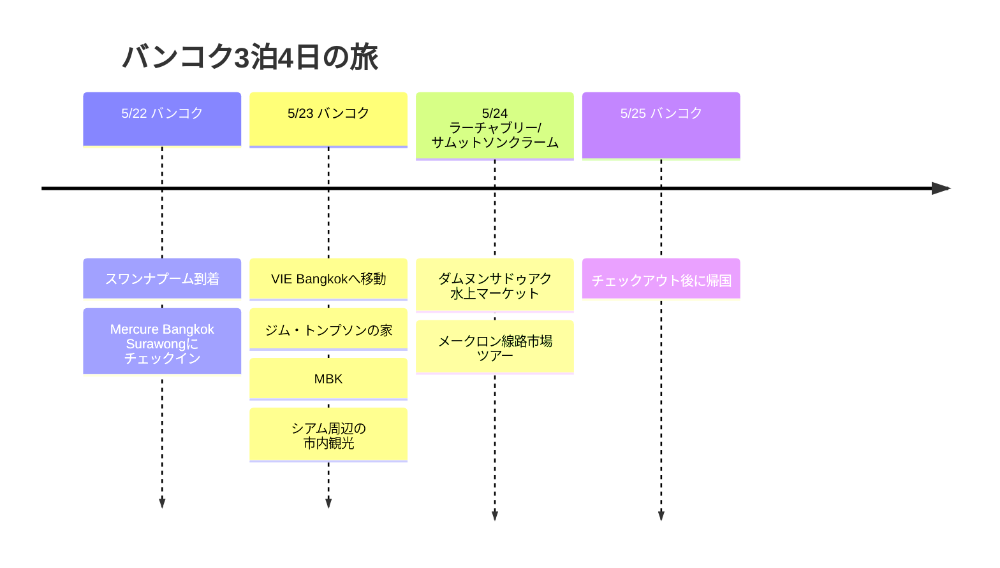

# バンコク3泊4日の旅

5月末に行く、バンコク往復の3泊4日の旅程。初日はスラウォンで軽くスタートし、その後はラーチャテーウィーにあるVIE Bangkokを拠点に、市内観光と近郊ツアーを組み合わせました。

## 旅行の概要

- 期間：2026年5月22日〜25日
- ルート：バンコク往復
- 宿泊：Mercure Bangkok Surawong 1泊、VIE Bangkok 2泊
- ハイライト：ダムヌンサドゥアク水上マーケット、メークロン線路市場、シアムでのショッピング

## 旅程の概要

| 日付 | エリア | 主な予定 |
|------|------|----------|
| 5/22 | バンコク | スワンナプーム到着、Mercure Bangkok Surawongにチェックイン |
| 5/23 | バンコク | VIE Bangkokへ移動、ジム・トンプソンの家、MBK、シアム周辺の市内観光 |
| 5/24 | ラーチャブリー/サムットソンクラーム | ダムヌンサドゥアク水上マーケット、メークロン線路市場ツアー |
| 5/25 | バンコク | チェックアウト後に帰国 |

## 旅程タイムライン

## 5/22 - スラウォンからスタート

バンコク到着後の1泊目はMercure Bangkok Surawong。移動の長い日は、詰め込みすぎずにホテルの周りで軽く食事をして、翌日から動きやすいようにコンディションを整えるのが合っています。

## 5/23 - VIE Bangkokへ移動

2軒目の宿はVIE Hotel Bangkok - MGallery。BTSラーチャテーウィー駅の近くなのでシアム方面へ移動しやすく、ショッピングモールやマッサージ、カフェを織り交ぜるのにちょうどいい立地です。バンコクでは、こうした立地のいいホテルが旅程の疲れをかなり減らしてくれます。

この日はホテルを移動した後、ラーチャテーウィーとシアム周辺をゆったり回る構成にしました。VIE Bangkok近くのジム・トンプソンの家を先に見て、その後MBKとシアムへ移り、ショッピングモール、カフェ、食事とつなげる流れです。翌日が近郊ツアーなので無理をせず、市内に慣れる感覚の一日。

## 5/24 - ダムヌンサドゥアク水上マーケット＆メークロン線路市場

今回の旅程の近郊ツアーの日。バンコクから南西へ向かい、まずダムヌンサドゥアク水上マーケットを見て、続いてメークロン線路市場へ移動するコースです。

ダムヌンサドゥアクは、運河の上を船が行き交い、船の上でフルーツやおやつ、お土産を売る光景が代名詞。観光地化した市場なので値段をよく見ながら動くほうがいいですが、バンコク近郊旅行らしい絵になる景色は間違いありません。

メークロン線路市場は、市場のど真ん中を列車が通る場所。列車が入ってくる前に店主たちが日よけをたたんで商品を片づけ、列車が通り過ぎるとまた市場が広がる光景が一番の見どころです。ツアーでは列車の時間に合わせて動くことが大切なので、この日はガイド付きツアーで行く構成が向いています。

## 5/25 - 帰国

最終日はVIE Bangkokをチェックアウトして、スワンナプーム国際空港へ移動。3泊4日としては、市内のホテル2軒と近郊ツアー1回を組み合わせた、短いながらも密度の濃いバンコク旅程です。
