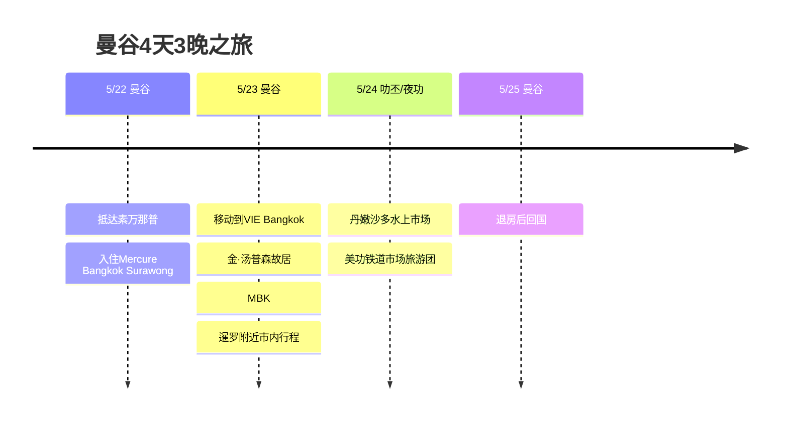

# 曼谷4天3晚之旅

5月底往返曼谷的4天3晚行程。第一天在素拉翁轻松开始，之后以拉差迪威的VIE Bangkok为大本营，把市内游览和近郊旅游团串在一起。

## 旅行概要

- 时间：2026年5月22日～25日
- 路线：曼谷往返
- 住宿：Mercure Bangkok Surawong 1晚，VIE Bangkok 2晚
- 亮点：丹嫩沙多水上市场、美功铁道市场、暹罗购物

## 行程概要

| 日期 | 地区 | 主要行程 |
|------|------|----------|
| 5/22 | 曼谷 | 抵达素万那普，入住Mercure Bangkok Surawong |
| 5/23 | 曼谷 | 移动到VIE Bangkok，金·汤普森故居、MBK、暹罗附近市内行程 |
| 5/24 | 叻丕/夜功 | 丹嫩沙多水上市场、美功铁道市场旅游团 |
| 5/25 | 曼谷 | 退房后回国 |

## 行程时间线

## 5/22 - 从素拉翁开始

抵达曼谷后的第一晚住在Mercure Bangkok Surawong。长途移动的日子，与其安排得太紧，不如在酒店周边简单吃点东西，把状态调整好，方便第二天开始行动，这样更合适。

## 5/23 - 移动到VIE Bangkok

第二家酒店是VIE Hotel Bangkok - MGallery。靠近BTS拉差迪威站，去暹罗很方便，也很适合穿插商场、按摩和咖啡馆。在曼谷，这样位置好的酒店能明显减轻行程的疲劳。

这一天安排为换酒店后，轻松游览拉差迪威和暹罗一带。先参观VIE Bangkok附近的金·汤普森故居，然后前往MBK和暹罗，接着逛商场、喝咖啡、用餐。第二天是近郊旅游团，所以不勉强，更像是适应市区的一天。

## 5/24 - 丹嫩沙多水上市场 & 美功铁道市场

这次行程的近郊旅游日。从曼谷向西南出发，先看丹嫩沙多水上市场，再前往美功铁道市场。

丹嫩沙多最具代表性的画面，是运河上船只往来，船上售卖水果、小吃和纪念品。由于已经是商业化的景区市场，最好留意价格，但作为曼谷近郊游，画面感绝对到位。

美功铁道市场是火车从市场正中间驶过的地方。火车进站前，摊主们会收起遮阳棚、整理商品，火车一过，市场又重新铺开，这一幕就是最大看点。旅游团要配合火车时间行动很重要，所以这一天以跟团方式前往比较合适。

## 5/25 - 回国

最后一天从VIE Bangkok退房，前往素万那普国际机场。作为4天3晚的行程，穿插了市内2家酒店和1次近郊旅游团，虽短但很充实的曼谷之旅。
