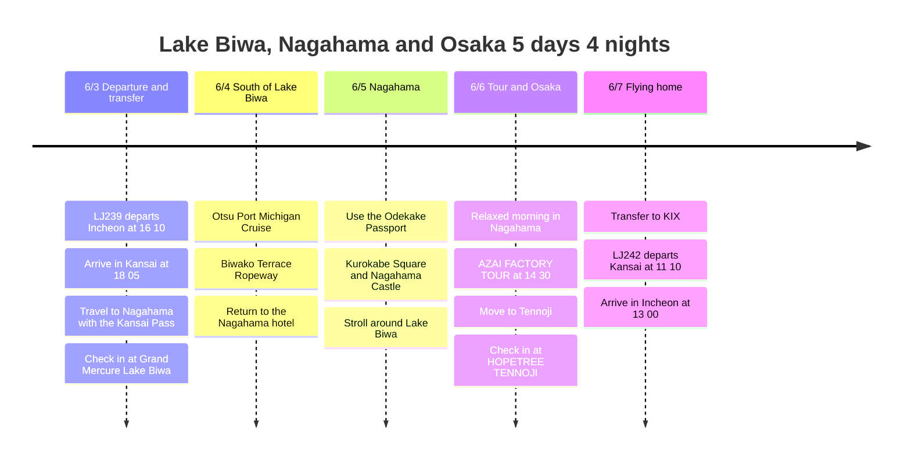

# Lake Biwa, Nagahama and Osaka: A 5-Day, 4-Night Trip Plan

In early June, fly from Incheon to Kansai, spend 3 nights based in Nagahama on the north shore of Lake Biwa, and finish with the last night in Tennoji, Osaka.

## Trip Overview

- Dates: June 3 to June 7, 2026
- Flights: Jin Air LJ239, LJ242
- Lodging: 3 nights at Grand Mercure Lake Biwa Resort & Spa, 1 night at HOPETREE TENNOJI
- Transport/passes: Kansai Pass 4-day ticket, Nagahama Odekake Passport
- Key plans: Otsu Port Michigan Cruise, Biwako Terrace Ropeway, AZAI FACTORY TOUR

## Itinerary Summary

| Date | Area | Main Plans |
|------|------|----------|
| 6/3 | Incheon, Kansai, Nagahama | Depart on LJ239, arrive at KIX, travel to Nagahama with the Kansai Pass, check in at Grand Mercure |
| 6/4 | Otsu, Biwako Terrace | Otsu Port Michigan Cruise, Biwako Terrace Ropeway, return to Nagahama |
| 6/5 | Nagahama | Stroll the city with the Nagahama Odekake Passport, Kurokabe Square and around Lake Biwa |
| 6/6 | Nagahama, Osaka | Relaxed morning in Nagahama, AZAI FACTORY TOUR at 14:30, move to Tennoji in the evening |
| 6/7 | Osaka, Kansai, Incheon | Check out of HOPETREE TENNOJI, transfer to KIX, fly home on LJ242 |

## Itinerary Timeline

## 6/3 - Enter Kansai and move to Nagahama

LJ239 departs Incheon in the afternoon, so it is best to make the first day all about travel. After arriving in Kansai, use the Kansai Pass right away to get to Nagahama and check in at Grand Mercure Lake Biwa Resort & Spa.

Since the arrival is fairly late, the first day is for a light wind-down and rest around the lodging. You need to travel to Otsu and Biwako Terrace the next day, so it is best not to push in city plans.

## 6/4 - Otsu Port Michigan Cruise and Biwako Terrace

The second day goes south to Otsu on Lake Biwa to ride the Michigan Cruise. Seeing Lake Biwa from the water at Otsu Port is the course that best brings out the lake theme of this trip.

If the weather is fine, combine it with the Biwako Terrace Ropeway. Lake Biwa is heavily affected by weather, so if it is cloudy or rainy, it is best to be flexible and swap this plan with 6/5.

## 6/5 - Nagahama Odekake Passport

The third day is for focusing on Nagahama. Based on the Nagahama Odekake Passport information, tour the city loosely, combining Kurokabe Square, Nagahama Castle and a walk by Lake Biwa.

Because the trip to Otsu and Biwako Terrace the day before is long, it is best not to pack this day too tightly. Make it a day to match Nagahama's pace, taking in cafes, shopping streets and local food.

## 6/6 - AZAI FACTORY TOUR and moving to Tennoji

In the morning, move around Nagahama at ease before and after checkout, then head to the AZAI FACTORY TOUR reserved for 14:30. The tour starts at the Nagahama Distillery and visits the AZAI Factory aging warehouse, and is planned at about 2.5 hours.

After the tour, move to Tennoji in Osaka and check in at HOPETREE TENNOJI. For the last night, considering the KIX transfer the next morning, it is best to have a light dinner around Tennoji and pack up.

## 6/7 - Flying home in the morning

On the last day, LJ242 departs at 11:10, so go straight into airport-transfer mode from the morning. Travel from Tennoji to Kansai Airport, check in, and wrap up the trip with a scheduled arrival in Incheon at 13:00.
