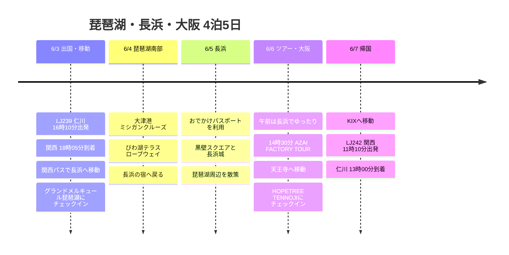

# 琵琶湖・長浜・大阪 4泊5日の旅行計画

6月初め、仁川から関西へ入り、琵琶湖北部の長浜を拠点に3泊して、最後の1泊は大阪の天王寺で締めくくる日程です。

## 旅行概要

- 期間: 2026年6月3日 〜 6月7日
- 航空: ジンエアー LJ239、LJ242
- 宿泊: グランドメルキュール琵琶湖リゾート＆スパ 3泊、HOPETREE TENNOJI 1泊
- 交通/パス: 関西パス 4日券、長浜おでかけパスポート
- 主な予定: 大津港ミシガンクルーズ、びわ湖テラス ロープウェイ、AZAI FACTORY TOUR

## 旅程の概要

| 日付 | エリア | 主なスケジュール |
|------|------|----------|
| 6/3 | 仁川、関西、長浜 | LJ239で出国、KIX到着、関西パスで長浜へ移動、グランドメルキュールにチェックイン |
| 6/4 | 大津、びわ湖テラス | 大津港ミシガンクルーズ、びわ湖テラス ロープウェイ、長浜へ戻る |
| 6/5 | 長浜 | 長浜おでかけパスポートで市内散策、黒壁スクエアと琵琶湖周辺 |
| 6/6 | 長浜、大阪 | 午前は長浜でゆったり、14:30 AZAI FACTORY TOUR、夕方に天王寺へ移動 |
| 6/7 | 大阪、関西、仁川 | HOPETREE TENNOJIをチェックアウト、KIXへ移動、LJ242で帰国 |

## 旅程タイムライン

## 6/3 - 関西入国後、長浜へ移動

LJ239は仁川を午後に出発するので、初日は移動中心に組むのがよさそうです。関西に着いたら関西パスをすぐに使って長浜まで移動し、グランドメルキュール琵琶湖リゾート＆スパにチェックインします。

到着時間が遅めなので、初日は宿の周辺で軽く過ごして休む日。翌日は大津とびわ湖テラスまで移動するので、無理に市内の予定を入れない構成がよいでしょう。

## 6/4 - 大津港ミシガンクルーズとびわ湖テラス

2日目は琵琶湖南部の大津へ下り、ミシガンクルーズに乗る日。大津港から琵琶湖を水上で眺める予定で、今回の旅の湖テーマが最もよく表れるコースです。

天気がよければ、びわ湖テラス ロープウェイもあわせてまわります。琵琶湖は天気の影響を受けやすいので、曇りや雨ならこの予定を6/5と入れ替えるなど、柔軟に運用するのがよいでしょう。

## 6/5 - 長浜おでかけパスポート

3日目は長浜に集中する日。長浜おでかけパスポートの情報を基準に市内をゆるくまわり、黒壁スクエア、長浜城、琵琶湖の散策をまとめます。

前日の大津とびわ湖テラスへの移動が長いので、この日はあまり詰め込まない方がよいでしょう。カフェや商店街、地元の料理まで楽しみながら、長浜のペースに合わせる日にします。

## 6/6 - AZAI FACTORY TOURと天王寺への移動

午前はチェックアウトの前後に長浜でゆったり動き、14時30分に予約したAZAI FACTORY TOURへ向かいます。ツアーは長浜蒸溜所から始まり、AZAI Factoryの熟成庫を見学する構成で、約2.5時間を見込んでいます。

ツアーが終わったら大阪の天王寺へ移動し、HOPETREE TENNOJIにチェックインします。最後の夜は翌朝のKIX移動を考えて、天王寺周辺で軽く夕食を済ませて整理する流れがよいでしょう。

## 6/7 - 午前に帰国

最終日はLJ242が11時10分出発なので、朝からすぐに空港へ向かうモード。天王寺から関西空港へ移動してチェックインし、13時00分の仁川到着予定で旅を締めくくります。
