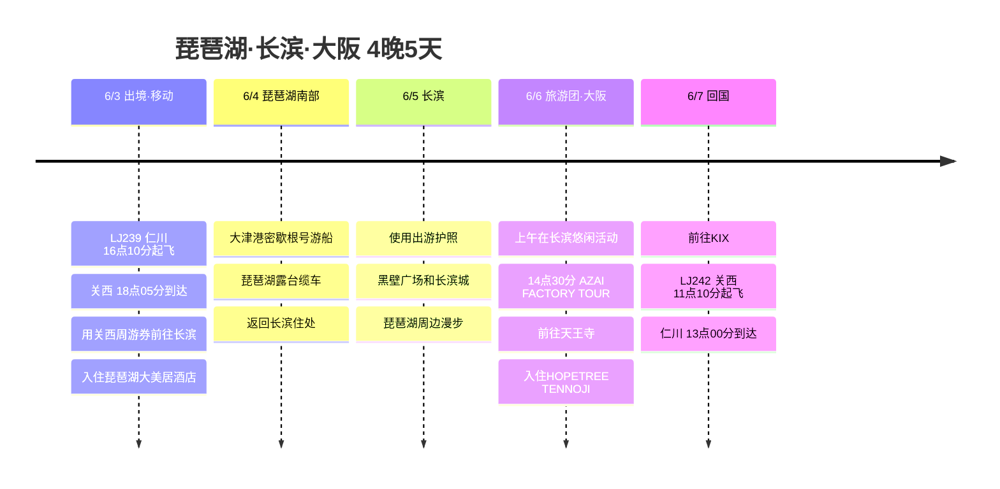

# 琵琶湖·长滨·大阪 4晚5天旅行计划

6月初从仁川飞往关西，以琵琶湖北部的长滨为据点住3晚，最后1晚在大阪天王寺收尾的行程。

## 旅行概览

- 时间: 2026年6月3日 ～ 6月7日
- 航班: 真航空 LJ239、LJ242
- 住宿: 琵琶湖大美居度假酒店＆水疗 3晚，HOPETREE TENNOJI 1晚
- 交通/周游券: 关西周游券4日券、长滨出游护照
- 核心行程: 大津港密歇根号游船、琵琶湖露台缆车、AZAI FACTORY TOUR

## 行程概要

| 日期 | 地区 | 主要行程 |
|------|------|----------|
| 6/3 | 仁川、关西、长滨 | 乘LJ239出境，到达KIX，用关西周游券前往长滨，入住大美居 |
| 6/4 | 大津、琵琶湖露台 | 大津港密歇根号游船、琵琶湖露台缆车、返回长滨 |
| 6/5 | 长滨 | 用长滨出游护照在市内漫步，黑壁广场和琵琶湖周边 |
| 6/6 | 长滨、大阪 | 上午在长滨悠闲活动，14:30 AZAI FACTORY TOUR，傍晚前往天王寺 |
| 6/7 | 大阪、关西、仁川 | HOPETREE TENNOJI退房，前往KIX，乘LJ242回国 |

## 行程时间线

## 6/3 - 抵达关西后前往长滨

LJ239下午从仁川起飞，所以第一天最好以移动为主。到达关西后立刻使用关西周游券前往长滨，入住琵琶湖大美居度假酒店＆水疗。

到达时间偏晚，第一天就在住处周围简单走走，好好休息。第二天要前往大津和琵琶湖露台，所以最好不要勉强安排市区行程。

## 6/4 - 大津港密歇根号游船与琵琶湖露台

第二天南下琵琶湖南部的大津，乘坐密歇根号游船。在大津港从水面上欣赏琵琶湖，最能体现这次旅行的湖泊主题。

如果天气不错，再把琵琶湖露台缆车也串联进来。琵琶湖受天气影响很大，阴天或下雨的话，可以和6/5的行程对调，灵活安排。

## 6/5 - 长滨出游护照

第三天专注于长滨。以长滨出游护照的信息为基准，悠闲地逛市区，把黑壁广场、长滨城和琵琶湖漫步串联起来。

前一天去大津和琵琶湖露台的路程较长，所以这天不要安排得太紧。逛逛咖啡馆、商店街，品尝当地美食，按长滨的节奏慢慢来。

## 6/6 - AZAI FACTORY TOUR与前往天王寺

上午在退房前后于长滨悠闲活动，然后前往14点30分预约的AZAI FACTORY TOUR。旅游团从长滨蒸馏所出发，参观AZAI Factory熟成仓库，预计约2.5小时。

团结束后前往大阪天王寺，入住HOPETREE TENNOJI。最后一晚考虑到第二天上午要前往KIX，建议在天王寺周边简单吃个晚饭，整理行李。

## 6/7 - 上午回国

最后一天LJ242 11点10分起飞，所以一早就要直奔机场。从天王寺前往关西机场办理登机手续，预计13点00分抵达仁川，旅行就此结束。
