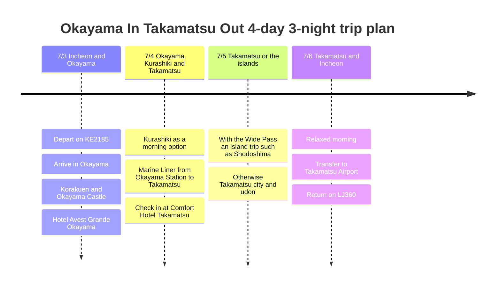

# Okayama In, Takamatsu Out: 4-Day, 3-Night Trip Plan

In early July the route flies into Okayama and out of Takamatsu. It is close to the reverse of the April trip, so a good setup is to see Okayama comfortably on the first day and then spend two nights in Takamatsu.

## Trip Overview

- Dates: July 3 to July 6, 2026
- Flights: Korean Air KE2185, Jin Air LJ360
- Hotels: Hotel Avest Grande Okayama for 1 night, Comfort Hotel Takamatsu for 2 nights
- Transport options: Okayama-Kagawa Wide Pass, or a one-way Marine Liner ticket
- Main areas: Okayama, Kurashiki, Takamatsu, with Shodoshima as a candidate

## Itinerary Summary

| Date | Area | Main plans |
|------|------|----------|
| 7/3 | Incheon, Okayama | Depart on KE2185, arrive in Okayama, Korakuen and Okayama Castle, Hotel Avest Grande Okayama |
| 7/4 | Okayama, Kurashiki, Takamatsu | Kurashiki as a morning option, Marine Liner from Okayama Station to Takamatsu, check in at Comfort Hotel Takamatsu |
| 7/5 | Takamatsu or the islands | With the Okayama-Kagawa Wide Pass, an island trip such as Shodoshima; otherwise Takamatsu city and udon |
| 7/6 | Takamatsu, Incheon | Relaxed morning, transfer to Takamatsu Airport, return on LJ360 |

## Itinerary Timeline

## 7/3 - Arrive in Okayama and Stroll the City

KE2185 arrives in Okayama in the morning, so you can make quite a long day of the first day. After arriving, the most reliable plan is to leave your luggage at Hotel Avest Grande Okayama and see Korakuen and Okayama Castle together.

Keep the first day easy with the next day's transfer in mind. If time remains, add a meal and a cafe around Okayama Station, then wrap up early at the hotel.

## 7/4 - See Kurashiki, Then Move to Takamatsu

If you feel fine in the morning, add the Kurashiki Bikan Historical Quarter. It is close to Okayama and makes a good half-day outing; afterwards, return to Okayama Station and take the Marine Liner to Takamatsu for a clean route.

This is the day to decide on the pass. If you will use the Okayama-Kagawa Wide Pass, a 3-day pass covering July 4 to July 6 fits well; if you will not use islands or buses and ferries much, buying just a one-way Marine Liner ticket is also perfectly workable.

## 7/5 - Cover Kagawa Widely or Explore Takamatsu in Depth

If you buy the pass, adding an island trip such as Shodoshima or Naoshima makes the pass worthwhile. In particular, if you base yourself at Takamatsu Port, it is natural to spend the day on the islands and return to Takamatsu in the evening.

If you skip the pass, focus on Takamatsu city. Loosely combine Ritsurin Garden, the shopping arcades, udon shops and a harbor walk, and finish the evening near the hotel with the next day's airport transfer in mind.

## 7/6 - Takamatsu Out

LJ360 departs in the afternoon, so one light activity in the morning is possible. Allow for the airport transfer time, though, and switch to departure mode right after lunch. The trip ends with departure from Takamatsu Airport at 17:15 and a scheduled arrival at Incheon at 18:55.
