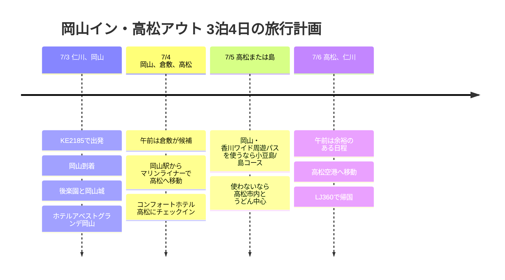

# 岡山イン・高松アウト 3泊4日の旅行計画

7月初めは、岡山に入って高松から出る流れです。4月の旅行とほぼ逆向きの動線なので、今回は初日に岡山をじっくり見て、高松で2泊する構成がよさそうです。

## 旅行の概要

- 期間: 2026年7月3日 ~ 7月6日
- 航空: 大韓航空 KE2185、ジンエアー LJ360
- 宿: ホテルアベストグランデ岡山 1泊、コンフォートホテル高松 2泊
- 移動の候補: 岡山・香川ワイド周遊パス、またはマリンライナー片道
- 主なエリア: 岡山、倉敷、高松、小豆島(候補)

## 旅程の概要

| 日付 | エリア | 主な日程 |
|------|------|----------|
| 7/3 | 仁川、岡山 | KE2185で出発、岡山到着、後楽園と岡山城、ホテルアベストグランデ岡山 |
| 7/4 | 岡山、倉敷、高松 | 午前は倉敷が候補、岡山駅からマリンライナーで高松へ移動、コンフォートホテル高松にチェックイン |
| 7/5 | 高松または島 | 岡山・香川ワイド周遊パスを使うなら小豆島/島コース、使わないなら高松市内とうどん中心 |
| 7/6 | 高松、仁川 | 午前は余裕のある日程、高松空港へ移動、LJ360で帰国 |

## 旅程タイムライン

## 7/3 - 岡山到着と市内散策

KE2185は午前に岡山へ到着する便なので、初日をかなり長く使えます。到着後、ホテルアベストグランデ岡山に荷物を預け、後楽園と岡山城をセットで見る構成がいちばん安定しています。

初日は翌日の移動を考えて、無理をしないほうがよいです。時間が余ったら、岡山駅周辺で食事とカフェを少し足し、宿で早めに片付ける流れにします。

## 7/4 - 倉敷を見て高松へ移動

午前は、体調がよければ倉敷美観地区を入れます。岡山から近いので半日コースにちょうどよく、そのあと岡山駅に戻ってマリンライナーで高松へ渡ると、動線がすっきりします。

この日がパスの判断ポイントです。岡山・香川ワイド周遊パスを使うなら、7/4から7/6までの3日券に合わせる流れがよく、島やバス/フェリーまで大きく使わないなら、マリンライナーの片道だけ買う方法でも十分可能です。

## 7/5 - 香川を広く使うか、高松を深く見るか

パスを買うなら、小豆島や直島のような島コースを入れるとパスの元が取りやすくなります。特に高松港を基準に動けば、1日を島の日程に使って夕方に高松へ戻る構成が自然です。

パスを使わないなら、高松市内を中心にします。栗林公園、商店街、うどん店、港の散歩をゆるくまとめ、夜は翌日の空港移動を考えて宿の周辺で締めくくります。

## 7/6 - 高松アウト

LJ360は午後の出発なので、午前に軽い予定をひとつ入れられます。ただし空港への移動時間を考えて、昼食以降はすぐに出国モードに切り替えるのがよいです。高松空港を17:15に出発し、仁川に18:55に到着する予定で、旅を締めくくります。
