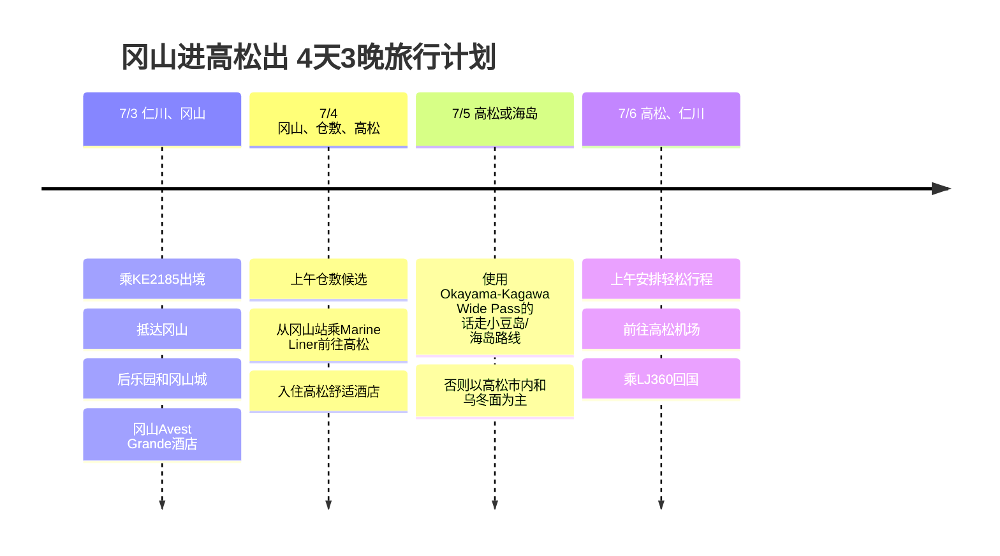

# 冈山进高松出 4天3晚旅行计划

7月初是从冈山进、从高松出的路线。这和4月旅行的动线几乎相反，所以这次比较适合第一天稳稳地游览冈山，在高松住2晚的安排。

## 旅行概要

- 时间: 2026年7月3日 ~ 7月6日
- 航班: 大韩航空 KE2185、真航空 LJ360
- 住宿: 冈山Avest Grande酒店 1晚，高松舒适酒店 2晚
- 交通候选: Okayama-Kagawa Wide Pass或Marine Liner单程
- 核心地区: 冈山、仓敷、高松、小豆岛(候选)

## 行程概要

| 日期 | 地区 | 主要行程 |
|------|------|----------|
| 7/3 | 仁川、冈山 | 乘KE2185出境，抵达冈山，后乐园和冈山城，冈山Avest Grande酒店 |
| 7/4 | 冈山、仓敷、高松 | 上午仓敷候选，从冈山站乘Marine Liner前往高松，入住高松舒适酒店 |
| 7/5 | 高松或海岛 | 使用Okayama-Kagawa Wide Pass的话走小豆岛/海岛路线，否则以高松市内和乌冬面为主 |
| 7/6 | 高松、仁川 | 上午安排轻松行程，前往高松机场，乘LJ360回国 |

## 行程时间线

## 7/3 - 抵达冈山与市内漫步

KE2185是上午抵达冈山的航班，所以第一天可以用得相当长。抵达后把行李寄存在冈山Avest Grande酒店，把后乐园和冈山城放在一起游览，是最稳妥的安排。

第一天考虑到第二天要赶路，不要太勉强比较好。如果还有时间，就在冈山站周边加上用餐和咖啡馆，然后早点回住处整理。

## 7/4 - 游览仓敷后前往高松

上午如果状态不错，就加入仓敷美观地区。离冈山很近，很适合半天的行程，之后回到冈山站乘Marine Liner前往高松，动线很清爽。

这一天是周游券的判断点。如果要用Okayama-Kagawa Wide Pass，配合7/4至7/6的3日券比较好；如果不会大量使用海岛或巴士/渡轮，只买Marine Liner单程票也完全可以。

## 7/5 - 是广泛使用香川，还是深入游览高松

如果买了周游券，加入小豆岛或直岛这样的海岛路线，周游券会更划算。特别是以高松港为基准行动的话，用一整天安排海岛行程、傍晚再回到高松，是很自然的安排。

如果不用周游券，就以高松市内为中心。把栗林公园、商店街、乌冬面店、港口散步轻松地串起来，晚上考虑到第二天要去机场，在住处周边收尾。

## 7/6 - 从高松出发

LJ360是下午起飞，所以上午可以安排一个轻松的行程。不过考虑到前往机场的时间，午餐之后最好立刻切换到出境模式。预计从高松机场17:15起飞，18:55抵达仁川，结束这趟旅行。
