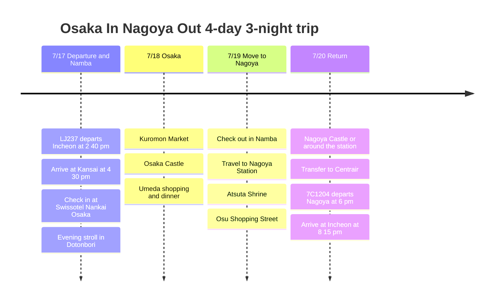

# Osaka In, Nagoya Out: 4-Day, 3-Night Trip Plan

A four-day, three-night itinerary in mid-July that flies into Osaka and out of Nagoya. The first two nights are at Swissotel Nankai Osaka for easy access to Namba, and the last day moves on to Nagoya to keep the trip home short.

## Trip Overview

- Dates: July 17 to 20, 2026
- Flights: LJ237 Incheon → Kansai, 7C1204 Nagoya → Incheon
- Hotels: Swissotel Nankai Osaka for 2 nights, 1 night near Nagoya Station as a candidate
- Route: Kansai Airport → Namba/Osaka → Nagoya → Chubu Centrair Airport

## Itinerary Summary

| Date | Area | Main plans |
|------|------|----------|
| 7/17 | Incheon, Kansai, Osaka | Depart on LJ237, arrive at KIX, travel to Namba, check in at Swissotel, dinner in Dotonbori |
| 7/18 | Osaka | Kuromon Market, Osaka Castle, shopping and dinner in Umeda |
| 7/19 | Osaka, Nagoya | Check out in Namba, travel to Nagoya, Atsuta Shrine, Osu Shopping Street |
| 7/20 | Nagoya, Incheon | Nagoya Castle or around the station, transfer to Centrair, return on 7C1204 |

## Itinerary Timeline

## 7/17 - Arrive in Osaka and Settle into Namba

LJ237 departs in the afternoon, so treat the first day as a gentle arrival day in Osaka. After landing at Kansai Airport, take the Nankai line to Namba and check in at Swissotel Nankai Osaka.

The hotel connects directly to Namba Station, so walking around Dotonbori and Shinsaibashi is enough for the first evening. The biggest advantage of this hotel is how much it cuts down on travel when you arrive late.

## 7/18 - A Full Day in Osaka

On the second day, stay in central Osaka rather than spreading out too far. Start the morning at Kuromon Market, then head to Osaka Castle at midday for the signature sights.

In the afternoon, move on to Umeda and combine a shopping mall, cafes and dinner. It is easy to return to the Namba hotel, so luggage and shopping are less of a burden.

## 7/19 - Move to Nagoya

The third day is the move from Osaka to Nagoya. The Shinkansen is fast, and the Kintetsu limited express line is a candidate if you want to save money. Staying the last night near Nagoya Station makes the next day's airport transfer easy.

After arriving in Nagoya, combine Atsuta Shrine and Osu Shopping Street for a light visit. Dinner is a good time for Nagoya food such as hitsumabushi or miso katsu.

## 7/20 - Return from Nagoya

On the last day, fit in Nagoya Castle or shopping around the station in the morning, then head to Chubu Centrair International Airport in the afternoon. 7C1204 departs in the evening, so the last day does not have to feel rushed either.
