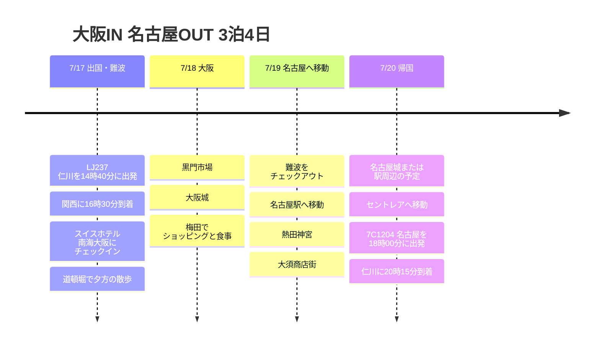

# 大阪IN 名古屋OUT 3泊4日の旅行プラン

7月中旬、大阪に入って名古屋から出る3泊4日の日程です。最初の2泊はスイスホテル南海大阪に拠点を置いて難波を快適に使い、最後の1日は名古屋へ移動して帰国の動線を短くする構成です。

## 旅行概要

- 期間: 2026年7月17日 ~ 20日
- 航空: LJ237 仁川 → 関西、7C1204 名古屋 → 仁川
- 宿泊: スイスホテル南海大阪 2泊、名古屋駅近くで1泊の候補
- ルート: 関西空港 → 難波/大阪 → 名古屋 → 中部国際空港

## 旅程の概要

| 日付 | エリア | 主な予定 |
|------|------|----------|
| 7/17 | 仁川、関西、大阪 | LJ237で出国、KIX到着、難波へ移動、スイスホテルにチェックイン、道頓堀で夕食 |
| 7/18 | 大阪 | 黒門市場、大阪城、梅田でショッピングと夕食 |
| 7/19 | 大阪、名古屋 | 難波をチェックアウト、名古屋へ移動、熱田神宮、大須商店街 |
| 7/20 | 名古屋、仁川 | 名古屋城または駅周辺の予定、セントレアへ移動、7C1204で帰国 |

## 旅程タイムライン

## 7/17 - 大阪到着と難波に慣れる

LJ237は午後出発なので、初日は無理をせず大阪に入る日にします。関西空港に着いたら南海電車で難波まで行き、スイスホテル南海大阪にチェックインします。

宿が難波駅とすぐつながる立地なので、初日の夜は道頓堀と心斎橋周辺を歩くだけでも十分です。遅い到着でも移動を減らせることが、この宿の一番の長所です。

## 7/18 - 大阪市内の1日

2日目は大阪をあまり広げず、市内中心で組みます。朝は黒門市場から始め、昼は大阪城へ移動して定番コースを見ます。

午後は梅田へ移り、ショッピングモール、カフェ、夕食をまとめます。難波の宿に戻りやすい構成なので、荷物や買い物の負担も少なくて済みます。

## 7/19 - 名古屋へ移動

3日目は大阪から名古屋へ移る日です。新幹線を使えば速く、費用を抑えたいなら近鉄特急系も候補になります。名古屋駅の近くに最後の1泊を置くと、翌日の空港移動が楽です。

名古屋到着後は、熱田神宮と大須商店街くらいをまとめて気軽に見ます。夕食はひつまぶしや味噌カツなど、名古屋ならではの料理を入れやすいです。

## 7/20 - 名古屋から帰国

最終日は午前に名古屋城や駅周辺のショッピングを入れ、午後は中部国際空港セントレアへ移動します。7C1204は夕方出発なので、最終日もあまり慌てずに過ごせます。
